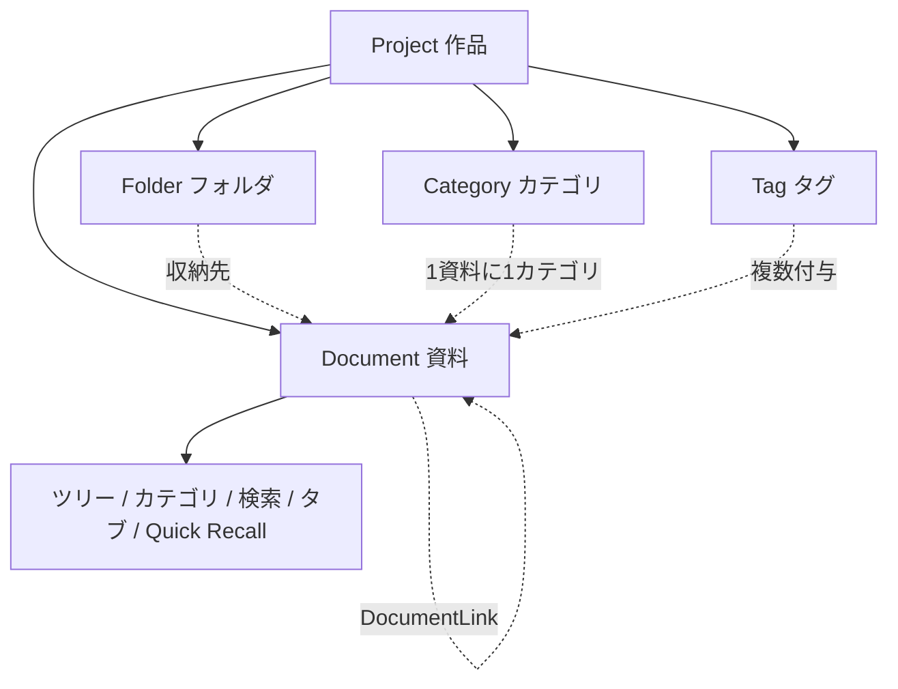
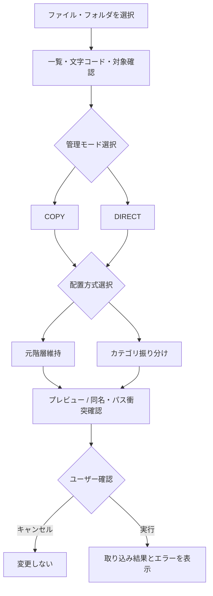
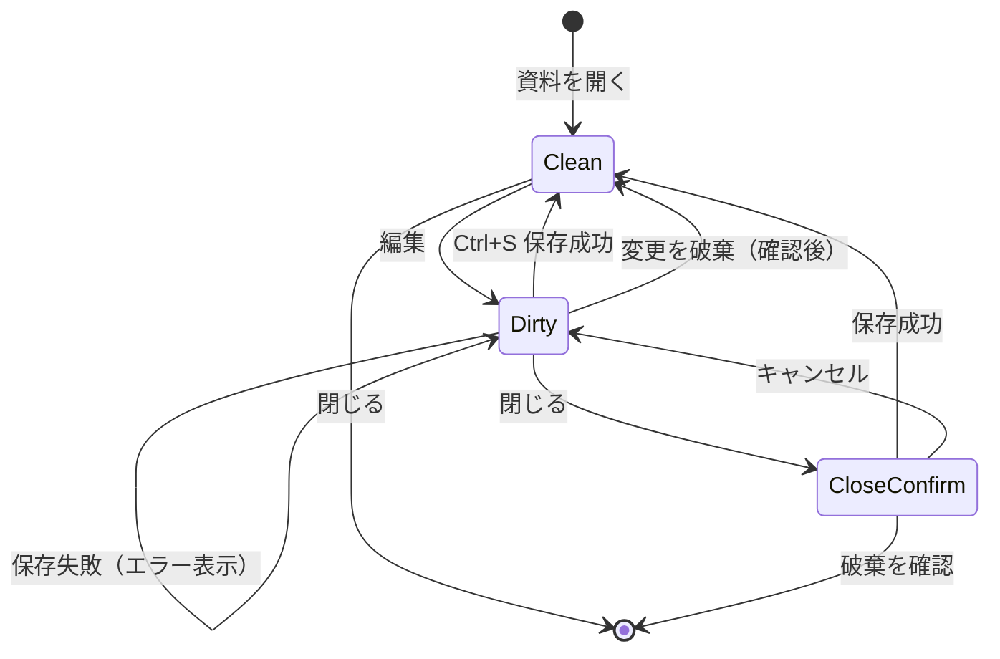
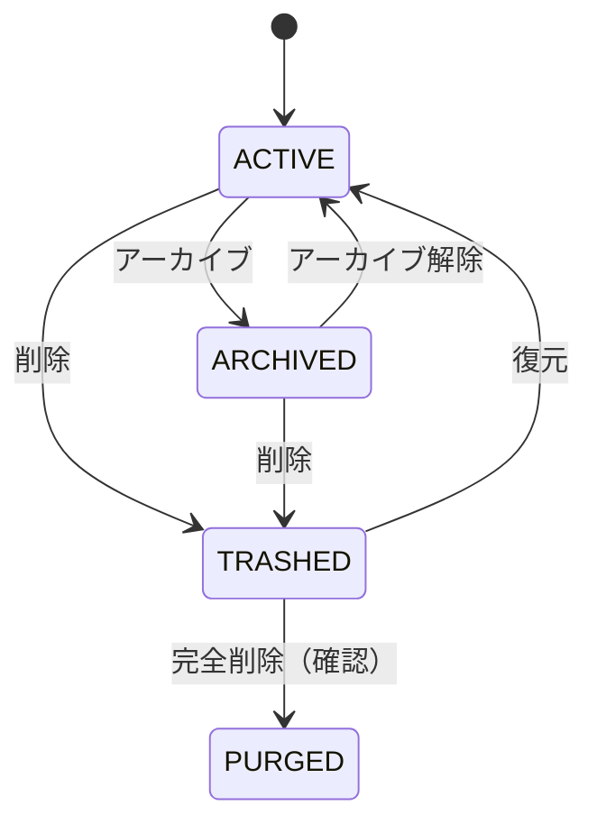

# Novel Lore Manager — データ管理基本設計書 v0.1

- 作成日：2026-10-30
- 状態：**レビュー用／未承認**
- 上位文書：`Novel_Lore_Manager_Requirements_v1.0.md`（2026-10-30）
- 目的：UI/UXプロトタイプの振る舞いを一貫させ、将来のWindows本実装でデータ損失を防ぐための基本ルールを定める。
- 対象：作品、資料、フォルダ、カテゴリ、タグ、取り込み、保存、外部変更、ゴミ箱、アーカイブ、Quick Recallとの共有状態。
- 対象外：DB製品・デスクトップフレームワーク・物理スキーマの確定、実際の同期エンジン実装、AI機能、作品横断検索。

## 0. ステータスの意味

- **確定方針**：ユーザーが希望として明示した動作。ただし方式まで承認されたわけではない。
- **推奨暫定案**：モックアップと設計検討を前に進めるための提案。**正式決定ではない**。
- **未決**：追加の判断が必要。
- **将来候補**：初期の実装対象外とする機能。

## 1. 設計原則と不変条件

1. **作品境界**：通常の検索・カテゴリ・リンク解決は、現在選択した作品の内部で完結する。作品横断検索・資料共有は将来候補。
2. **原本の保護**：コピー取り込みでは元ファイルへ書き込まない。直接編集では書き込み先・影響を事前に示す。
3. **一意な資料識別**：表示名やファイルパスだけを恒久IDにしない。内部の安定した `document_id` を採用することを推奨。
4. **単一の論理資料**：ツリー、カテゴリ、検索、タブ、Quick Recallは原則として同じ `document_id` を参照する。表示ごとに独立した本文を作らない（推奨暫定案）。
5. **原文の尊重**：インポート時にMarkdownの構文やTXTの文字内容を黙って書き換えない。プレビュー変換とディスク保存形式を区別。
6. **保存の明示**：`Ctrl+S` が基本。未保存状態を常に区別し、異常終了時の復旧については保存とは別に設計する。
7. **可逆な削除**：削除後はゴミ箱から復元できる。アーカイブと削除を同一状態として扱わない。
8. **競合時に黙って上書きしない**：外部更新や別ウィンドウ編集が競合した際、ユーザーの確認なしで新しい／古い内容を破棄しない。
9. **非AI・オフライン**：本設計の基本操作はネットワークとAIを必要としない。

## 2. 論理データモデル（DB非依存）

| エンティティ | 主な属性例 | 役割 | 状態 |
|---|---|---|---|
| Project | `project_id`, `name`, `root_location` | 作品ごとの隔離境界 | 作品単位は確定、属性は暫定 |
| Document | `document_id`, `project_id`, `display_name`, `filename`, `folder_id`, `category_id`, `storage_mode`, `status`, `content_ref`, `revision` | 設定資料の一意管理 | 推奨暫定案 |
| Folder | `folder_id`, `project_id`, `parent_folder_id`, `name` | 階層とツリー | 階層管理は確定、実装は暫定 |
| Category | `category_id`, `project_id`, `name` | 1資料1カテゴリ | 確定方針 |
| Tag | `tag_id`, `project_id`, `name` | 1資料に複数設定 | 確定方針 |
| DocumentTag | `document_id`, `tag_id` | 資料とタグの対応 | 推奨暫定案 |
| DocumentLink | `source_document_id`, `target_document_id`, `link_text` | 関連資料へのリンク | 手動リンクは確定、構造は暫定 |
| ImportBatch | `batch_id`, `project_id`, `mode`, `layout_policy`, `items`, `result` | 一括選択の取り込み履歴 | 推奨暫定案 |
| DraftSession | `document_id`, `window_id`, `base_revision`, `dirty`, `draft_content` | 未保存編集中の状態 | 推奨暫定案 |
| QuickMemo | `memo_id`, `project_id`, `content`, `linked_document_id?`, `status` | Quick Recallのメモ | 機能希望確定、保存先未決 |

**補足**：`root_location`、`content_ref` は保存方式が未決のため論理的な参照値。DBの物理カラム名やテーブルを示さない。`revision` は競合検知のための内部世代番号であり、ユーザー向けのバージョン履歴機能を意味しない。

### 2.1 推奨される関係

- **未決 OD-01**：同一資料を複数のフォルダに実在させない方式を正式採用するか。現時点の推奨は、**保存位置は1つ／カテゴリ・タグ・リンクは参照**。
- **未決 OD-02**：作品全体での「同名禁止」はユーザー希望。比較対象が `display_name` か `filename` か、拡張子・空白・大小文字・Unicode正規化の扱いは未決。**物理ファイルパス重複検知は、これとは別に必須**。

## 3. ファイル保存モード

| モード | 実データの保存・編集先 | 原本への影響 | 表示上の識別 | 状態 |
|---|---|---|---|---|
| COPY（アプリ内コピー） | アプリ管理下の複製 | 原則なし | 「コピー管理」 | ユーザー希望確定／保存パス未決 |
| DIRECT（元ファイル直接編集） | 元ファイルパス | 保存時に元ファイルを更新 | 「元ファイルを直接編集」 | ユーザー希望確定／安全策暫定 |
| SYNC（コピー＋同期） | 複製と元ファイル | 同期方向で変化 | なし | **未決・初期非対象** |

### 3.1 取り込みバッチとモードの適用範囲

ユーザーは**個々のファイルに毎回確認せず、一括でモードを選びたい**。暫定案では、取り込みウィザードで選択した**1バッチの全対象ファイル**に同じモードを適用する。ただし別のバッチで異なるモードを選ぶと、作品内にCOPYとDIRECTが混在しうる。これは現状未決であり、混在を許す場合は資料ごとにモードが分かる表示が必要。

### 3.2 インポートの操作フロー（暫定）

実装時の安全要件：
- 取り込み前に、対象件数、管理モード、対象ルート、衝突候補、元ファイルへの影響を表示。
- COPYではコピー完了確認後に資料を登録。失敗ファイルと成功ファイルを明示。
- DIRECTでは読み込み可能性と書き込み権限を検査し、アクセス不可・移動済み・読み取り専用を区別。
- パス正規化と許可ルート確認を行い、意図しない外部ファイルへの書き込みを防ぐ（シンボリックリンク等の扱いは詳細設計）。
- 同名や上書きの衝突時に暗黙の上書きを行わない。取り込み中断・スキップ・名前変更などの具体的なUIは未決。
- 元のフォルダ構造を維持する方式とカテゴリ振り分け方式を選択可能にする。カテゴリ振り分けの自動判定は**根拠と精度未検証**。

### 3.3 `.txt` / `.md` の扱い

| 事項 | 推奨暫定案 |
|---|---|
| `.md` の表示 | ソースMarkdownを編集し、別にレンダリングプレビューを提供 |
| `.txt` の表示 | テキスト内容を**Markdown編集画面で扱う**。表示時に勝手に見出し等へ変換しない |
| `.txt` の保存 | 初期は元拡張子・文字コード・改行コードを維持することを優先。`.md` への変換は別操作・確認制 |
| 元データの保持 | COPYでは原本に触れず、DIRECTでは保存前に元の状態を検査 |
| 目次生成 | Markdownの見出し解析は非AIでも実装可能。ただしTXTは明示的見出しがない場合は自動判定を保証しない |
| 人名・地名抽出 | 正規表現・辞書・手動指定で限定的に可能。高精度な意味分類は検証対象 |

**未決 OD-04**：ユーザーの「アプリ側の.md形式に変換したい」が、統一した表示体験を指すのか、内部保存形式まで変更したいのかを確定する。

### 3.4 「更新」操作の分離

- **再読み込み**：現在の保存元を読み直す。未保存内容があれば破棄の確認が必要。
- **保存（Ctrl+S）**：編集結果を現在の管理モードの書き込み先へ反映する。
- **元ファイルへ書き出し**：COPY資料から原本など別の指定先へ出力する操作。元ファイルへの上書きは必ず確認する。
- **同期**：双方向差分・競合解決を伴うため、初期非対象。

この命名は**推奨暫定案**であり、ユーザーの「更新ボタン」がどれを意図するかは未決（OD-05）。

## 4. 編集・保存・競合

### 4.1 基本編集状態

- `Ctrl+S` を保存の基本とする。未保存時はタブ・ウィンドウに明確な表示を出す。
- `Ctrl+Z` と画面上のUndoボタンは**編集中の操作履歴**を戻す。保存済みの過去バージョン復元とは別。
- 閉じる／作品切り替え／別画面遷移で未保存変更が失われる場合、「保存／破棄／キャンセル」を表示する（暫定）。
- **自動保存は未決**。必要なら後日クラッシュ復旧用の一時書き出しを別途設計し、通常保存と混同しない。

### 4.2 実装時の安全な保存方式（推奨・要技術検証）

1. 対象資料の `base_revision`、書き込み先ファイルの最終状態を記録。
2. 書き込み直前に外部変更がないか確認（更新日時だけに依存しない照合方法を検討）。
3. 競合があれば保存を停止し、再読み込み／別名保存／差分確認などの選択肢を表示。**無言で上書きしない**。
4. 可能なら同一ファイルシステム上の一時ファイルに書き、フラッシュと安全な置換を行う。ただしDIRECTはアクセス権・シンボリックリンク・他アプリのファイルハンドル・置換による属性変化等に注意し、方式を実装前に検証する。
5. 保存成功を確認して初めて「保存済み」に遷移する。失敗した場合は編集中の内容を保持する。

### 4.3 メイン画面とQuick Recallの同時編集

**重大な未決事項（OD-06）**。初期設計の推奨案は、同一 `document_id` に対してアプリ内で単一の編集セッションを共有すること。

- メイン画面とQuick Recallが同じ資料を開いた場合、表示は両方に許可する。
- 編集内容は同じドキュメントのドラフト状態として扱い、別々の本文コピーを生成しない方式を優先検討。
- 競合が起きる環境や共有セッションが成立しない場合は、片方を読み取り専用にする暫定的な保護を検討。
- Quick Recallの**簡易メモは本文とは別データ**として保存することを推奨（後から資料に転記可能）。保存タイミングと参照対象は未決。
- メイン画面を閉じてもQuick Recallを利用できるようにする常駐・プロセス構成は本実装の課題。プロトタイプでは状態を模擬する。

## 5. 削除・ゴミ箱・アーカイブ・復元

### 5.1 論理状態

| 状態 | 意味 | エクスプローラー上の推奨表現 |
|---|---|---|
| ACTIVE | 通常利用中 | 通常表示 |
| ARCHIVED | 意図的に非表示・保管 | アーカイブ表示の中に残す／必要に応じてフィルタ |
| TRASHED | 削除操作済みで復元可能 | 薄い文字・削除アイコン・ゴミ箱表記、表示切替可能 |
| PURGED | 完全削除済み | 通常一覧には表示しない |

ユーザーの「削除しても色を落として存在を示したい」という要望はTRASHEDに対応。ただし通常一覧にすべて残すと情報量が増えるため、**削除済みを表示するトグル**を設ける案を提示する。

### 5.2 状態遷移

- **復元時の同名衝突**は、元の名前で復元できない場合の警告・別名復元などを用意する（具体案未決）。
- **DIRECT資料の削除**は特に注意が必要。アプリ一覧から外すだけか、元ファイル自体をゴミ箱に移すかを未決とし、**モックアップでは元ファイルを削除しない**。
- 関連資料へのリンクは、TRASHED状態を「リンク先がゴミ箱内」として識別する暫定案。完全削除時のリンク維持・削除は未決。
- ZIP／エクスポート対象にアーカイブ・ゴミ箱を含めるかは未決。

## 6. 保存先・バックアップ・エクスポート

### 6.1 データの分類

| 種類 | 内容 | 推奨配置（未承認） |
|---|---|---|
| 作品データ | Markdown/TXT、フォルダ構造、分類情報 | ユーザーが選べる作品ごとのルート／アプリ管理領域 |
| アプリ設定 | テーマ、フォント、ショートカット、ウィンドウ配置 | Windowsユーザー別アプリデータ領域 |
| 内部メタデータ | 資料ID、関連付け、検索インデックス、取り込み履歴 | アプリ管理領域（移行・再構築方針も必要） |
| 一時復旧データ | 未保存編集のスナップショット等 | アプリ管理下の復旧領域（採用未決） |
| Quick Memo | 執筆中に残す短いメモ | 作品に紐づく専用データ（推奨案） |

ユーザーのQ28は「アプリの設定データ」の意味が未明確だったため未決。**設定データは作品本文とは異なる、UIや動作のユーザー設定を指す**。

### 6.2 バックアップとエクスポート

- 初期方針：手動エクスポートを提供。`.md/.txt`、フォルダ構造、作品ZIPを対象とする。
- **エクスポートは常に完全なバックアップとは限らない**。カテゴリ・タグ・資料ID・リンク・メモ・アーカイブ等を再インポートで再現するには、メタデータを含める形式の設計が必要。
- 作品ZIPをバックアップ兼用にする場合のマニフェスト形式と復元手順は未決。
- 自動バックアップは将来候補。

## 7. モックアップで実際に再現する状態

**ブラウザ上で再現するのは操作と状態遷移。原本に対する読み書きの完成実装ではない。**

| シナリオ | 必須のモック挙動 | 本実装での追加検証 |
|---|---|---|
| 資料を開く | 同じ資料IDをツリー／カテゴリ／検索から開く | 実ファイル参照とアクセス権 |
| 同名の取り込み | 衝突警告・キャンセル／スキップの選択 | OSパス比較と衝突処理 |
| COPY／DIRECT | 一括選択・影響説明・モード表示 | ディスク読書き・原本保護 |
| `.txt` の編集 | Markdown編集画面に文字列を表示 | 文字コード・改行保持・保存互換 |
| 保存 | 未保存→保存済みを切り替え、エラー状態も用意 | 原子的保存・外部更新検知 |
| 編集Undo | Ctrl+Z／画面ボタンを再現 | Undoバッファと実エディタ統合 |
| 削除・復元 | ACTIVE／TRASHED／ARCHIVEDの表示切替 | ファイル移動、復元衝突 |
| Quick Recall | 別ウィンドウ相当で参照・メモ・編集UIを切り替える | ネイティブ起動・最前面・同時編集 |
| エクスポート | 対象形式と設定の確認画面 | 完全性・再インポート検証 |

## 8. プロトタイプ受け入れテスト案

- **DM-T01**：作品A内の資料をツリーとカテゴリから開いても同一内容になる。
- **DM-T02**：作品Aから作品Bへの自動検索混入が起きない。
- **DM-T03**：同名資料の取り込み時に、無断で上書きしない。
- **DM-T04**：COPYモードでは「元ファイルは変更しない」と明示される。
- **DM-T05**：DIRECTモードでは「保存が元ファイルに影響する」と明示される。
- **DM-T06**：手動保存・Undo・未保存時の閉じる警告を試せる。
- **DM-T07**：削除後のグレーアウト／ゴミ箱復元／アーカイブ解除を区別して確認できる。
- **DM-T08**：Quick Recall側で同じ資料を開いた場合、メイン側と矛盾する別内容を勝手に保存しない。
- **DM-T09**：元ファイルが外部変更された場合の競合警告を模擬できる。
- **DM-T10**：ファイル取り込み／保存／削除の失敗時に、エラーと継続方法が表示される。

## 9. 先に確認したい未決事項（承認用）

| ID | 質問 | 推奨案 |
|---|---|---|
| DM-Q01 | 同一資料は1保存位置＋他ビューから参照としてよいか？ | はい |
| DM-Q02 | 同名禁止は表示名・ファイル名のどちらに適用するか？ | ファイル名の作品内一意を暫定採用、例外は検討 |
| DM-Q03 | COPY／DIRECTは「取り込みバッチごと」で、別バッチとの混在を許可するか？ | バッチ単位・混在可、資料ごとにモード表示 |
| DM-Q04 | TXTは最初は拡張子を保持しMarkdown編集画面で扱うか？ | はい。実形式変更は明示操作 |
| DM-Q05 | 「更新ボタン」は再読み込みか、元ファイルへの書き出しか？ | 操作を分けて提供 |
| DM-Q06 | Quick Recallの本文編集は共有セッションとし、簡易メモは別保存でよいか？ | 共有セッション＋独立メモ |
| DM-Q07 | DIRECT資料を削除するとき、実ファイルを削除するか管理対象から外すだけか？ | 初期は管理対象から外すだけ、実削除は別操作 |
| DM-Q08 | 復旧用一時保存は手動保存と分けて検討してよいか？ | はい（ユーザーの自動保存懸念を尊重） |

## 10. 次の工程への引き継ぎ

1. 上記DM-Q01〜Q08の推奨案をレビューし、採用／修正／保留を記録する。
2. `user-flows.md`：新規作品→編集、取り込み、検索→参照、Quick Recall→メモ、削除→復元、競合対応を画面遷移に落とす。
3. `screen-specifications.md`：未保存表示、COPY/DIRECTバッジ、取り込み確認、ゴミ箱のグレーアウト、衝突ダイアログなどのUI状態を定義する。
4. 低忠実度ワイヤーフレーム→3つのデザイン比較→インタラクティブプロトタイプへ進む。
5. ネイティブ本実装に着手する前に、選んだ保存方式とOSファイル操作の実証テストを行う。

---

**変更履歴**

| 版 | 日付 | 内容 |
|---|---|---|
| v0.1 | 2026-10-30 | 要件定義v1.0とQ1〜Q34の回答を基にした基本設計初版。未決事項を明示。 |
