# Novel Lore Manager モックアップ機能設計書 ver3.0

- 作成日：2026-11-23
- 対象：`mockups/novel-lore-manager/index.html` を入口とする現行の操作モック
- 位置付け：**モックアップ作成時の画面・操作・内部状態を記録する文書**。Windows製品の確定機能仕様、ファイル保存仕様、実装完了報告ではない。
- 参照：[`やって欲しいことver3.0.md`](../やって欲しいことver3.0.md)、現行HTML/CSS/JavaScript、[`requirements.md`](../requirements.md)、[`data-management-design.md`](../data-management-design.md)、[`user-flows.md`](../user-flows.md)、[`screen-specifications.md`](../screen-specifications.md)

## 1. 記述上の区分と対象境界

| 区分 | 本書での意味 |
|---|---|
| 操作あり | 現行ソースに画面から呼べる処理がある。実ブラウザでの全経路検証を意味しない |
| 模擬 | 結果がページ内のJavaScriptデータに限られる |
| 一部 | 表示や基本操作はあるが、想定された分岐・復帰・同期などが揃っていない |
| 対象外／未実装 | 現行モックに処理がない。製品で不要と確定した意味ではない |
| 未決 | 要件・基本設計上、製品としての方式が承認されていない |

要件資料の `CONFIRMED`、`PROVISIONAL`、`OPEN`、`FUTURE` は製品計画の区分であり、上表のモック実装状況とは別に扱う。本書はコード上の動作を優先して記載し、モックの仮の挙動を製品仕様として確定しない。

対象はHTML5、CSS3、Vanilla JavaScript（ES Modules）のローカルブラウザ試作である。小説本文の執筆エディタではなく、作品の設定資料を管理・参照・編集するUIを示す。外部API、外部配信ライブラリ、DB、LLMとの接続は現行画面の機能に含まれない。実ファイルへの保存・複製・直接編集・移動・削除・エクスポートは行わない。ファイル選択時に使うのは名前と相対パスであり、本文は読み取らない。`http://www.w3.org/2000/svg` はSVG要素生成用の名前空間で、通信先ではない。

起動確認は `mockups/novel-lore-manager/` で `node preview.mjs` を実行し、`http://127.0.0.1:4173/` を開く想定である。ES Modulesを使うため `file://` からの起動は想定しない。`preview.mjs` はローカル静的配信であり、外部APIサーバーではない。

## 2. 画面と主要な遷移

| 画面・領域 | 入口・遷移 | モックでの扱い |
|---|---|---|
| スタート | 通常起動 →「作品を選ぶ」 | 端末の月・時刻に応じた季節の木と時間帯を起動時に表示 |
| 作品作成・選択（SCR-01） | スタート、ワークスペース上部の戻る操作 | 最近開いた作品、全作品、作品検索・並び替え、新規作品作成 |
| 最初の設定資料 | 新規作品を開く | 資料名・カテゴリ・Markdown本文を入力して作成後、検索へ進む |
| 資料一覧・編集（SCR-02/03） | 既存作品を開く、資料選択、検索結果 | フォルダ、カテゴリ、タブ、編集、プレビュー、関連資料 |
| 作品内検索（SCR-04） | 左メニュー、通常画面の `Ctrl+F` | 条件入力、結果、プレビューから資料を開く |
| 取り込み（SCR-05） | 左メニュー、Quick Recall内 | 5段階の取り込みウィザード |
| ルビ辞書 | 左メニュー、Quick Recall内 | 登録・一覧・検索、編集欄への候補挿入 |
| 保管庫（SCR-08） | 左メニュー、Quick Recall内 | 通常・アーカイブ・ゴミ箱の状態表示と模擬変更 |
| Quick Recall（SCR-06） | 上部ボタン、`index.html?recall=1` | 別ブラウザ窓またはページ内小窓 |
| 初回ガイド・テーマ（SCR-07の一部） | 作品選択のガイド、上部テーマ選択 | 短い操作案内と3テーマ切替。独立した設定画面全体はない |

作品選択に戻るときは未保存資料全件を確認する。通常の左メニュー切替は同じ離脱確認を通さない。画面の主な構造と操作ロジックは3テーマで共通である。

## 3. データと状態の設計

| 対象 | 現行モックの状態 |
|---|---|
| 初期作品 | 「灰冠の王国」1作品。初期資料は人物3件、世界観2件、組織1件の計6件 |
| 作品 | `id`、作品名、ジャンル、仮表紙、資料配列、フォルダ、タブ、選択資料、最終オープン時刻などをメモリで保持 |
| 資料 | `id`、資料名、フォルダ、カテゴリ、タグ、別名、関連ID、概要、`content`、`saved`、Undo履歴、状態、管理方式などを保持 |
| 保存状態 | `content !== saved` を未保存と判定。保存操作は `saved` に現在の本文を代入するだけ |
| 資料状態 | `active`／`archived`／`trashed`。実ファイルの移動や削除は行わない |
| 作品切替 | 現在作品の資料・フォルダ・タブ・選択を作品オブジェクトへ退避し、選択作品の状態を復元するコード経路がある |
| 永続化 | テーマ選択のみ `localStorage` の `nlm-theme` を使用。作品、資料、本文、履歴、取り込み結果、ルビ辞書、メモは再読み込みで初期化される |
| 別窓 | `?recall=1` は同じHTMLを新規ページとして読み込む。メイン窓のメモリ内容とは同期しない。テーマの変更は `storage` イベントによる反映経路がある |

画面上の「アプリ内コピー」「直接編集」は管理方式の**想定表示**である。DIRECTを選んでも原本への書き込みは発生しない。初期作品が常に1件あるため、全作品0件の初回起動は再現していない。

## 4. 機能仕様（現行モック）

### 4.1 スタート・作品選択・作成

| ID | 操作と結果 | 制限・例外 |
|---|---|---|
| M-01 | 端末日時の月・時刻から春夏秋冬と朝昼夕夜を選び、スタートの木を表示する | 天候サービスや外部時刻APIは使わない。表示は起動時の選択 |
| M-02 | 最近開いた作品を `lastOpened` 順に最大3件表示し、全作品を作品名で絞り込み、最近開いた順／作品名順に並べ替える | 最終更新日順ではなくオープン時刻順。履歴はメモリ内 |
| M-03 | 作品名・ジャンル・仮表紙から作品を作成する。作品名の空欄・正規化後の重複をエラー表示する | 本物の表紙ファイルは扱わない。新規作品は資料0件から始まる |
| M-04 | 新規作品を開いた後、最初の資料を資料名・カテゴリ・本文で作る | 資料名の空欄・同名を検査。作成後は作品内検索へ移る |
| M-05 | 「初めての使い方」で本を開く、資料を選ぶ、Markdownを編集して保存する手順を表示する | 3操作の短い案内のみ。設定画面全体や動画はない |

### 4.2 資料一覧・作成・名前変更

| ID | 操作と結果 | 制限・例外 |
|---|---|---|
| M-06 | `active` の資料をフォルダ・カテゴリ・タブ・関連資料から同じ資料IDで開く。フォルダとカテゴリを展開できる | フォルダとカテゴリは別表示。関連資料は初期データのIDを使用 |
| M-07 | 「フォルダ作成」からフォルダ名を追加する。空欄、使用禁止文字、正規化後の同名を検査する | メモリ内の一覧追加。実ディレクトリは作らない。任意の入れ子階層はない |
| M-08 | 各フォルダ行またはカテゴリ行の作成ボタンから空の資料を作る。作成直後は一覧内で名前を入力し、確定／Escでキャンセルする | キャンセル時は作成した資料をメモリから取り消す。カテゴリは定義済み候補から割り当てる |
| M-09 | 資料行または現在資料で `F2` を押すと名前変更に入る。Enterで確定、Escで取り消す | 空欄・使用禁止文字・正規化後の同名を検査。改名後の `[[資料名]]` 参照追従はない |
| M-10 | 複数タブの開閉、編集／プレビュー／左右分割、右側に別の開いている資料を選ぶ参照表示ができる | 右側は別資料のプレビューで、自由配置や複数独立編集領域ではない |
| M-11 | レール・資料一覧・関連資料・編集／プレビュー境界をポインターまたは左右キーで調整できる | 幅はページ内のみ。配置の永続化はない |

### 4.3 Markdown編集・保存表示

| ID | 操作と結果 | 制限・例外 |
|---|---|---|
| M-12 | テキストエリアの入力を現在資料の `content` に反映し、プレビューと未保存表示を更新する | 保存ボタン／`Ctrl+S` は `saved` を更新する模擬保存。失敗や実ディスク保存はない |
| M-13 | 資料ごとの入力前履歴を最大100件保持し、Undoボタン／編集欄の `Ctrl+Z` で一段戻す | Redo、永続履歴、クラッシュ復旧はない |
| M-14 | 未保存タブの閉鎖時に保存・破棄・キャンセルを表示する。作品選択へ戻る際は未保存資料全件を対象に同様の選択を出す | ブラウザ離脱時は `beforeunload` に依存。保存失敗の分岐はない |
| M-15 | 見出し1～6、引用、箇条書き、番号付きリスト、水平線、太字、斜体、インラインコード、HTTP(S)リンク、`[[資料名]]`、`｜語《読み》` を限定的に表示する | 生HTMLはエスケープ。画像、任意HTML、Markdown全仕様には非対応。資料リンクは表示名の完全一致で探索 |
| M-16 | 「?」から記号の入力例と表示例を対にしたガイドを開く | ルビ記法と投稿先向け表記はモックの仮例 |

### 4.4 検索・ルビ辞書

| ID | 操作と結果 | 制限・例外 |
|---|---|---|
| M-17 | 通常資料の資料名・明示した別名・タグ・本文を部分一致検索する。文字列はNFKC正規化と日本語ロケールの小文字化を行う | 漢字の読み推定、一般的な表記ゆれ解決、作品横断検索はない |
| M-18 | 作品内全資料／現在資料、フォルダ・カテゴリ・タグ、関連度順／名前順を選ぶ | 関連度順は初期配列順で、スコア計算ではない |
| M-19 | 件数、抜粋、簡易強調、結果プレビュー、資料を開く操作、0件表示、条件解除を提供する | 抜粋と強調は単純な文字位置処理。検索失敗の模擬状態はない |
| M-20 | 単語・読み・投稿先を登録し、登録済み一覧を表示・削除する。編集欄で一致候補をTabまたはクリックで挿入する | 辞書はメモリ内。投稿サイト別の表記は仮例で、正式な変換・出力ではない |

### 4.5 取り込みウィザード

| 段階 | 画面の入力・表示 | 模擬処理 |
|---|---|---|
| 1. 対象 | `.md`／`.txt` のファイル・フォルダ選択、ドラッグ投入、サンプル2件、対象の追加・除外 | `File` の名前と `webkitRelativePath` だけを取り込む。拡張子を判定し、選択内の同一パス重複を除く |
| 2. 管理方式 | アプリ内コピー／元ファイルを直接編集の想定を一括選択 | 選択対象全件へ同じ方式ラベルを適用。原本は変更しない |
| 3. 整理方式 | 元階層保持／カテゴリ別整理の想定を一括選択 | 元階層時は相対パスから仮のフォルダ名を作る。カテゴリ別時は未分類に登録 |
| 4. 事前確認 | 件数、方式、整理方式、資料名の同名候補を表示 | 既存資料との同名は自動スキップ。ファイルごとの解決操作はない |
| 5. 結果 | 登録・スキップ・失敗件数を表示 | 資料名と固定ダミー本文をメモリに追加。失敗は常に0件と表示 |

途中キャンセルで資料一覧へ戻る。Quick Recall内からも同じウィザードを使い、結果画面から小窓へ戻る。本文・文字コード・アクセス権の読み取り、実コピー、実DIRECT保存、取り込み途中失敗、再試行はない。取り込み後の結果はそのウィザード内に表示する。

### 4.6 Quick Recall・保管庫・テーマ

| ID | 操作と結果 | 制限・例外 |
|---|---|---|
| M-21 | 上部ボタンから約420×560のブラウザ別窓を試み、ポップアップ不可ならページ内小窓を開く。`?recall=1` は同じHTMLを使う | OS最前面固定、全域ショートカット、ネイティブ最小化は実装しない |
| M-22 | Quick Recallで通常資料を検索し、概要・詳細・編集・簡易メモを切り替える。ルビ、取り込み、保管庫も小窓内に表示する | 別窓は独立メモリ。資料・メモの同期と二重編集競合処理はない。閉じる／最小化は実質同じ非表示経路 |
| M-23 | Quick Recall内保管庫で通常資料をアーカイブ、アーカイブ等の資料を通常へ復元する | 未保存資料は先に保存するよう警告。小窓内にゴミ箱移動はない |
| M-24 | メイン保管庫で通常／アーカイブ／ゴミ箱の件数と一覧を表示し、資料名・カテゴリ・タグ・本文検索と登録済みタグ絞り込みを行う | 0件状態あり。自由入力タグ検索ではない |
| M-25 | メイン保管庫でアーカイブ・ゴミ箱への移動前に確認し、未保存なら保存／破棄／キャンセルを選ぶ。各状態から通常へ復元する | 状態変更のみ。完全削除、実ファイル移動・削除、復元時の同名・パス衝突確認はない |
| M-26 | Forest Workbench／Storybook Atelier／Quiet Lore StudioのCSSを上部セレクタで切り替え、テーマ選択だけブラウザに保持する | HTML、DOM構造、データ、画面遷移、操作順は共通。テーマ別の機能分岐はない |

## 5. 画面上のエラー・空状態と未実装

| 領域 | 現行モックで表示・対処できること | 残ること |
|---|---|---|
| 作成・改名 | 作品名・資料名・フォルダ名の空欄や重複、資料名・フォルダ名の禁止文字を画面内に表示 | 製品のファイル名規則、作品0件の起動状態 |
| 資料 | 資料0件／タブ0件の案内、未保存表示、タブ閉鎖と作品へ戻る際の確認 | 保存失敗、外部更新・編集競合、復旧操作、Redo |
| 検索・保管庫 | 0件の案内、検索条件の変更・解除 | 検索実行失敗、復元時衝突、完全削除 |
| 取り込み | 非対応拡張子の除外、選択内の同一パス重複除外、既存資料名のスキップ表示 | 本文検査、権限・文字コード・パス競合ごとの解決、途中失敗と再試行 |
| Quick Recall | 検索0件、メモ未保存時の閉じる確認、小窓内の未保存資料警告 | メイン窓との共有状態、OS常駐・最前面・全域ショートカット |
| 設定・データ | 3テーマ切替と限定ガイド | 総合設定画面、作品・資料・メモの永続化、エクスポート、バックアップ |

製品設計上の未決事項として、同名判定と資料リンクの安定ID、COPY／DIRECTの実適用範囲、`.txt` の保存形式、外部変更への対応、Quick Recallの同期・競合、DIRECT資料の削除、異常終了時の復旧が残る。現行モックの選択肢や表示だけをもって、これらの方式を承認済みとしない。AI自然言語検索、作品横断検索、自動同期は現行モックの対象外である。

## 6. 使用ソースと参照関係

以下はすべて `mockups/novel-lore-manager/` からの相対パス。現行 `index.html` の読み込みとJavaScriptの静的 `import` を対象とする。

| ファイル | 役割 |
|---|---|
| `index.html`、`novel_lore_manager_icon.png` | 共通画面DOM、Quick Recall小窓、確認ダイアログ、ファビコンと上部アイコン |
| `css/base.css`、`css/layout.css`、`css/components.css`、`css/flows.css`、`css/revisions.css`、`css/ver3.css`、`css/ver3-features.css` | 共通表示、レイアウト、部品、画面フロー、ver3.0の追加調整 |
| `css/themes/forest-workbench.css`、`css/themes/storybook-atelier.css`、`css/themes/quiet-lore-studio.css` | テーマ固有の視覚表現。初期はForestを読み、選択時に `#theme-css` の参照先を切り替える |
| `js/theme-manager.js` | JavaScript入口。初期資料・共通状態、資料一覧、編集・保存表示、タブ、Quick Recall、テーマ切替 |
| `js/flows.js` | 作品選択、最初の資料、検索画面、ルビ辞書、取り込み・保管庫画面と遷移 |
| `js/enhancements.js` | スタートの演出、区切り調整、Markdownガイド、ルビ入力補助、Quick Recall内の追加操作 |
| `js/search.js`、`js/markdown.js`、`js/ruby.js`、`js/import-wizard.js` | 検索、限定Markdown表示、仮のルビ辞書・表記、共通取り込みウィザード |

読み込み経路は `index.html` → `js/theme-manager.js` → `js/flows.js`・`js/markdown.js`・`js/enhancements.js`。さらに `flows.js` は `search.js`・`ruby.js`・`import-wizard.js` を、`enhancements.js` は `ruby.js`・`markdown.js`・`import-wizard.js` を取り込む。Quick Recall別窓は `index.html?recall=1` であり、旧 `quick-recall.html` は現行経路に入らない。`preview.mjs` はローカル配信、`tests/smoke.mjs` は簡易検証用で、画面から読み込むファイルではない。旧 `scripts/`、`styles/`、設計記録 `design/` も画面実行時の依存先ではない。

## 7. 現在の画面画像

スタート画面：
 - 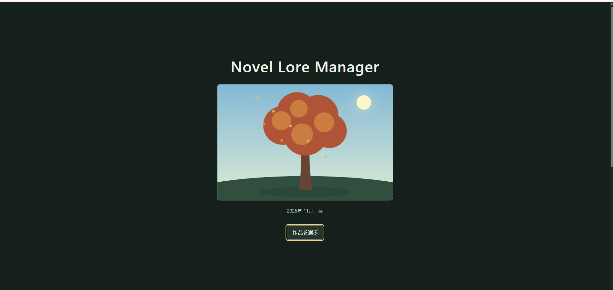

作品作成・選択画面：
 - 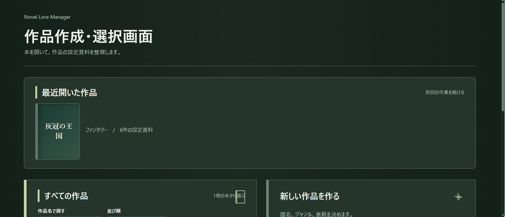
 - 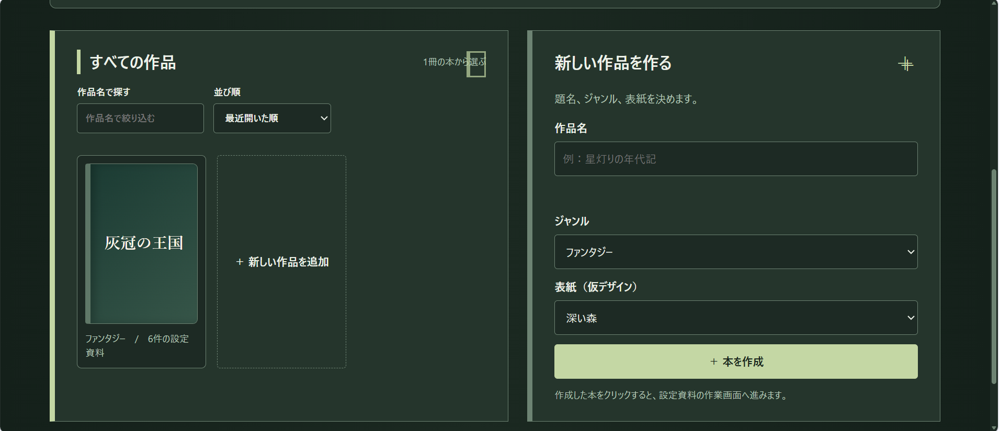
 - 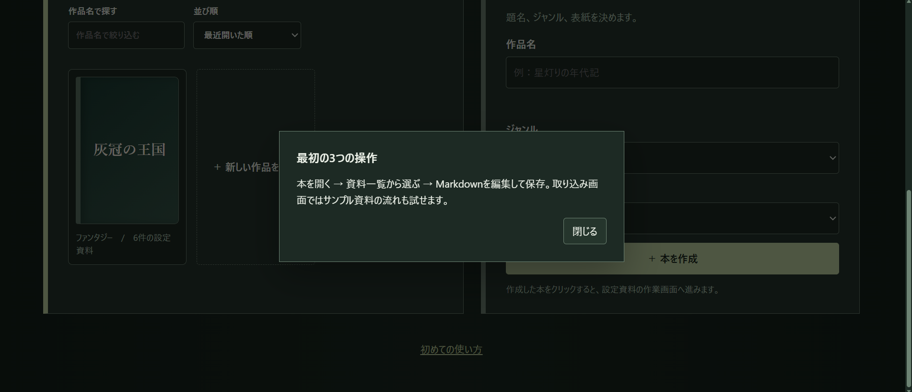

資料一覧・編集・表示・関連・記号説明画面：
 - 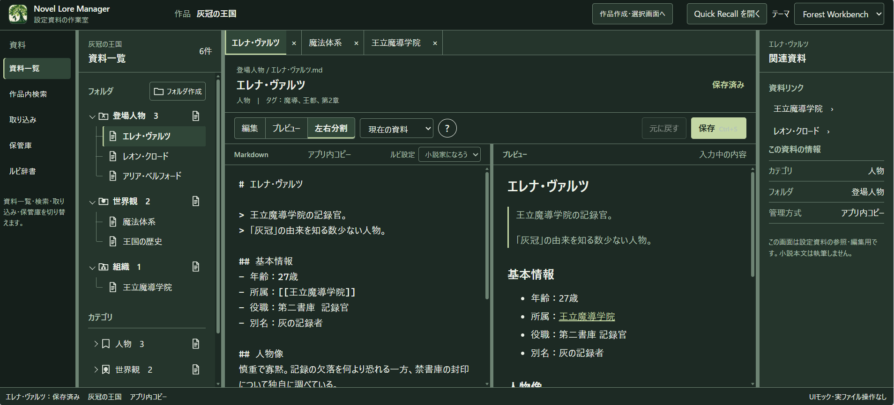
 - 資料一覧・関連画面：
  - 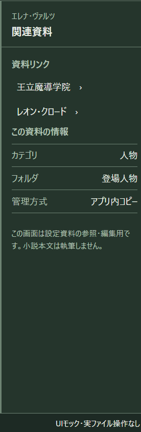
 - 資料一覧画面編集記号説明画面：
   - 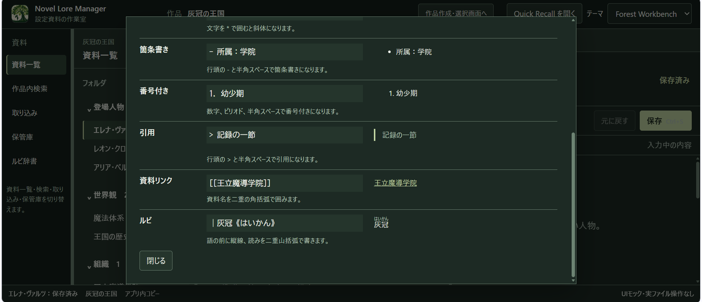

作品内検索画面：
 - 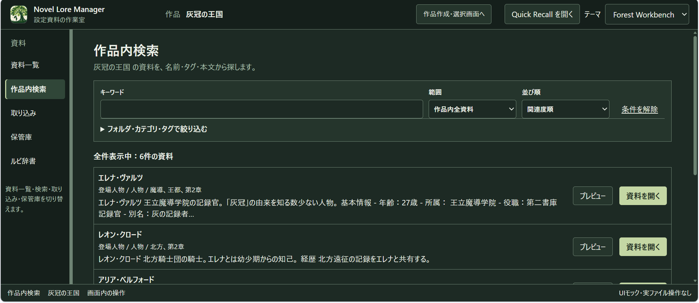
 - 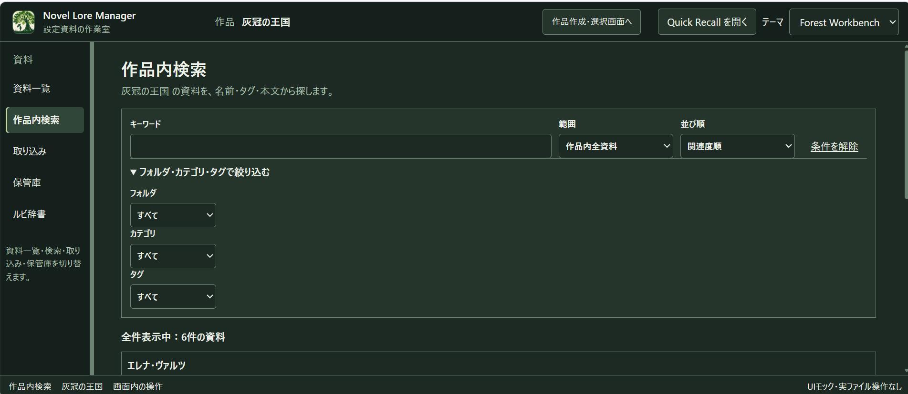

取り込み画面：
 - 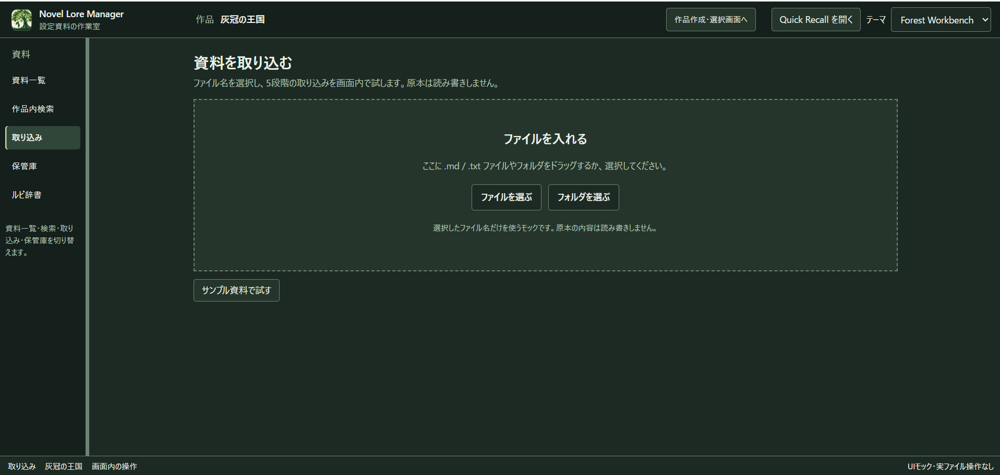
 - 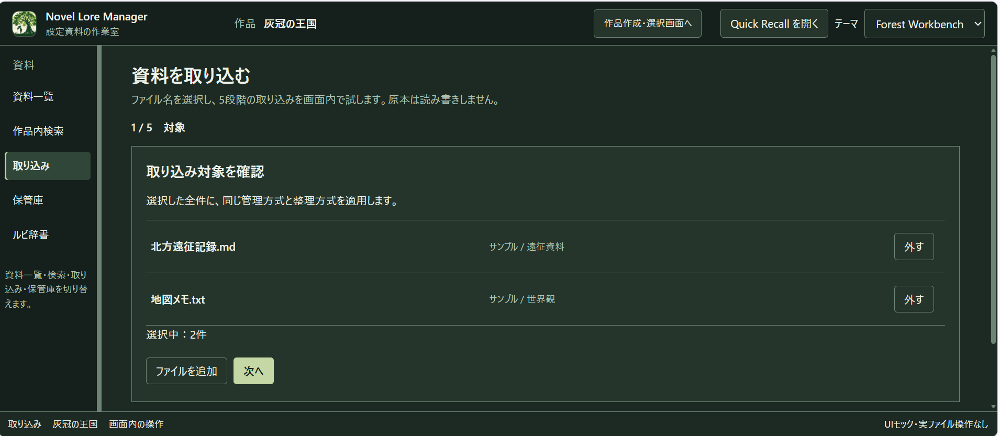 
 - 
 - 
 - 
 - 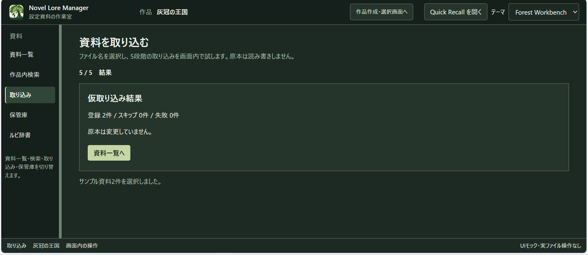

保管後画面：
 - 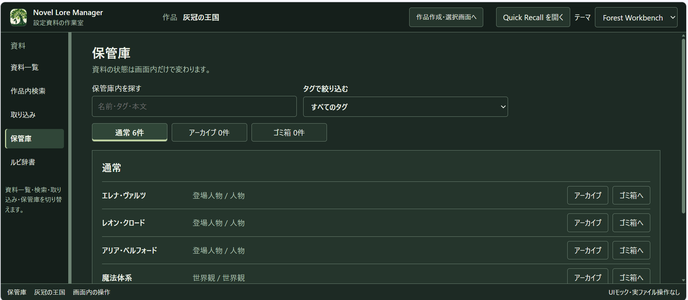

ルビ辞書・一覧画面：
 - 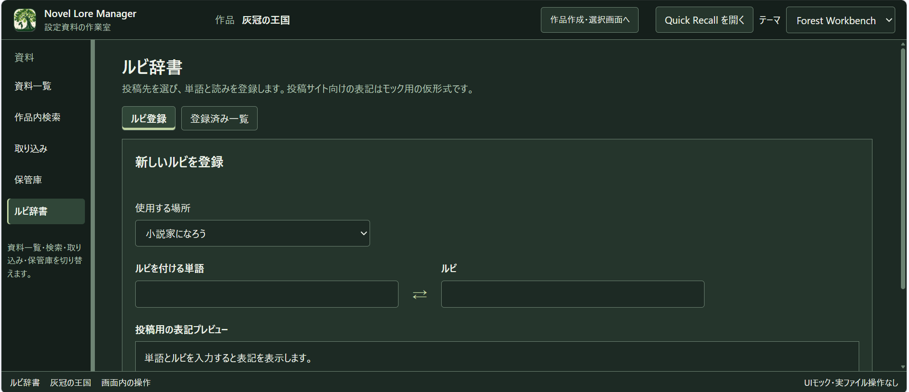
 - 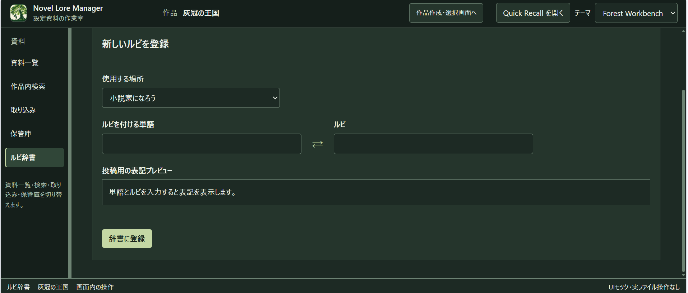
 - 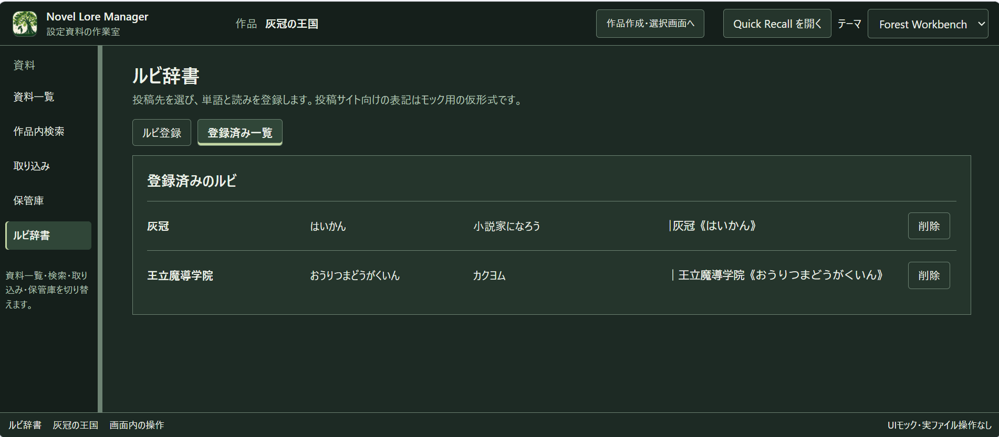

Quick Recall画面：
 - 
 - 
 - 
 - 
 - 
 - 
 - 
 - 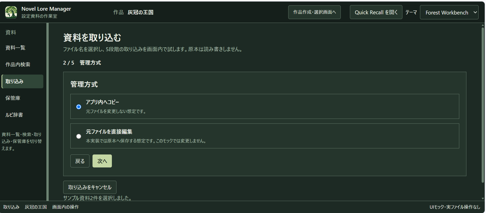
 - 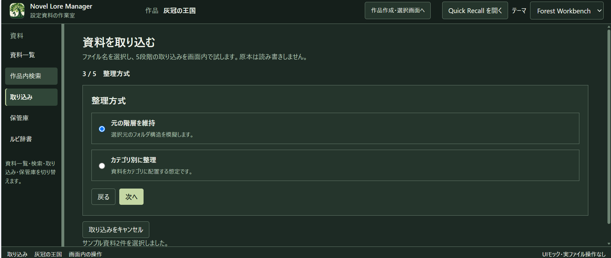
 - 
 - 
 - 

## 8. 確認方法と検証範囲

本書は現行ソースの操作経路とデータ境界を静的に確認して作成した。`tests/smoke.mjs` は検索の基本条件、MarkdownのHTMLエスケープ、ルビ表示例、3テーマの資産参照を確認する簡易テストである。これだけで全画面遷移、3テーマ×1366×768／1440×900／1920×1080の表示、キーボード・読み上げ品質、ブラウザ別窓の同期を保証しない。今回の文書作成では外部API接続、パッケージ追加、実ユーザーファイルの読み書きは行わない。

## 9. 現在の未実装・一部実装（2026-11-23のソース照合）

ここでの「未実装」は現行の `index.html` とその読み込み先に操作または状態がないことを指す。Windows製品の必要性や実装方式を確定する判定ではない。`quick-recall.html` と旧 `scripts/`・`styles/` は現行入口から読み込まれないため、実装済みの根拠に含めない。

| 領域 | 現行コードで確認できる範囲 | 残る機能・状態 | 判定 |
|---|---|---|---|
| 作品・初回起動 | `flows.js` が初期作品1件を作り、作品作成とメモリ内の作品切替を扱う | 作品0件からの初回起動と空状態、再起動後の作品・資料・最近開いた履歴の保持、別作品への資料移動・コピー | 未実装。作品切替時の資料・フォルダ・タブ退避はコード上あり、複数作品での通し操作は未検証 |
| フォルダ・資料一覧 | `theme-manager.js` の `state.folders`、`createDialog`、`createBlankDoc`、`renameDoc` によりフォルダの追加、フォルダ／カテゴリからの資料作成、`F2` 改名を模擬する | フォルダの改名・削除・移動と任意の入れ子、資料のフォルダ移動、カテゴリ・タグ・別名・概要・関連資料の編集、ユーザー定義カテゴリと資料テンプレート | 一部実装。作成先カテゴリは固定候補から選ぶだけ |
| 取り込み後の整理 | `import-wizard.js` が相対パスを資料の `folder` に、カテゴリ別整理を `未分類` に設定する | 元階層を実ディレクトリとして作る処理、カテゴリへの実際の振り分け、取り込みで付いた `未分類` を選択・編集する操作 | 一部実装。`theme-manager.js` のカテゴリ一覧は固定4種で、`未分類` はそこに表示されない |
| Markdown編集・保存 | `theme-manager.js` で `content`／`saved`、Undo履歴、タブ閉鎖・作品選択時の未保存確認を扱う | Redo、保存履歴・版復元、保存失敗と再試行、異常終了後の復旧、外部変更の検知と競合比較、本文以外のメタデータ変更の保存状態 | 未実装。`Ctrl+S` はメモリ上の `saved` 更新のみ |
| 検索・リンク | `search.js` でNFKC化した部分一致、固定フィルタ、名前順と配列順を扱う。`markdown.js` は `[[資料名]]` の限定表示を行う | 読み・漢字表記ゆれの自動推定、関連度スコア、検索失敗の再現、リンク作成・改名追従・リンク切れ解決、関連候補提示 | 一部実装。作品横断検索・AI自然言語検索は将来範囲であり、現在の欠陥には含めない |
| インポート・エクスポート | `import-wizard.js` はファイルの名前・相対パスを使い、同名資料を自動スキップし、固定本文をメモリへ追加する | 実本文の読取と原文保持、文字コード・権限検査、同名・パス衝突ごとの名前変更／スキップ／中断、途中失敗・再試行、手動更新、ファイル・フォルダ・ZIPのエクスポート | 一部実装。結果の失敗数は常に0件。実ファイル操作はモックの対象外 |
| 保管庫 | `flows.js` でアーカイブ・ゴミ箱・復元を論理状態として変更する | 完全削除の模擬と確認、復元時の同名・パス衝突、通常ツリーで削除済み資料を薄く表示する切替 | 一部実装。DIRECT元ファイルの処理は行わない |
| Quick Recall | `theme-manager.js` と `enhancements.js` に検索・概要・編集・簡易メモ・取り込み・保管庫がある | 別窓とメイン窓の資料・メモ共有、同時編集競合、メモ永続化、作品未選択時の復帰導線、閉じると最小化の別動作 | 一部実装。OS全域ショートカット、常時最前面、メイン終了後の常駐はブラウザ試作では実装できない |
| 設定・検証 | 3テーマ切替と短いガイド、区切り幅の調整がある | 独立した設定画面、文字サイズ・表示密度・操作一覧・配置リセット、幅の保持、内蔵動画 | 未実装または一部実装。3テーマ×指定3解像度、表示倍率、キーボード操作と読み上げの実画面検証は未了 |

## 10. 製品仕様として未確定の判断事項

以下はモックの仮動作からは確定できない。要件資料の `OPEN`／`PROVISIONAL` と、現行コードの不足を混同しない。

| 論点 | 現行モックの仮置き | 決める必要があること |
|---|---|---|
| 資料ID・同名判定（DM-Q01/02） | 資料IDを複数ビューで共有し、資料名は作品内でNFKC化して比較する。取り込みは生の資料名比較でスキップする | 同名禁止の範囲、拡張子・大文字小文字・正規化・フォルダ階層を含む衝突規則と、リンクの安定識別 |
| COPY／DIRECT・TXT（DM-Q03/04） | 管理方式は取り込みバッチ単位のラベル。`.txt` も資料画面で扱い、パンくずは `.md` と表示する | 方式の適用単位、原本・複製の保存先、`.txt` の保存形式と拡張子表示 |
| 更新・削除・復旧（DM-Q05/07/08） | 保存はメモリ内、削除は論理状態のみ | 外部ファイルの再読込と書戻しの区別、DIRECT元ファイルの削除範囲、異常終了時の復旧方法 |
| Quick Recall（DM-Q06、UX-Q01～03） | 別窓は別のJS状態で初期化。×と最小化は同じ非表示経路 | 起動時の対象作品、メインとの同時編集・競合・メモ保存、ウィンドウの閉鎖／最小化、ホットキーと位置記憶 |
| 資料の整理・画面配置（UX-Q05/06） | 固定カテゴリ4種、フラットなフォルダ、幅調整、別資料の右プレビュー | ユーザー定義カテゴリと任意階層のデータ規則、削除済み資料の通常ツリー表示条件、自由配置の対象と保持方法 |
| 検索・ルビ・関連 | 明示済み別名と簡易一致、仮の投稿先ルビ表示、資料名によるリンク | 読み・表記ゆれの精度と関連度の算出、ルビ保存記法・投稿先別変換、改名時のリンク処理と関連候補の範囲 |
| 作品カード・保管庫の絞り込み | 最近開いた順／作品名順、保管庫タグは登録済み値の選択式 | 最終更新日時・著者・進行状態・表紙画像を正式な作品データに含めるか、タグ自由入力検索を設けるか |

Windows向け配布方式、バックアップ方式、AI機能はこのブラウザモックの実装結果から決めない。外部APIとの接続は行っていない。

---

| 版 | 日付 | 内容 |
|---|---|
| ver2.o | 2026-11-23 | `やって欲しいことver3.0.md` の使用ソースを基準に、現行モックの機能・模擬範囲・未実装を再整理 |
| ver3.0 | 2026-11-23 | 現行ソースと要件を再照合し、モック内の未実装・一部実装と製品仕様の未確定事項を分けて追記 |
