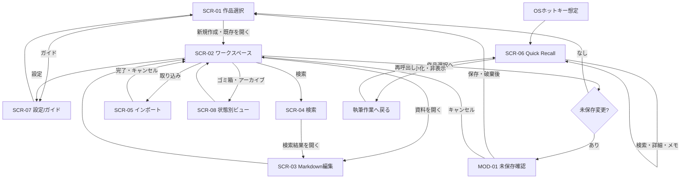

# Novel Lore Manager — 画面仕様書 v0.1

- **作成日**：2026-10-30
- **状態**：初版・レビュー対象（承認済みの実装仕様ではない）
- **対象製品**：Windowsデスクトップアプリ「Novel Lore Manager」
- **対象工程**：ワイヤーフレーム → UIデザイン3案比較 → 画面遷移可能なプロトタイプ
- **参照資料**：`Novel_Lore_Manager_Requirements_v1.0.md`、`data-management-design.md` v0.1、`user-flows.md` v0.1
- **最優先**：本文執筆アプリではなく、創作設定資料の管理・編集・検索・クイック参照ツールとして設計する。

> **文書の区分**　[確定]＝ユーザーが決めた要求、[暫定]＝プロトタイプの仮仕様、[未決]＝確認・検証が必要、[将来]＝今回のプロトタイプの必須範囲外。画面位置や文言の提案は、ユーザーが要件として承認したものではない。

## 1. 目的とスコープ

本書は、各画面の**役割、構成要素、操作、画面遷移、各種状態、エラー時の挙動、受け入れ条件**を定義する。UIの実装方法やDBの物理構造を確定する文書ではない。

### 1.1 モックアップの再現レベル

| 項目 | プロトタイプで再現 | 実装時の別検証 |
|---|---|---|
| 作品・資料管理 | モックデータに基づく作成・選択・分類・移動の状態変化 | 永続保存、実ファイル移動、権限 |
| Markdown編集 | 入力、Undo、保存状態、プレビュー、タブ | 実書き込み、文字コード、原本保護、クラッシュ復旧 |
| 検索 | 作品内のサンプル資料に対する一致・絞り込み・強調 | 漢字読み推定、形態素解析、大量データ性能 |
| インポート | COPY/DIRECT選択、配置選択、衝突・エラーの模擬 | 実ファイル取り込み、再読み込み、外部変更検出 |
| Quick Recall | 独立小型画面風のUI、検索・概要・メモ・編集の模擬 | OSグローバルホットキー、常時最前面、常駐、同時書き込み |
| ゴミ箱・アーカイブ | 状態の変更、表示の切替、復元 | 実ファイルの削除・復元、DIRECT安全性 |
| 3デザイン比較 | 同一データ・同一レイアウトを3テーマで表示 | 実ユーザー評価・アクセシビリティ検証 |

**今回対象外**：AI支援、自然言語検索、作品横断検索、作品間の同一資料共有、本番用データベースや外部API。

## 2. 画面体系と識別子

| 画面ID | 名前 | 表示形式 | 機能優先度 | 対応フロー |
|---|---|---|---|---|
| SCR-01 | 作品選択・初回案内 | メインウィンドウ | 必須 | UF-01, UF-08 |
| SCR-02 | メインワークスペース | メインウィンドウ | 必須 | UF-01, UF-02 |
| SCR-03 | Markdown編集・プレビュー | SCR-02の中央ビュー | 必須 | UF-02, UF-04 |
| SCR-04 | 作品内検索 | SCR-02の検索ビュー／パネル | 必須 | UF-05 |
| SCR-05 | ファイル取り込みウィザード | SCR-02から開く画面／ダイアログ | 必須 | UF-03 |
| SCR-06 | Quick Recall | 独立小型ウィンドウ | 必須 | UF-06 |
| SCR-07 | アプリ設定・初回ガイド | 独立ビュー／設定パネル | 必須（基本項目） | UF-01, UF-08 |
| SCR-08 | ゴミ箱・アーカイブ | SCR-02内の専用ビュー | 必須 | UF-07 |
| MOD-01 | 未保存変更の確認 | モーダル | 必須 | UF-04, UF-08 |
| MOD-02 | 同名・パス衝突の確認 | モーダル／ウィザード内警告 | 必須 | UF-01, UF-03, UF-07 |
| MOD-03 | 外部更新・編集競合 | モーダル | 必須（模擬） | UF-03, UF-04, UF-06, UF-08 |
| MOD-04 | 削除・完全削除確認 | モーダル | 暫定追加 | UF-07 |

**配置方針 [暫定]**：SCR-03・04・08はできる限りSCR-02の共通ワークベンチ内に収め、無駄な別画面移動を減らす。SCR-06はメイン画面と独立させる。[確定]

## 3. 共通UIと共通操作

### 3.1 メインウィンドウの情報構造（暫定）

```text
┌──────────────────────────────────────────────────────────────────┐
│ タイトル / 現在の作品名 / ウィンドウ操作                         │
├──────┬──────────────────┬──────────────────────────┬────────────┤
│機能  │ 資料ツリー        │ タブ列                   │ 関連資料   │
│切替  │ ├ フォルダ       ├──────────────────────────┤            │
│      │ ├ カテゴリ       │ Markdown編集 / プレビュー│ （任意）   │
│      │ ├ 検索           │ または検索ビュー         │            │
│      │ └ ゴミ箱         │                          │            │
├──────┴──────────────────┴──────────────────────────┴────────────┤
│ 状態表示：保存状態・ファイル管理方式・検索範囲など               │
└──────────────────────────────────────────────────────────────────┘
```

- [確定] 複数タブ、左右分割表示、自由なパネル配置を目指す。
- [暫定] 初期レイアウトは左ツリー＋中央編集＋右関連情報。右パネルやツリーは閉じられる。
- [暫定] フォルダとカテゴリは**異なる探し方**であり、同じ論理資料を開く。選択資料の独立コピーを作らない。
- [未決] 自由ドッキング可能なパネルの範囲、レイアウト記憶の単位（作品／アプリ全体）。

### 3.2 共通コンポーネント

| コンポーネントID | 名称 | 主な状態と操作 |
|---|---|---|
| CMP-01 | 作品名・現在位置 | 現在作品を常に識別可能。作品選択へ戻る導線 |
| CMP-02 | 資料エクスプローラー | 展開／折りたたみ、選択、コンテキストメニュー、スクロール |
| CMP-03 | カテゴリ／タグフィルタ | カテゴリ1つ・タグ複数の情報構造を反映 |
| CMP-04 | タブバー | 開く、選ぶ、閉じる、未保存インジケーター、左右分割 |
| CMP-05 | 状態表示 | 保存済み／未保存／保存失敗、COPY／DIRECT、削除状態 |
| CMP-06 | 共通通知 | 成功・警告・エラー、説明と回復アクション。過剰なトーストを避ける |
| CMP-07 | 確認ダイアログ | 影響範囲・実行・キャンセルを明記。危険操作の既定は安全側 |
| CMP-08 | キーボードフォーカス | Tab移動、フォーカス表示、Escで閉じられる範囲を設計 |

### 3.3 共通の保存・離脱規則

- [確定] `Ctrl+S` を標準の手動保存とする。画面上に保存状態を示す。
- [確定] `Ctrl+Z` とUI上のUndoボタンで編集操作を戻す。
- [暫定] 未保存タブを閉じる、別作品へ戻る、アプリを終了するときはMOD-01（保存／破棄／キャンセル）。別タブへ移るだけなら内容を保持する。
- [暫定] 保存が失敗したらドラフトを保持し、保存済み表示にしない。
- [未決] 自動保存、異常終了時の一時復旧、保存済み履歴復元。

### 3.4 推奨ショートカット（モック用仮割当）

| 操作 | 仮キー | 備考 |
|---|---|---|
| 保存 | Ctrl+S | 確定方針 |
| Undo | Ctrl+Z | 確定方針 |
| 検索 | Ctrl+F／Ctrl+Shift+F | 現在資料／作品全体の候補。キー割当は暫定 |
| 新規資料 | Ctrl+N | 暫定 |
| タブ切替 | Ctrl+Tab | 暫定 |
| Quick Recall呼び出し | 未割当 | [未決] OS／執筆アプリとの衝突を検証する |

## 4. SCR-01 作品選択・初回案内

**目的**：作品を選ぶ・新規作成する。初回は新規作品作成を優先する。[確定]

**表示項目**：製品名、新規作品作成、既存作品一覧（作品名・更新情報の表示は暫定）、作品を開く、ガイドへのリンク、空状態、作品切替後の戻り先。

| 操作・イベント | 画面挙動 | 遷移先 |
|---|---|---|
| 新規作品作成 | 名前入力→確認→作品を作成（空の作品も許可） | SCR-02 |
| 既存作品を選択 | 対象作品を開く | SCR-02 |
| 初回ガイド | 短い説明を開く。内蔵動画は未決 | SCR-07 |
| 名前が空／重複 | 入力欄付近にエラー。作成しない | SCR-01 |
| 作品が0件 | 新規作成を主要アクションとして表示 | SCR-01 |

**入力条件 [暫定]**：前後空白を除いた空文字を禁止。作品名の重複許可・最大長・禁止文字は未決（モックでは検証用エラーを用意）。

**受け入れ条件**：作品ゼロ状態から作成でき、作品名がワークスペースに反映される。作品を選び直すには選択画面に戻る。[確定]

## 5. SCR-02 メインワークスペース

**目的**：フォルダ・カテゴリから設定資料を探し、編集・検索・取り込みを開始する中核画面。

### 5.1 領域の定義

| 領域 | 表示内容 | 操作 |
|---|---|---|
| 左端ナビゲーション | エクスプローラー、検索、取り込み、ゴミ箱、設定の入口 | ビュー切替 |
| 左パネル | フォルダ階層／カテゴリ一覧／最近開いた資料（最後は暫定） | 展開、資料選択、フィルタ、幅調整 |
| 中央 | タブ、SCR-03、必要に応じSCR-04・SCR-08 | タブ操作、編集、分割 |
| 右パネル | 関連資料、リンク先（候補表示） | 資料へ移動、閉じる |
| 下端 | 保存状況、COPY／DIRECT、作品名等 | 状態確認。詳細表示は暫定 |

### 5.2 操作仕様

- [確定] フォルダとカテゴリから同じ資料を開けるようにする。カテゴリは1つ、タグは複数。
- [確定] 複数タブを開き、左右分割で2資料を表示できる。
- [確定] 作品切替はSCR-01へ戻る。
- [暫定] 新規資料作成時は名前・フォルダ・カテゴリ・テンプレートを指定。内部IDはUIには原則表示しない。
- [暫定] 移動や名称変更で重複が生じた場合はMOD-02を開く。無言で上書きしない。
- [未決] パネルのドラッグ＆ドロップ範囲、保存位置、カテゴリ変更時の自動移動の有無（初期案は**物理ファイル移動しない**）。

**空状態**：資料なしなら「新規資料を作成」「ファイルを取り込む」を提示。タブなしなら利用方法の短い案内。

**受け入れ条件**：ツリー・カテゴリ・タブ・分割で同じ資料を混同しない。未保存資料が閉じられるときに内容が黙って消えない。

## 6. SCR-03 Markdown編集・プレビュー

**目的**：設定資料をMarkdownで直接編集・確認する。小説本文執筆用途ではない。[確定]

| 表示要素 | 詳細 |
|---|---|
| 資料名／タブ | 現在資料、未保存印、状態によりゴミ箱等の表示 |
| モード切替 | 「編集」「プレビュー」「左右分割」[確定] |
| Markdown編集 | 生のMarkdown文字列入力、スクロール、Undo |
| プレビュー | 見出し・リスト・リンク等を整形表示。レンダリング対象は暫定 |
| 保存UI | Ctrl+S、保存ボタン（暫定）、未保存／保存済み／失敗 |
| 関連資料 | `[[資料名]]` リンクを候補として表示・移動 [暫定] |
| 保存先の注意 | COPYなら複製、DIRECTなら元ファイルに反映する旨を表示 |

**主要イベント**

1. 入力→`dirty=true`、未保存表示。
2. モード切替→同じドラフトを表示し、内容を破棄しない。
3. Undo→直前の編集操作を戻す。保存履歴復元とは区別。
4. Ctrl+S→（モック）成功なら保存済み、失敗なら未保存保持。DIRECT外部変更時はMOD-03。
5. 未保存でタブを閉じる／作品選択へ戻る→MOD-01。
6. リンク選択→対象資料をSCR-02内の別タブで開く。[暫定]

**制約と例外**：`.txt`も画面上はMarkdown編集体験に寄せるが、**表示解釈と実拡張子変更は別**。保存形式の決定はDM-Q04。リンクの一意解決はDM-Q01/02に依存。

**受け入れ条件**：入力→プレビュー→戻るで文字列が変化せず、Ctrl+SやUndoの状態が一貫し、未保存離脱に警告が出る。

## 7. SCR-04 作品内検索

**目的**：目的の設定を短時間で発見し、内容プレビューから資料へ移る。[確定]

### 7.1 構成

| コンポーネント | 仕様 |
|---|---|
| 検索窓 | キーワード入力。入力中の検索方法／実行タイミングは暫定 |
| 検索範囲 | 「作品内全資料」を初期値、「現在開いている資料」へ切替 [確定] |
| 絞り込み | フォルダ・カテゴリ・タグ [確定] |
| 並び替え | 標準「関連度順」、選択変更可 [確定]。候補は更新日・名前・カテゴリ等 [暫定] |
| 結果一覧 | 資料名、所在、該当箇所の前後の抜粋、強調表示 |
| プレビュー | 選択結果の本文該当位置を表示。選択→資料を開く |
| 0件状態 | 条件・フィルタの見直し、クリア操作 |

### 7.2 検索の区分と実現度

- [確定] 部分一致、登録済み人物名・別名・通称、読み仮名・ルビ、表記ゆれへの対応を目指す。
- [暫定] プロトタイプはサンプル資料の`name`・`aliases`・`reading`・`tags`などの明示的メタ情報と文字正規化を使い、検索マッチングを再現。
- [未決] 漢字の読みを自動推定するか、ルビをどの記法で保存するか、関連度の採点式、複数一致のハイライト仕様。
- [将来] 作品横断検索とAI自然言語検索は初期非対象。作品横断の切替は**UIに設置しない**。

**主要イベント**：文字入力→検索結果更新→フィルタ切替→並び替え→行選択でプレビュー→資料を開くとSCR-03の対象タブに遷移。

**エラー／空状態**：未入力、0件、無効なフィルタ組合せ、検索失敗（モック）を明確に区別。絞り込みの解除手段を表示。

**受け入れ条件**：作品内／現在資料でヒット集合が変わり、ハイライトとプレビューが一致し、結果から目的の資料へ移動できる。

## 8. SCR-05 インポートウィザード

**目的**：原本への影響と取り込み後の整理方法を理解した上で、`.md/.txt`を作品へ登録する。

### 8.1 ステップ（暫定）

| ステップ | 主な入力／表示 | 確認事項 |
|---|---|---|
| 1. 取り込み対象 | `.md`／`.txt`、フォルダ、件数、対象一覧 | 対象が0件なら次へ進めない |
| 2. 管理方式 | COPY（アプリ内コピー）／DIRECT（元ファイル直接編集） | **すべての選択対象に適用する**説明、保存先への影響 |
| 3. 整理方式 | 元階層保持／カテゴリ別振り分け | カテゴリ指定、取り込み後の配置プレビュー |
| 4. 事前確認 | 原本の扱い、件数、衝突、結果予測 | 同名衝突があればMOD-02／中断 |
| 5. 結果 | 成功数、失敗数、スキップ数、資料を開く | 再試行／完了 |

- [確定] 管理方式と整理方式は別々に選べる。COPYとDIRECTを個々のファイルに都度尋ねる設計にはしない。
- [暫定] COPY／DIRECTの選択適用範囲は**取り込みバッチ単位**。既存資料と異なるモードが混在する可能性がある旨を示す（DM-Q03未承認）。
- [暫定] 目次抽出はMarkdown見出しの構文解析、カテゴリ提案は基本的なルール処理として紹介可能。ただし実用精度を保証しない。
- [確定] AIなしでも原文保持を基本とし、変換時に黙って内容を消さない。

**エラー**：未対応形式、読み取り不可、同名／同パス競合、直接編集先が利用不可、取り込み途中失敗。すべてに対象と復帰アクションを表示し、実ファイルへの操作はモックでは行わない。

**注意文言例 [暫定]**：
- COPY：「取り込み先の複製を編集します。元ファイルは変更されません。」
- DIRECT：「保存すると、選択元のファイル内容が変更されます。今回の取り込み対象すべてに適用します。」

**受け入れ条件**：両方式の違いと一括適用範囲を理解でき、階層保持・カテゴリ振り分けを試し、衝突時に上書きされない。

## 9. SCR-06 Quick Recall

**目的**：別の執筆アプリの作業中に、設定を短時間で検索・確認し、元の執筆作業へ戻る。独立した小型ウィンドウ。[確定]

### 9.1 初期レイアウト（暫定）

```text
┌────────────────────────────────────┐
│ Quick Recall    作品名      _  ×  │
├────────────────────────────────────┤
│ 🔎 名前・過去の出来事を検索       │
├────────────────────────────────────┤
│ 結果一覧    │ 選択資料の概要      │
│ 1. ...     │ 重要な項目         │
│ 2. ...     │ [詳細] [編集]      │
├────────────────────────────────────┤
│ [簡易メモを開く]                  │
└────────────────────────────────────┘
```

- [確定] 呼び出し手段の第一候補はキーボードショートカット。メイン画面を閉じていても使用したい。
- [確定] 常に最前面が基本、邪魔なら最小化して戻れること。
- [確定] 主画面と分離、概要／詳細を表示し、簡易メモと設定編集も利用したい。
- [暫定] 初期表示は検索＋結果＋概要。詳細／全文／編集／メモは操作時に展開し、小型画面へ詰め込みすぎない。
- [未決] ホットキー割当、閉じると最小化の違い、起動直後の作品選択、単独稼働のプロセス、ウィンドウ位置記憶。

### 9.2 操作と状態

| 操作 | 期待挙動 | 注意点 |
|---|---|---|
| ホットキーで呼び出す | 小型ビューを表示 | ブラウザモックはOS全域での起動を保証しない |
| 検索する | 現在の対象作品で結果表示 | 作品横断しない |
| 結果を選ぶ | 概要と関連資料を表示 | 設定内容を素早く読む |
| 詳細／編集 | 必要時だけ詳細領域に切替 | メインとの同時編集はDM-Q06未決 |
| 簡易メモ | メモを書き、保存・未保存を区別 | 本文とは別データを暫定推奨 |
| 最小化・閉じる | 執筆画面を見やすい状態へ戻す | ×で終了するか非表示かは未決 |

**エラー**：対象作品未選択、検索0件、資料削除済み、保存競合、メモ未保存。確認するべきメッセージを表示する。**モックが他アプリのフォーカスを完全制御できるように見せかけない**。

**受け入れ条件**：検索→概要→詳細／メモ→最小化の操作をたどれ、選択中作品が分かり、メイン側と同じ資料を表示できる。

## 10. SCR-07 アプリ設定・初回ガイド

**目的**：環境を調整し、初回利用者が作品作成・資料取り込み・検索を理解できるようにする。

| セクション | 表示項目 | 状態 |
|---|---|---|
| 外観 | A/B/Cテーマの切替（比較用）、文字サイズ、表示密度 | テーマ比較は確定／項目は暫定 |
| 操作 | キーボード操作一覧、Quick Recallホットキーの設定入口 | 割当・OS連携は未決 |
| 画面配置 | サイドバー幅・パネル位置を戻す | 詳細は暫定 |
| ガイド | 新規作品作成、Markdown編集、取り込み、クイック参照の短い説明 | [確定] ガイド要望、内蔵動画は未決 |
| 保存／情報 | COPY/DIRECTの説明、ローカル管理の注意 | 保存場所・実エクスポートは別設計 |

**受け入れ条件**：テーマ切替で画面構造とサンプルデータを変えずに視覚表現だけ変更でき、ガイドから作品選択へ戻れる。

## 11. SCR-08 ゴミ箱・アーカイブ

**目的**：利用中の資料と、アーカイブ済み・削除済みの資料を区別し、復元できるようにする。

| 表示要素 | 内容 |
|---|---|
| 状態切替 | 通常／アーカイブ／ゴミ箱 |
| 資料一覧 | 名前、元の場所、状態、変更日時（日時は暫定） |
| 削除済み表示 | ツリーで薄い表示をする案＋表示切替（暫定） |
| 操作 | 復元、アーカイブ解除、完全削除（確認必須） |

**状態遷移**：`ACTIVE → ARCHIVED → ACTIVE`、`ACTIVE/ARCHIVED → TRASHED → ACTIVE`、`TRASHED → PURGED`（最後は確認）。

**重要な例外**：DIRECT資料の削除は元ファイルの処理に影響する。[未決] 実ファイル削除はモックでは絶対に行わず、論理状態だけ模擬する。復元時の同名衝突はMOD-02へ。

**受け入れ条件**：アーカイブとゴミ箱を混同せず、削除済み資料を判別でき、復元操作を試せる。

## 12. 共通モーダル仕様

| ID | 表示条件 | 表示内容 | 操作と結果 |
|---|---|---|---|
| MOD-01 未保存変更 | 変更中のタブを閉じる／作品変更／アプリ終了 | 対象資料、変更が未保存である旨 | 保存して進む／破棄して進む／キャンセル。保存失敗時は留まる |
| MOD-02 同名・パス衝突 | 作成・改名・取り込み・復元等 | 衝突対象、保存先、既存データへの影響 | 名前変更／スキップ／キャンセル（文脈依存）。**上書き自動実行禁止** |
| MOD-03 外部更新・競合 | DIRECTで外部変更、複数ビューの編集世代衝突 | 編集元と外部側の変更が異なる旨 | 比較／再読込／キャンセル等を暫定表示。実マージは未実装 |
| MOD-04 削除確認 | ゴミ箱移動、特に完全削除 | 対象件数、復元可否、DIRECTの注意 | 削除／キャンセル。完全削除では影響を強調 |

**共通原則**：初期フォーカスは安全な操作に置く。Escは原則キャンセル。破壊的操作をデフォルトにしない。文言は実際の取り込み・保存方式と矛盾しないこと。

## 13. 画面遷移仕様



**補足**：上図は主要経路を記載し、MOD-02/03/04は該当画面上で発生する。Quick RecallはSCR-02を経由せず直接呼び出せることが目標。ブラウザプロトタイプでは起動導線を模擬する。

## 14. 共通状態・空状態・エラー表示の仕様

| 状態ID | 発生例 | UIでの表示 | 可能にする次の操作 |
|---|---|---|---|
| ST-01 初回 | 作品0件 | 空状態＋新規作品作成 | 作成・ガイド |
| ST-02 資料なし | 作品内0件 | 新規資料／取り込みを目立たせる | 作成・取り込み |
| ST-03 未保存 | 編集後 | タブに未保存マーク | 保存・Undo |
| ST-04 保存完了 | Ctrl+S成功 | 保存済み表示 | 続行 |
| ST-05 保存失敗 | 権限・競合の模擬 | エラー、編集内容維持 | 再試行・中断 |
| ST-06 検索0件 | 一致なし | 0件＋条件の確認 | フィルタ解除 |
| ST-07 取り込み競合 | 同名 | 対象名と競合理由 | 名前変更・スキップ・中止 |
| ST-08 DIRECT | 元ファイル編集 | COPYと異なる注意表示 | 編集方針確認 |
| ST-09 削除済み | TRASHED | 薄い文字、削除状態 | 復元 |
| ST-10 アーカイブ | ARCHIVED | アーカイブ状態 | 解除 |
| ST-11 QR作品未選択 | メイン閉鎖状態等 | 対象作品不明の案内 | 作品選択（挙動未決） |
| ST-12 QRメモ未保存 | メモ記入後 | 未保存表示 | 保存・戻る |
| ST-13 外部変更 | DIRECT編集中 | MOD-03 | 比較・キャンセル等 |
| ST-14 インポート失敗 | 権限・非対応形式 | 失敗件数・対象・理由 | 設定修正・再試行 |

## 15. プロトタイプ用のデータと検証条件

### 15.1 共通モックデータ

- 作品：**灰冠の王国**（完全な架空作品）
- 登場人物：エレナ・ヴァルツ、レオン・クロード、アリア・ベルフォード
- 世界観：魔法体系、王国の歴史、禁書庫
- 組織：王立魔導学院、北方騎士団
- 地理：王都アストリア、北方領グラシエ
- 各資料にサンプルMarkdown、カテゴリ1件、タグ複数、フォルダ、関連資料を設定する。
- 検索検証のため、別名と読み仮名、ヒット抜粋、検索0件になる入力も用意する。
- 比較デザインA/B/Cで**同じデータ、同じ操作タスク、同じ画面構造**を使用する。

### 15.2 画面サイズ・操作環境（暫定）

- メイン：1366×768 と 1920×1080、表示倍率125%・150%の検討。
- Quick Recall：コンパクトなサイズで情報が読めることを優先。具体的な最小寸法はワイヤーフレーム比較で決定。
- マウスとキーボードの両方で主要操作が可能で、フォーカス位置を見失わない。
- A：Forest Workbench／B：Storybook Atelier／C：Quiet Lore Studio（テーマ名は現時点のデザイン案）。

## 16. 受け入れテスト（画面仕様単位）

| ID | 該当画面 | テスト操作 | 判定基準 |
|---|---|---|---|
| SC-T01 | SCR-01 | 新規作品を作成 | SCR-02へ移動、作品名反映 |
| SC-T02 | SCR-02 | ツリーとカテゴリで同じ資料を開く | 表示内容と資料IDが一致する |
| SC-T03 | SCR-02/03 | 複数タブ・左右分割・編集モード切替 | 意図しない上書きや入力消失なし |
| SC-T04 | SCR-03/MOD-01 | 編集→未保存で閉じる | 保存／破棄／キャンセルが機能 |
| SC-T05 | SCR-03 | Ctrl+S→Undo | 状態が一貫し、Undoが実行できる |
| SC-T06 | SCR-04 | 範囲・フィルタ・ソート・結果選択 | ヒット強調とプレビュー、遷移が一致 |
| SC-T07 | SCR-05 | COPY/DIRECTと配置方式を選択 | 一括適用と影響説明を確認できる |
| SC-T08 | SCR-05/MOD-02 | 同名衝突を模擬 | 元データを上書きせず回復操作がある |
| SC-T09 | SCR-06 | 呼出し→検索→概要→メモ→最小化 | 執筆中の参照体験をたどれる |
| SC-T10 | SCR-06/MOD-03 | 同資料の二重編集を模擬 | 黙って変更が失われない |
| SC-T11 | SCR-08/MOD-04 | 削除→グレー表示→復元 | 削除／アーカイブ状態を区別 |
| SC-T12 | SCR-07 | A/B/Cのテーマを変更 | データ・情報配置・操作が維持される |
| SC-T13 | 共通 | 検索0件・保存失敗・取り込み失敗 | 状態説明と復帰導線が表示される |

## 17. 未決事項・レビュー対象

| ID | 論点 | 本書での扱い | 影響画面 |
|---|---|---|---|
| DM-Q01 | 同資料の複数ビュー参照・内部ID | 単一論理資料IDを暫定採用 | SCR-02/03/04/06 |
| DM-Q02 | 作品内同名禁止の判定方法 | 衝突確認のみ先に設計 | SCR-01/02/05/08 |
| DM-Q03 | COPY/DIRECTの選択単位 | 取り込みバッチ単位の仮仕様 | SCR-05 |
| DM-Q04 | `.txt` の実保存形式 | 画面はMarkdown、実形式は未決 | SCR-03/05 |
| DM-Q05 | 手動更新の意味 | 再読み込みと書き出しを分離する案 | SCR-03/05 |
| DM-Q06 | Quick Recallとの同時編集・メモ保存 | 共有ドラフト＋別メモ案 | SCR-03/06 |
| DM-Q07 | DIRECT資料の削除 | 実ファイル削除は行わない | SCR-08 |
| DM-Q08 | 異常終了時の一時復旧 | 未実装、状態だけ比較対象 | SCR-03 |
| UX-Q01 | Quick Recall対象作品の決定 | 前回作品／作品選択を比較 | SCR-06 |
| UX-Q02 | ×と最小化の違い | 非表示・待機を仮定 | SCR-06 |
| UX-Q03 | QRの概要・全文・編集の階層 | 段階的開示案 | SCR-06 |
| UX-Q04 | 検索や取り込みの詳細配置 | ワイヤーフレームで比較 | SCR-02/04/05 |
| UX-Q05 | ゴミ箱グレー表示の適用範囲 | 表示切替案 | SCR-02/08 |
| UX-Q06 | パネル自由配置の対象範囲 | まず幅調整・左右分割を検証 | SCR-02 |

**承認待ちの事項を、AIが独断で「実装済み仕様」に変更しないこと。**

## 18. 次工程への引き継ぎ

1. **`wireframes/`**：まずSCR-02（通常編集・検索・分割）とSCR-06（小型クイック参照）の低忠実度ワイヤーフレームを作成。続いてSCR-01・05・08・MOD群を制作する。
2. **`design-system.md`**：3案の配色・タイポグラフィ・余白・状態表現を同じワイヤーフレームに適用して比較。美観だけでなく可読性・情報密度で判断する。
3. **プロトタイプ**：SC-T01〜T13をモックデータで検証できるようにし、画面だけのダミーボタンを残さない。
4. **基本設計レビュー**：DM-Q01〜08とUX-Q01〜06のうち、データ損失・競合に関係する項目を本実装前に解決する。

---

### 変更履歴

| 版 | 日付 | 変更 |
|---|---|---|
| v0.1 | 2026-10-30 | 要件定義書、データ管理基本設計、ユーザーフローを反映して初版作成 |
