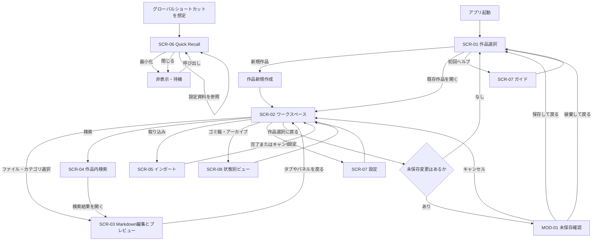
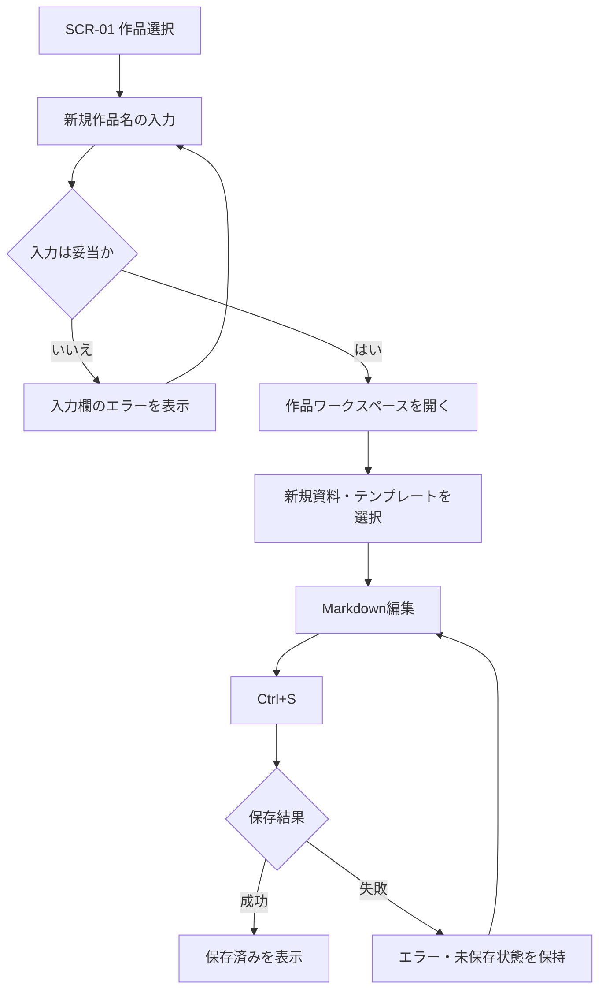
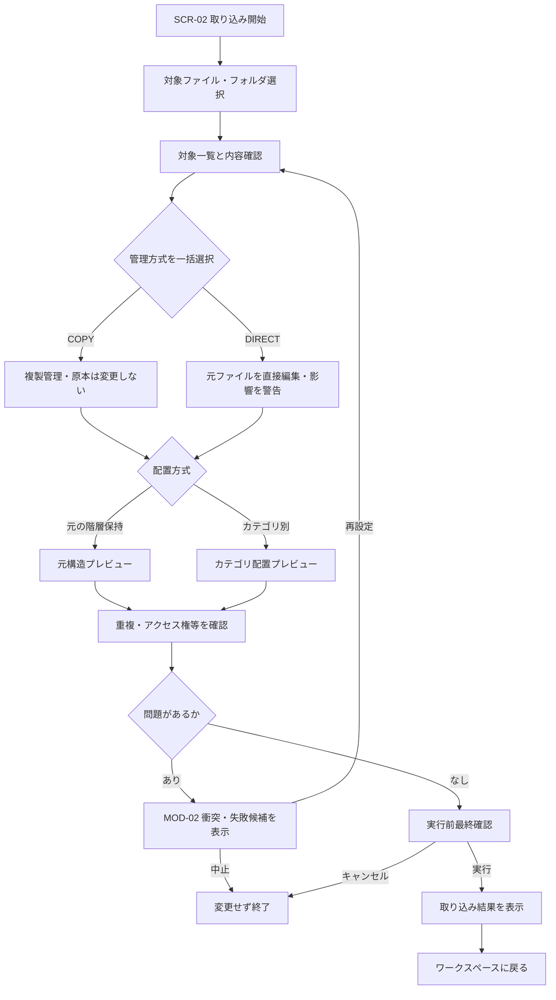
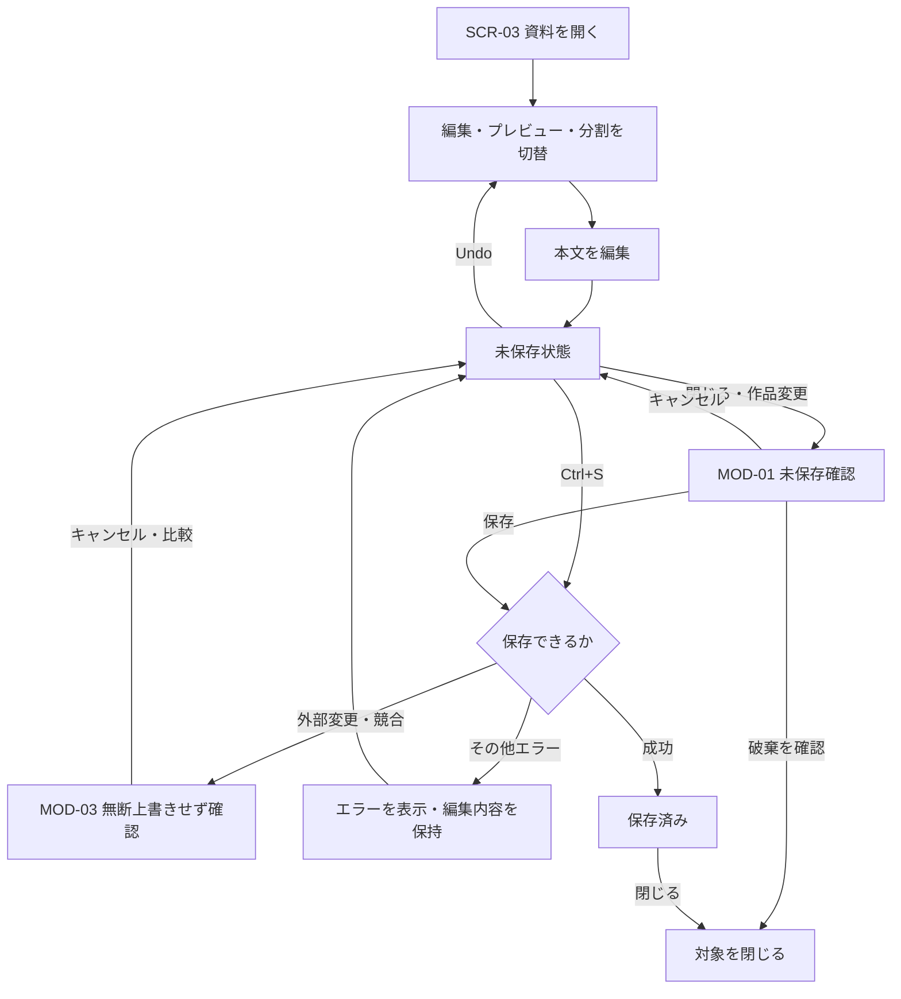
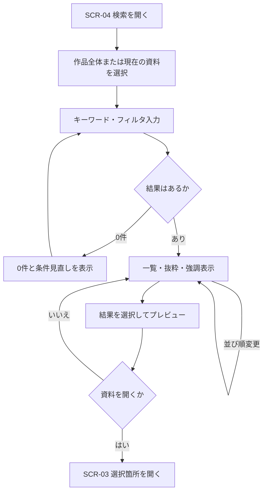
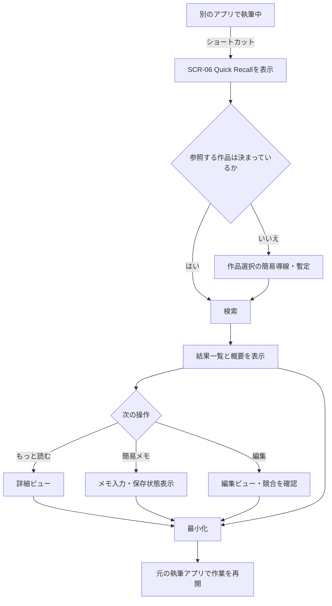
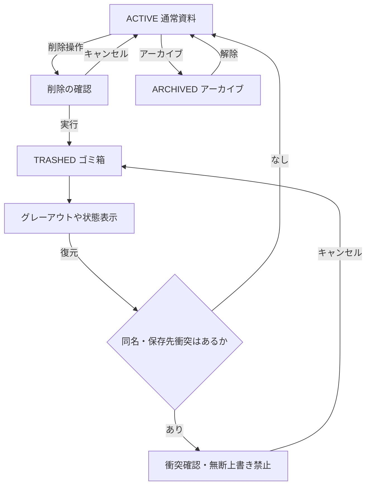

# Novel Lore Manager — ユーザーフロー・画面遷移設計書 v0.1

| 項目 | 内容 |
|---|---|
| 作成日 | 2026-10-30 |
| ステータス | **レビュー用・未承認** |
| 対象 | WindowsデスクトップアプリのUI/UXモックアップと操作可能プロトタイプ |
| 上位文書 | `Novel_Lore_Manager_Requirements_v1.0.md`、`data-management-design.md` v0.1 |
| 対象範囲 | 非AI・オフラインを前提とした作品／資料管理、編集、検索、取り込み、Quick Recall、削除・復元 |

> **表記**：**[確定]**はユーザーの希望が明示された動作、**[暫定]**はプロトタイプ用の提案、**[未決]**はユーザー判断が必要な事項、**[将来]**は初期対象外。画面遷移図の矢印は設計上の想定であり、OS操作やディスク操作の実装完了を表すものではない。

## 1. この文書の目的

小説家が「設定を作る」「既存資料を取り込む」「設定を探す」「執筆中にすぐ参照する」を実行する際、**どこから始め、何を操作し、どの画面・状態に移り、失敗時にどう戻るか**を定義する。美観・配色の決定は `design-system.md`、各画面の具体的な項目と配置は `screen-specifications.md` に引き継ぐ。

- 本アプリは小説本文の執筆エディタではない。**設定資料専用**の作成・編集・整理・参照ツール。[確定]
- 作品内で操作が完結する。**作品横断検索／同じ資料の作品間共有は初期非対象**。[確定]
- Quick Recallは**別の小型ウィンドウ**として設計する。[確定] ブラウザでのモックは独立ウィンドウの体験を模擬する。
- 実ファイルの保存や変更、OSグローバルショートカット、最前面固定は**プロトタイプ上の状態表現と本実装を区別**する。

## 2. 想定ユーザーと代表タスク

| ペルソナ／状況 | 最初の目的 | 完了と見なす状態 |
|---|---|---|
| 執筆前に設定を作る作家 | 新しい作品と人物資料を作成 | 資料がツリーに追加され、Ctrl+Sで保存済みになる |
| 執筆しながら設定が増える作家 | 既存作品へ設定を追加・関連付け | 資料に編集が反映され、必要なら関連資料へ移動できる |
| 過去の資料が散らばっている作家 | .md/.txtフォルダを一括取り込み | 対象・原本への影響を確認し、取り込み結果を確認できる |
| 別の執筆アプリで作業中の作家 | 過去の設定をすぐ調べる | Quick Recallで情報を確認し、執筆アプリへ戻れる |

## 3. 画面IDと画面構成

| ID | 画面／領域 | 主な要素 | 注記 |
|---|---|---|---|
| SCR-01 | 作品選択／新規作成 | 作品一覧、新規作成、簡単な初回ガイド | 初期はここで作品切替 [確定] |
| SCR-02 | メインワークスペース | エクスプローラー、カテゴリ、タブ、分割ビュー | 基本の作業領域 [確定] |
| SCR-03 | Markdown編集／プレビュー | 編集・プレビュー・左右分割、保存状態、Undo | **SCR-02内のビュー**でよく、独立した画面を強制しない |
| SCR-04 | 検索 | 検索範囲、入力、フィルタ、結果、プレビュー | SCR-02内のパネルでも可 |
| SCR-05 | インポートウィザード | 選択、管理モード、配置方式、プレビュー、結果 | 複数ステップ [暫定] |
| SCR-06 | Quick Recall | 検索、概要、詳細、編集／簡易メモ | 別ウィンドウ [確定] |
| SCR-07 | 設定／初回ガイド | テーマ、文字・操作設定、操作説明 | 詳細は未決 |
| SCR-08 | ゴミ箱／アーカイブ表示 | グレーアウト資料、復元、完全削除への導線 | SCR-02のビューとして実装可能 [暫定] |
| MOD-01 | 未保存確認 | 保存／保存せず終了／キャンセル | 保存せずの破棄には明示確認 [暫定] |
| MOD-02 | 同名・パス衝突 | 衝突内容、キャンセル／スキップ／別名 | 自動上書き禁止 [暫定] |
| MOD-03 | 外部変更・編集競合 | 変更検知、比較／再読込／キャンセル等 | 無断上書き禁止 [暫定] |

## 4. 全体の画面遷移

**補足**：Quick Recallはメインウィンドウを閉じた状態でも使用したいという要件がある。`閉じる` が単にウィンドウを隠すのか、Quick Recall自体を終了するのか、アプリ常駐の仕組みは**未決**。上図の `HIDDEN` は**暫定挙動**。Quick Recallからメイン編集画面を起動する導線も実装時に要判断。

## 5. 詳細ユーザーフロー

### UF-01 初回起動 → 作品作成 → 資料作成

- **開始条件**：初回起動／作品未登録、または作品選択画面を表示中。
- **終了条件**：新しい作品のワークスペースで新規資料を開き、保存状態を確認できる。
- **正常系**：`SCR-01` → 「新規作品作成」 → 作品名入力 → 「作成」 → `SCR-02`（空状態） → 「新しい資料」 → カテゴリ／フォルダ／テンプレートの選択 → `SCR-03` → Markdown編集 → `Ctrl+S` → 保存済み表示。
- **分岐**：初回ガイドは「見る／スキップ」を提示 [暫定]。名前なし・既存名重複などはエラーを表示し、入力を保持 [暫定]。
- **データ上の効果**：ProjectとDocumentを作成する想定。実プロトタイプではモック状態のみ更新。

### UF-02 作品内での閲覧・資料切り替え・リンク移動

- **開始条件**：作品が開かれている。
- **正常系**：フォルダツリーまたはカテゴリ一覧から資料を選択 → 同じ資料をタブに表示 → 必要なら別タブを開く／左右分割 → 関連リンクから対象資料を開く。
- **確定ルール**：資料ごとに**1カテゴリ＋複数タグ**。複数タブ・左右分割・パネルの自由配置を目指す。
- **暫定ルール**：ツリー・カテゴリ・検索・Quick Recallは同じ `document_id` の論理資料を参照し、別コピーを自動生成しない。
- **例外**：リンク先がゴミ箱／存在しない場合はその状態を表示し、黙って別資料へ移動しない。

### UF-03 既存 .md/.txt・フォルダの取り込み

- **開始条件**：作品を開いている。
- **正常系**：`SCR-02` → 「取り込み」 → ファイル／フォルダ選択 → 対象プレビュー → **COPY／DIRECTを取り込み対象にまとめて選択** → **元階層保持／カテゴリ振り分け**を選択 → 影響確認 → 実行 → 成功／失敗の一覧 → `SCR-02`。
- **警告**：DIRECTは保存操作で元ファイルを書き換える可能性があることを明示。COPYは原本に影響しないことを明示。
- **例外**：同名衝突、読み込み不可、文字コード問題、権限不足、対象ゼロ、途中失敗のそれぞれでメッセージを分ける。無言の上書き禁止。
- **未決**：一括選択が「1回の取り込みバッチ」か「作品全体」か、COPY/DIRECTの混在可否、TXTの実形式の変更、更新操作の定義。

### UF-04 Markdown編集 → Undo → 手動保存 → 離脱

- **開始条件**：資料を編集中。
- **正常系**：編集・プレビュー・左右分割を切り替える → 本文を編集すると「未保存」表示 → `Ctrl+Z`またはUndoボタンで操作を戻す → `Ctrl+S` → 保存成功表示。
- **離脱時**：未保存なら `MOD-01` を表示し「保存」「保存せず破棄」「キャンセル」を選択する [暫定]。保存失敗時は入力内容を保持する。
- **競合**：DIRECT資料が外部アプリで変更されていた場合、**上書きせず** `MOD-03` に進む [暫定]。本文の双方を確認できる比較UIの詳細は未決。
- **未決**：自動保存、クラッシュ復旧用一時保持、保存バージョン履歴。

### UF-05 作品内検索 → プレビュー → 資料を開く

- **開始条件**：作品が選択されている。
- **検索範囲**：初期値「作品全体」。切替先「現在開いている資料」[確定]。作品横断検索なし。
- **入力方法**：部分一致、人物名・別名・通称、ルビ・読み仮名、表記ゆれを対象とする。カテゴリ・タグ・フォルダで絞る。
- **結果**：関連度順を初期値とし、ソート変更可。ヒット箇所を抜粋＋強調表示し、プレビューと結果一覧を並べる。
- **正常系**：`SCR-02` → 検索を開く → キーワード入力 → 検索範囲・絞り込みを変更 → 結果選択 → プレビュー → 必要な場合 `SCR-03` のタブで開く。
- **空状態**：0件なら検索範囲・フィルタを緩める提案を表示する [暫定]。あいまいな読みの自動推測を保証しない。
- **制約**：漢字の読みの自動推定と登録済み別名の照合は技術的に別。プロトタイプでは**事前に用意したサンプルデータに対する挙動**として検証する。

### UF-06 Quick Recall → 参照 → 簡易メモ／編集 → 執筆へ戻る

- **開始条件**：別の執筆アプリで作業中、またはNovel Lore Managerのメインウィンドウを閉じている。
- **起動**：キーボードショートカットで別の小型ウィンドウを表示 [確定希望]。OSグローバルショートカットが実動することはプロトタイプでは保証しない。
- **基本操作**：現在の作品内の設定を検索 → 概要表示 → 詳細表示に切替 → 必要に応じて簡易メモまたは編集 → 最小化 → 執筆へ戻る。
- **前面表示**：最前面固定を希望。邪魔な場合は最小化する [確定希望]。デュアルモニターの位置・最小化後の再表示は未決。
- **保存安全性**：メイン画面と同じ資料を編集する場合は共有編集状態を推奨するが**未承認**。共有できない実装では、同時編集を制限して競合を警告する。
- **簡易メモ**：設定資料への追記なのか、別のメモとして保存するかは未決。暫定的には別メモとして保持する。
- **作品の選択**：メインウィンドウ非表示・閉鎖時に「前回開いた作品を使う」か「作品を選ぶ」かは未決。

### UF-07 資料削除／アーカイブ → 表示 → 復元

- **開始条件**：`SCR-02`で資料を選択。
- **正常系（削除）**：削除を選ぶ → 確認 → `TRASHED`扱い → ツリー等でグレーアウトする暫定表示 → ゴミ箱を開き復元 → 元の表示へ戻る。
- **正常系（アーカイブ）**：アーカイブへ移す → `ARCHIVED` → 必要なら一覧表示を切り替える → アーカイブ解除。
- **DIRECT注意**：実ファイルをゴミ箱に移すか「管理対象から外すだけ」にするかは未決。**モックアップは実ファイルを削除しない**。
- **例外**：復元先に同名が存在したら自動上書きしない。選択肢（別名復元、キャンセル等）は未決。

### UF-08 作品選択に戻る・終了・エラーからの復帰

- **作品切替**：メインワークスペースから作品選択画面に戻る。未保存のタブ・簡易メモがある場合、保存／破棄／キャンセルの扱いを明示する [暫定]。
- **外部ファイル変更**：DIRECTの編集中にディスク上の変更を検知したら `MOD-03` を表示し、無断で保存・破棄しない [暫定]。
- **異常終了**：クラッシュ復旧データの自動保持は未決。プロトタイプでは「復旧不可／復旧候補あり」の状態をモックで示すにとどめ、機能実装と混同しない。
- **失敗時共通原則**：入力内容を可能な限り保持し、失敗理由・影響範囲・再試行／戻る方法を表示する。

## 6. UX上の重要な状態とメッセージ

| 状態 | UI上で示す内容 | 想定する次の操作 |
|---|---|---|
| 作品がゼロ | 新規作品の作成を主導・初回説明にアクセス可能 | 新規作成 |
| 作品内に資料がない | 新規資料作成／取り込みを案内 | 新規作成・取り込み |
| 資料を編集中 | 未保存を明示 | Ctrl+S・Undo |
| 保存済み | 保存完了を明示 | 続けて作業 |
| 保存エラー | 編集内容を保持、原因と再試行手段 | 再試行・中断 |
| 検索0件 | 0件表示、検索範囲・フィルタの見直し | 条件変更 |
| ファイル名衝突 | 対象・競合名を表示、無断上書きしない | 中止・再設定 |
| コピー管理 | 原本に保存しないことを表示 | 通常編集 |
| 元ファイル直接編集 | 保存時に原本へ反映する可能性を表示 | 影響を承知して編集 |
| 外部変更・競合 | 双方の変更を黙って破棄しない | 比較・キャンセル等 |
| ゴミ箱資料 | 通常資料と異なる表示と復元導線 | 復元 |
| アーカイブ資料 | ゴミ箱とは別状態と分かる表示 | アーカイブ解除 |
| Quick Recall簡易メモ | 未保存／保存の区別 | 保存・戻る |

## 7. プロトタイプで再現する操作と実機での検証を区別

| 対象 | プロトタイプで行う | Windows本実装で確認が必要 |
|---|---|---|
| 作品・資料の作成 | モックデータと画面状態の更新 | 永続保存、アクセス権、保存先 |
| Markdown編集 | 入力、プレビュー、Undo、保存状態 | 実ファイル書込み、形式保持、異常終了 |
| 検索 | サンプルデータに対する検索とハイライト | 大量資料の速度、表記ゆれ・ルビの精度 |
| 取り込み | 選択から結果までのウィザード | ディスク操作、文字コード、衝突、権限 |
| Quick Recall | 小ウィンドウ風UI／可能なら別ウィンドウ | グローバルショートカット、前面固定、常駐、フォーカス |
| 削除と復元 | 状態の変化と復元操作 | COPY/DIRECTごとのファイル処理 |
| 外部変更競合 | 警告と選択肢を模擬 | 競合検知、比較・復旧の実装 |

## 8. ワイヤーフレームへ引き継ぐ優先事項

1. **メインワークスペース**：フォルダ・カテゴリ切替、タブ・左右分割、未保存状態、関連資料の入口。
2. **検索**：作品全体／現在の資料の切替、フィルタ、結果一覧＋ヒット抜粋＋プレビュー。
3. **インポート**：COPY/DIRECTの危険度が分かる説明、階層保持／カテゴリ振分、衝突・確認画面。
4. **Quick Recall**：小型サイズでの検索・概要表示と、詳細・編集・メモの段階的な開示。
5. **ゴミ箱・アーカイブ**：削除後グレーアウト、状態表示、復元時衝突。
6. **共通モーダル**：未保存、同名衝突、外部変更競合の確認。

3つのデザイン案（Forest Workbench／Storybook Atelier／Quiet Lore Studio）では**同じ画面構成・同じ操作とダミーデータ**を使い、視覚表現だけ比較する。

## 9. 画面遷移とUXの受け入れテスト

| ID | 操作シナリオ | 確認項目 |
|---|---|---|
| UF-T01 | 新規作品→資料作成→保存 | 新規作成が可能／未保存と保存済みが区別される |
| UF-T02 | ツリー→タブ→カテゴリ→左右分割 | 参照する論理資料の一貫性・切替 |
| UF-T03 | .md/.txt一括取り込み（COPY） | 元ファイル非変更の説明／配置方式選択／結果 |
| UF-T04 | DIRECT取り込み | 元ファイル更新の警告／キャンセル・衝突表示 |
| UF-T05 | 検索→フィルタ→ハイライト→資料を開く | 結果プレビューと遷移が一致 |
| UF-T06 | Quick Recall起動→設定確認→最小化 | 少ない操作で情報を取得して執筆に戻れる |
| UF-T07 | Quick Recallメモ／編集→競合警告 | 保存状態の明示／無断上書きなし |
| UF-T08 | 削除→ゴミ箱→復元／アーカイブ→解除 | それぞれの状態が混同されない |
| UF-T09 | 未保存タブから作品選択に戻る | 選択肢とキャンセルで編集を保護 |
| UF-T10 | 取り込みエラー／検索0件／保存失敗 | 失敗内容と復帰手段が明確 |

## 10. 未決事項・意思決定ログ（次のレビュー対象）

以下は`data-management-design.md` v0.1との対応を優先した一覧。**未回答のままでも仮仕様でワイヤーフレーム制作は可能**。ただし本番のファイル操作へ進む前に確定する。

| ID | 未決事項 | この文書での暫定扱い | 関連フロー |
|---|---|---|---|
| DM-Q01 | 同一資料の複数ビュー参照 | 1資料IDを各ビューが参照 | UF-02,05,06 |
| DM-Q02 | 同名禁止の具体的な判定 | 作品内の名前衝突で警告 | UF-01,03,07 |
| DM-Q03 | COPY/DIRECT適用単位・混在 | 取り込みバッチ単位として表現 | UF-03 |
| DM-Q04 | .txt保存形式 | 画面はMarkdown編集、実形式は保持 | UF-03,04 |
| DM-Q05 | 更新ボタンの意味 | 再読込と書き戻しを分離する案 | UF-03,08 |
| DM-Q06 | Quick Recallの同時編集・メモ保存 | 共有編集状態＋別メモ案 | UF-06,08 |
| DM-Q07 | DIRECT削除 | 実ファイル削除をモックでは行わない | UF-07 |
| DM-Q08 | クラッシュ復旧用一時保持 | 手動保存と別問題として保留 | UF-04,08 |
| UX-Q01 | Quick Recallで作品未選択のとき | 前回作品／簡易作品選択を比較 | UF-06 |
| UX-Q02 | 小型ウィンドウの閉じると最小化の違い | 非表示・待機を仮定 | UF-06 |
| UX-Q03 | Quick Recall詳細・全文・編集の切替 | 段階的な開示とする案 | UF-06 |
| UX-Q04 | 取り込み／検索／分割ビューの画面内配置 | ワイヤーフレームで比較 | UF-02,03,05 |

## 11. 次に作成するファイル

1. `screen-specifications.md`：SCR-01〜08、MOD-01〜03の入力欄、状態、操作、エラーメッセージ、遷移先を具体化。
2. ワイヤーフレーム：まずSCR-02、SCR-04、SCR-06、SCR-05の順に情報配置を確認。
3. `design-system.md`：3案の配色・余白・日本語タイポグラフィ・状態表示とデザイン比較基準を整理。
4. 操作可能プロトタイプ：UF-T01〜10に従い画面遷移と状態を検証。

---

## 変更履歴

| バージョン | 日付 | 内容 |
|---|---|---|
| v0.1 | 2026-10-30 | 要件定義書v1.0とデータ管理基本設計書v0.1を統合し、主要8フロー・遷移図・例外系・未決事項を整理。 |
