# Novel Lore Manager データフロー図 v0.1

作成日：2026-09-24  
対象：Windows向けデスクトップアプリ  
文書種別：データフロー図（DFD）  
基準資料：企画書 / 要求分析書 / 要件定義書 v1.0 / 画面一覧 / 画面遷移図 / システム構成図 / 画面構成図 v0.3 / 本チャットでの決定事項

---

# 1. 目的

本資料は、Novel Lore Manager において「誰が・どのデータを・どの処理へ渡し・どこへ保存し・何が返るか」を定義する。

画面遷移図が画面移動を示すのに対し、本資料は以下を対象とする。

- ユーザー入力
- Markdown / TXT Import
- PostgreSQL保存
- 通常検索
- Quick Recall
- Ruby / Alias / Relation
- Auto Save
- 60%版機能
- Semantic Search / Local RAG
- 将来のGoogle OAuth / MCP

---

# 2. DFD記号

| 記号 | 意味 |
|---|---|
| `[External Entity]` | 外部主体 |
| `((Process))` | データ処理 |
| `[(Data Store)]` | データストア |
| `-->` | 主データフロー |
| `-.->` | 任意・将来フロー |

---

# 3. システム境界

## システム内

- Project
- Entity
- Alias
- Ruby
- Relation
- Document
- App Settings
- Tag（60%版）
- Timeline Event（60%版）
- Foreshadowing（60%版）
- Asset（60%版）
- Embedding（80%版）
- Local AI結果（80%版以降）

## システム外

- 本文執筆
- なろう / カクヨムへの投稿
- 外部AIでの生成工程
- Google Password
- 他社執筆エディタ内部データ

---

# 4. DFD Level 0：コンテキスト図

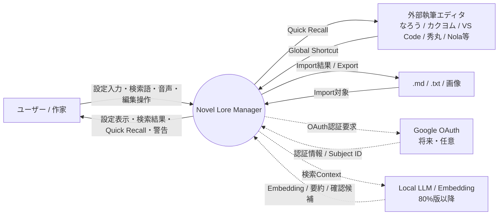

---

# 5. MVP中心フロー

```text
設定入力 / .md・.txt
        ↓
解析・検証
        ↓
PostgreSQL
        ↓
検索
        ↓
Quick Recall
        ↓
ユーザー
```

MVPの主要経路にLocal LLMを入れない。

---

# 6. DFD Level 1：MVP全体

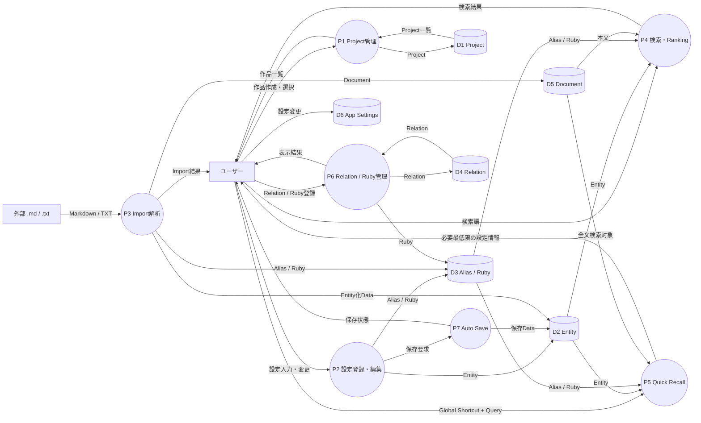

---

# 7. Data Store

## D1 Project

主な属性候補：

- project_id
- name
- genre
- cover
- description
- created_at
- updated_at

## D2 Entity

- entity_id
- project_id
- type
- name
- ruby
- description
- notes
- created_at
- updated_at

## D3 Alias / Ruby

- entity_id
- alias
- surface
- reading

## D4 Relation

- relation_id
- source_entity_id
- relation_type
- target_entity_id

## D5 Document

- document_id
- project_id
- source_path
- file_type
- content
- hash
- imported_at

## D6 App Settings

- Theme
- Font Size
- Quick Recall Shortcut
- Auto Save
- Import Folder
- Standard / Local AI Mode

---

# 8. Project作成フロー

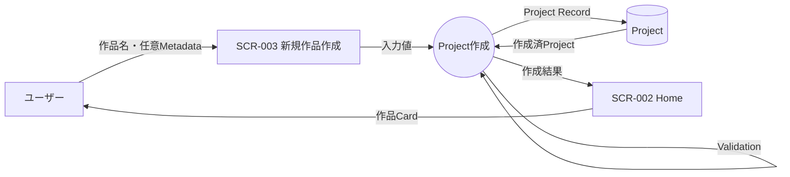

---

# 9. 設定直接登録フロー

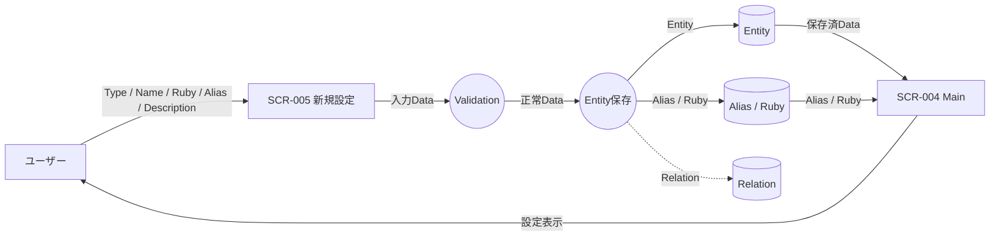

---

# 10. 設定編集 / Auto Save

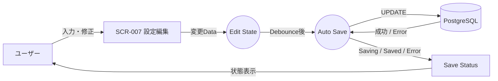

Auto Save間隔・Debounce値は基本設計で確定する。

---

# 11. Markdown / TXT Import

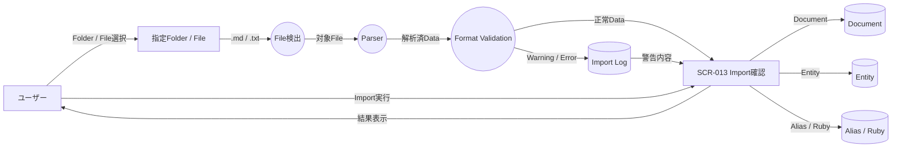

## Import保護方針

- 原本を書き換えない
- AI生成物かどうかを自動判定しない
- 不正Formatを勝手に補正して上書きしない

---

# 12. 通常検索フロー

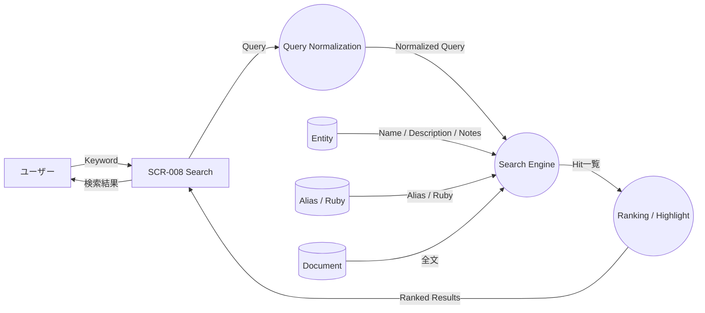

MVP検索：

- Exact
- Partial
- Alias
- Ruby
- Japanese Full Text Search

Local LLMは通さない。

---

# 13. Quick Recallフロー

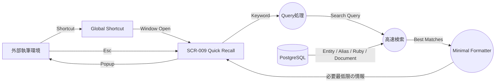

例：

```text
Query:
アリシア 武器

Return:
Entity = アリシア
Field  = Weapon
Value  = 銀月剣
```

---

# 14. Ruby検索フロー

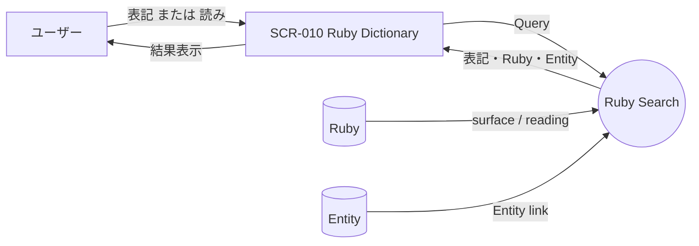

---

# 15. Relation管理フロー

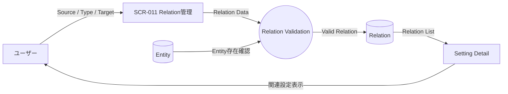

---

# 16. 60%版：Character Shelf

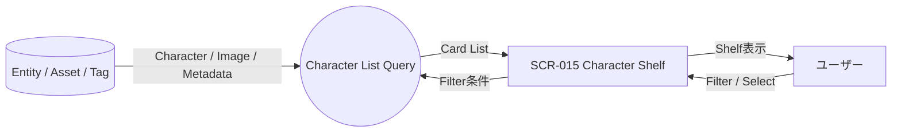

---

# 17. 60%版：Relation Graph

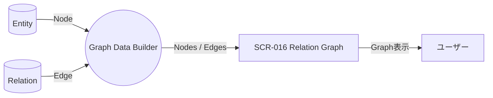

Graph専用DBはMVP必須ではない。

---

# 18. 60%版：Timeline

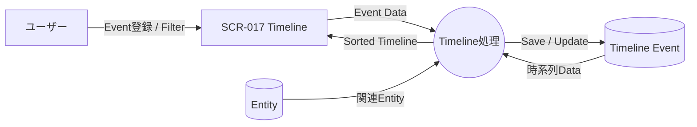

---

# 19. 60%版：伏線Tracker

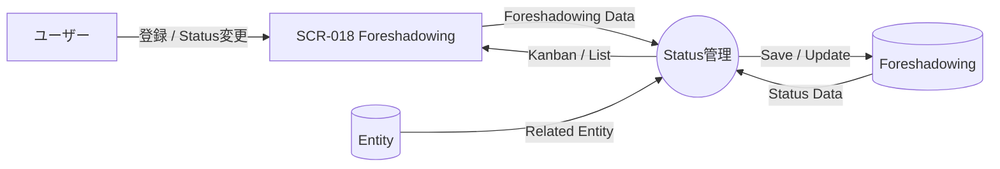

---

# 20. 60%版：World Map / Image Gallery

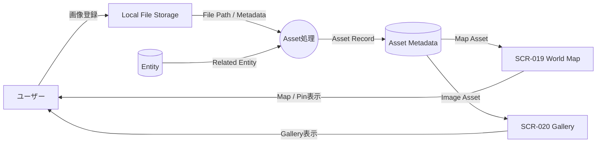

画像本体をDBへ格納するか、File Path管理とするかは未確定。

---

# 21. 60%版：Rule-based Contradiction Checker

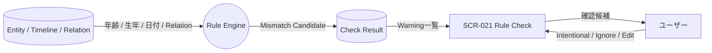

Standard Modeで動作する。

---

# 22. 60%版：Voice Recall

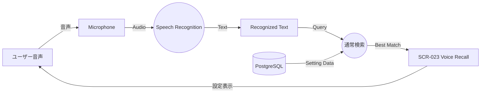

LLMは必須ではない。

---

# 23. 60%版：Backup / Export

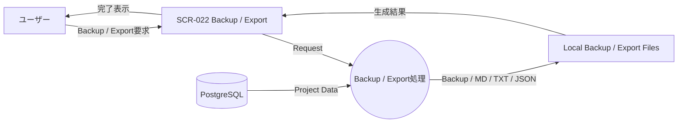

---

# 24. 80%版：Semantic Search

Semantic Searchは、文章の意味の近さで設定を探す検索。

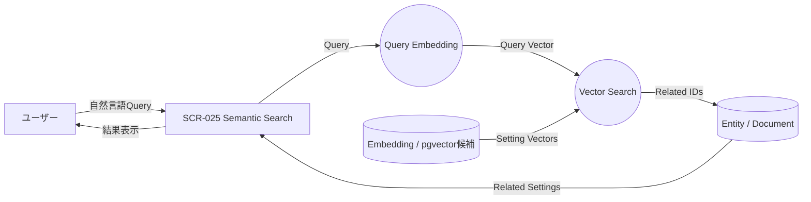

---

# 25. 80%版：Local RAG

RAGは、質問に関係する既存資料を検索してから、その資料をLLMへ渡して回答させる方式。

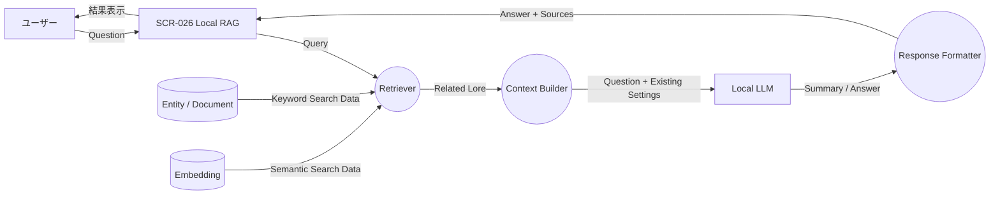

対象：

- 既存設定の検索
- 関連箇所の抽出
- 既存設定の要約

対象外：

- 本文生成
- 台詞生成
- 次話生成
- 新キャラクター生成
- 新設定の自動決定

---

# 26. 完成版：AI矛盾候補

```mermaid
flowchart LR
    DB[(Entity / Relation / Timeline)]
    RET((関連設定抽出))
    LLM[Local LLM]
    CAND((Conflict Candidate))
    UI[SCR-027 AI矛盾候補]
    U[ユーザー]

    DB -->|関連設定| RET
    RET -->|Context| LLM
    LLM -->|Possible Conflict| CAND
    CAND -->|確認候補| UI
    UI -->|表示| U
    U -->|Intentional / Edit / Ignore| UI
```

AIは矛盾を確定しない。

---

# 27. Standard Mode / Local AI Mode

```mermaid
flowchart TB
    INPUT[ユーザー操作]
    INPUT --> MODE{Mode}

    MODE -->|Standard| STD[通常処理]
    MODE -->|Local AI ON| AI[Local AI処理]

    STD --> DB[(PostgreSQL)]
    DB --> SEARCH[Exact / Partial / Alias / Ruby / FTS]
    SEARCH --> OUTPUT[結果]

    AI --> RET[Retriever]
    RET --> VDB[(Embedding)]
    RET --> DB
    RET --> LLM[Local LLM]
    LLM --> OUTPUT
```

Standard ModeではAIなしで主要機能が成立する。

---

# 28. 将来：Google OAuth

MVP対象外。

```mermaid
sequenceDiagram
    participant U as User
    participant APP as Novel Lore Manager
    participant G as Google OAuth
    participant DB as PostgreSQL

    U->>APP: Googleでログイン
    APP->>G: Authorization Request
    G->>U: Google認証画面
    U->>G: Google側で認証
    G->>APP: Authorization Code / Token
    APP->>G: User Info Request
    G->>APP: subject id / email / display name
    APP->>DB: internal user mapping保存
    APP->>U: Login完了
```

Google Passwordは取得・保存しない。

---

# 29. 将来：MCP

MCPは、外部AIクライアント等から本ツールの機能を共通形式で呼び出す仕組み。

```mermaid
flowchart LR
    C[External MCP Client]
    MCP((MCP Server))
    AUTH((Permission / Tool Check))
    SEARCH((Lore Search Service))
    DB[(PostgreSQL)]
    RES((Structured Result))

    C -->|search_lore等| MCP
    MCP -->|Tool Request| AUTH
    AUTH -->|許可済Request| SEARCH
    DB -->|Lore Data| SEARCH
    SEARCH -->|Result| RES
    RES -->|Tool Response| MCP
    MCP -->|Structured Data| C
```

---

# 30. 外部ファイルとPostgreSQLの責務

現要件の第一候補：

```text
外部Markdown / TXT
        │
        │ Import
        ▼
PostgreSQL
        │
        ├── Entity
        ├── Alias
        ├── Ruby
        ├── Relation
        └── Document
```

PostgreSQLを内部管理基盤のSource of Truth候補とする。

未確定：

- File Watch
- 双方向同期
- 外部ファイルをSource of Truthとする方式

---

# 31. データ分類とPhase

| Data | MVP | 60% | 80%〜完成 |
|---|---:|---:|---:|
| Project | ○ | ○ | ○ |
| Entity | ○ | ○ | ○ |
| Alias | ○ | ○ | ○ |
| Ruby | ○ | ○ | ○ |
| Relation | ○ | ○ | ○ |
| Document | ○ | ○ | ○ |
| App Settings | ○ | ○ | ○ |
| Tag | - | ○ | ○ |
| Timeline Event | - | ○ | ○ |
| Foreshadowing | - | ○ | ○ |
| Asset | - | ○ | ○ |
| Backup Metadata | - | ○ | ○ |
| Embedding | - | - | ○ |
| AI Check Result | - | - | ○ |
| MCP Settings | - | - | ○ |
| Account / OAuth | - | 条件付き | 条件付き |

---

# 32. AI利用情報の扱い

本ツールは投稿サイト上のAI利用区分を自動判定しない。

保持する場合の内部Metadata候補：

```text
Project AI Mode Metadata
├ Standard Mode
├ Local AI Enabled
└ Last AI Feature Used
```

ただし、このMetadataから投稿サイト上の区分を確定しない。

---

# 33. 小説家になろうへの対応

2026-09-24確認時点で、小説家になろうでは作品創作におけるAI利用状況の設定が必須。

DFD上の対応：

```text
Standard Mode
    ↓
AIを使わないシステム経路

Local AI Mode
    ↓
ユーザーが明示的にON
    ↓
Local AI処理
    ↓
AI利用を画面上で把握可能
```

本ツールは利用区分そのものを自動決定しない。

---

# 34. カクヨムへの対応

2026-05-27更新のガイドラインでは、

- AI本文利用
- AI本文一部利用
- AI補助利用

の目安が示されている。

DFD上では、

- Standard経路とAI経路を分離
- Local AIを明示的Opt-inにする
- AI処理を隠さない
- 利用区分をアプリ側で保証しない

方針とする。

---

# 35. セキュリティData Flow

```mermaid
flowchart LR
    UI[React UI]
    API[FastAPI]
    DB[(PostgreSQL)]
    FS[Local File]
    AI[Local AI]
    EXT[External Service]

    UI -->|Local Request| API
    API -->|DB Access| DB
    FS -->|Read / Import| API
    API -->|Local Context| AI
    API -.->|将来 OAuth等のみ| EXT
```

基本方針：

- 小説設定を外部AI APIへ自動送信しない
- Local AIは原則ローカル処理
- Import原本を勝手に変更しない
- Google Passwordを保存しない
- OAuth Tokenを平文保存しない

---

# 36. エラー時フロー

## Import Error

```text
File
 ↓
Parser
 ↓
Validation Error
 ↓
Import Log
 ↓
User Warning

原本 → 変更なし
```

## Save Error

```text
Edit State
 ↓
Auto Save
 ↓
DB Error
 ↓
Save Error
 ↓
ユーザー通知
```

## Search No Result

```text
Query
 ↓
Search
 ↓
0 Result
 ↓
「該当なし」
```

Local AIへ自動Fallbackしない。

---

# 37. Quick Recall性能方針

避ける構成：

```text
Shortcut
 ↓
Local LLM起動
 ↓
RAG
 ↓
生成
 ↓
表示
```

MVPで採用する構成：

```text
Shortcut
 ↓
Local Search
 ↓
DB Query
 ↓
Minimal Formatting
 ↓
表示
```

理由：

- 高速性
- 安定性
- AIなし利用
- 執筆中断時間の短縮

---

# 38. システム構成との対応

第一候補：

```text
Windows Desktop
      │
React + TypeScript
      │
Tauri 2（第一候補）
      │
FastAPI
      │
PostgreSQL
```

発展：

```text
PostgreSQL
├ PGroonga候補
│  └ Japanese Full Text Search
│
└ pgvector候補
   └ Semantic Search / RAG
```

Local AI：

```text
FastAPI
  ↓
Retriever
  ↓
llama.cpp等
  ↓
軽量Local LLM
```

---

# 39. 作家・編集者視点の批判的検証

## 強み

- 「探す」「思い出す」を中心にしたData Flow
- Quick Recallの経路が短い
- 本文生成フローが存在しない
- ルビ・Relation・Timeline等の長編向けDataが明確
- Standard Modeが独立して成立する

## リスク

### PostgreSQLと外部ファイルの二重管理

Import後に元Markdownを編集するとDBと不一致になる可能性がある。

基本設計で、

- DBを正とするか
- File Watchするか
- 双方向同期するか

を決める必要がある。

### Asset保存方式

画像をDB内Binaryで持つか、ローカルFile + Metadataで持つか未決定。

### RAGの責務肥大化

RAGへ本文生成・設定生成まで追加すると製品コンセプトが崩れる。

既存設定参照へ限定する。

---

# 40. 2028年新卒ポートフォリオ視点

評価されやすい点：

- UIだけでなくDataの責務を設計している
- MVPと将来機能の境界が明確
- Quick RecallにLLMを挟まない理由が説明できる
- Import原本と内部DBを区別できている
- Local-FirstとAI任意の設計が一貫している

面接で重要な説明：

> なぜQuick RecallをRAGにしないのか。

回答軸：

> ユーザー要求が「既存設定を数秒で確認して執筆へ戻ること」であり、LLM生成を挟むと速度・安定性・AI非利用者対応と衝突するため。

---

# 41. 未決事項

基本設計で確定する。

- Source of Truth
- File Watch方式
- Import Conflict
- Auto Save Debounce
- Search Ranking
- PGroonga正式採用
- ORM / Migration
- Asset保存方式
- Backup Format
- Voice Recognition Engine
- Embedding Model
- Vector Dimension
- Vector Index
- Chunk設計
- Retriever
- Reranking
- Local LLM Model
- FastAPI Sidecar方式
- Tauri 2 / Electron最終決定
- Google OAuthの必要性
- MCP公開範囲

---

# 42. 最終DFD要約

```text
            ┌──────────────┐
            │   ユーザー   │
            └──────┬───────┘
                   │
       ┌───────────┼────────────┐
       │           │            │
       ▼           ▼            ▼
   設定入力     .md/.txt      検索Query
       │           │            │
       ▼           ▼            │
    Validation   Parser          │
       │           │            │
       └─────┬─────┘            │
             ▼                  │
        PostgreSQL ◄────────────┘
             │
             ▼
        Search Engine
             │
      ┌──────┴─────────┐
      ▼                ▼
 Main画面         Quick Recall
                      │
                      ▼
                 執筆へ復帰
```

---

# 43. 結論

Novel Lore ManagerのMVPは、

> **入力 → 構造化 → PostgreSQL → 高速検索 → 必要最小限の参照**

を中心Data Flowとする。

Local AI / RAGは主経路を置き換えず、80%版以降の別経路として追加する。

特にQuick Recallは、

> **ユーザー → 検索 → PostgreSQL → 最小結果 → ユーザー**

という短いData Flowを維持する。

---

# 44. 参照情報

確認日：2026-09-24

## プロジェクト内部

- 企画書
- 要求分析書
- 要件定義書 v1.0
- 画面一覧
- 画面遷移図
- システム構成図
- 画面構成図 v0.3
- 本チャットでの決定事項

## 外部公式情報

- 小説家になろう「AI利用状況に関して」  
  https://syosetu.com/site/ai/

- カクヨム「カクヨムの小説投稿ガイドラインを一部変更しました」  
  https://kakuyomu.jp/info/entry/gen_ai_guideline

- カクヨム「小説投稿ガイドライン」  
  https://kakuyomu.jp/legal/guideline
