# Novel Lore Manager 機能設計書（現行モック実装ベース）

- 版：現状記録 v0.1
- 作成日：2026-11-11
- 対象：`mockups/novel-lore-manager/index.html` を起点とするブラウザ用UIモック
- 状態：**実装観察の記録**。Windows製品の確定仕様や、未承認の要件を確定する文書ではない。

## 1. 根拠と読み方

`docs/UI・UX修正設計書ver3.0.md` の「使用するファイル」に従い、現行の `index.html` とその読み込み先を確認した。要件上の位置付けは `docs/requirements.md`、`docs/data-management-design.md`、`docs/user-flows.md`、`docs/screen-specifications.md` と照合した。ver3.0で加わった内容は `js/enhancements.js`、`css/revisions.css`、`css/ver3.css` にもあるため、使用ファイル表だけで対象を打ち切っていない。

以下の「実装」はブラウザ内の操作を意味する。「模擬」は実ファイル・OS・製品データに処理が及ばないことを意味する。「未実装」は画面に候補があっても必要な処理がないことを意味する。`quick-recall.html` と `scripts/`・`styles/` は旧試作であり、本書の機能判定から除外する。

| 現行ファイル | 役割 |
|---|---|
| `index.html` | 共通のワークスペース、Quick RecallのDOM、タブ離脱ダイアログ。`js/theme-manager.js`を読み込む |
| `js/theme-manager.js` | 6件の初期資料、画面状態、資料タブ、Markdown編集・保存、Quick Recall、テーマ切替の起点 |
| `js/flows.js` | 作品画面、初回資料作成、検索、ルビ辞書、取り込み、保管庫、画面遷移 |
| `js/enhancements.js` | ver3起動画面、幅調整、Markdownガイド、ルビ入力補助、Quick Recall内の追加機能 |
| `js/search.js` / `js/markdown.js` / `js/ruby.js` / `js/import-wizard.js` | 検索条件、限定Markdown表示、ルビ表示例、取り込み手順 |
| `css/base.css`、`layout.css`、`components.css`、`flows.css`、`revisions.css`、`ver3.css` | 共通の表示・画面追加・ver3表示 |
| `css/themes/*.css` | Forest Workbench / Storybook Atelier / Quiet Lore Studio の視覚テーマ |
| `preview.mjs` | `127.0.0.1:4173` のローカル静的配信。外部APIサーバーではない |

## 2. 現在の画面の画像

スタート画面：
 - 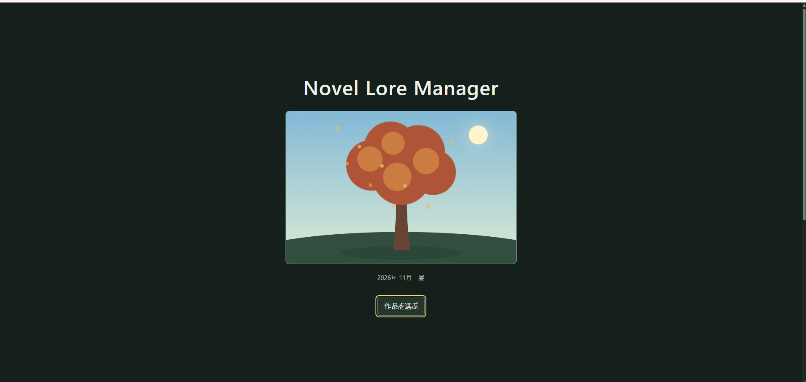
作品作成・選択画面：
 - 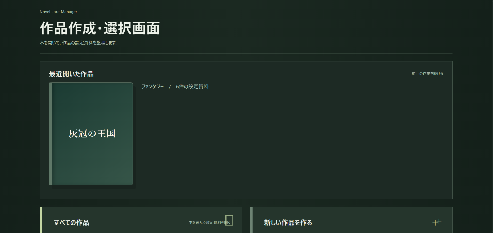
 - 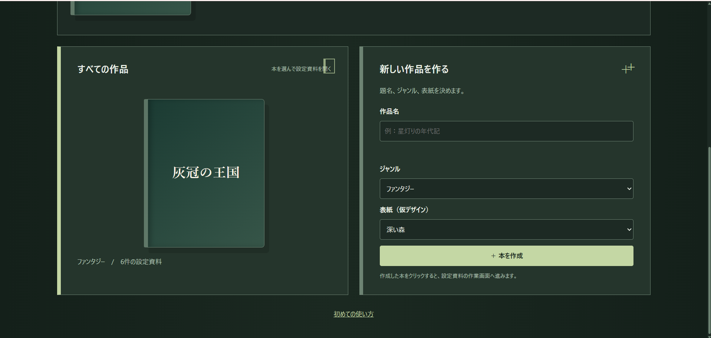
 - 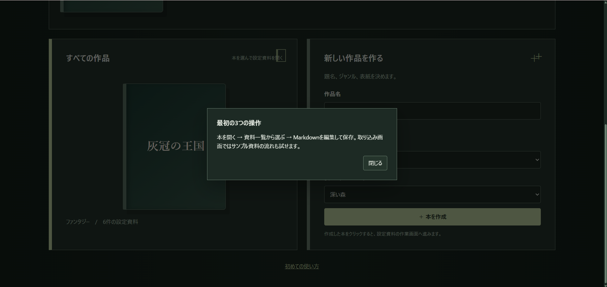

**注意**：
 説明：
 - ここの画面は作品作成・選択画面のデザインをこれに変更して欲しい時の見本画像。
 - 現在の作品作成・選択画面の機能は残しつつ、下記2つの画像を元に修正して欲しい時の画像。

 - 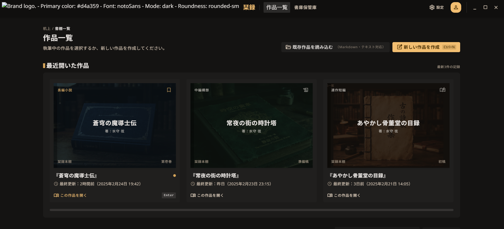
 - 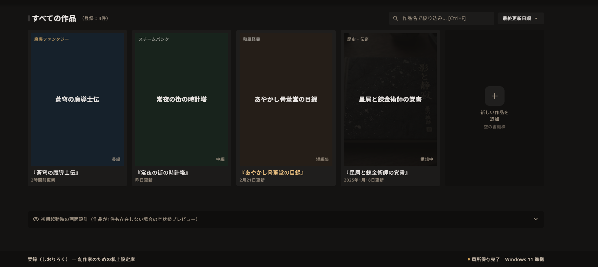

 - 
 - 

作品内検索画面：
 - 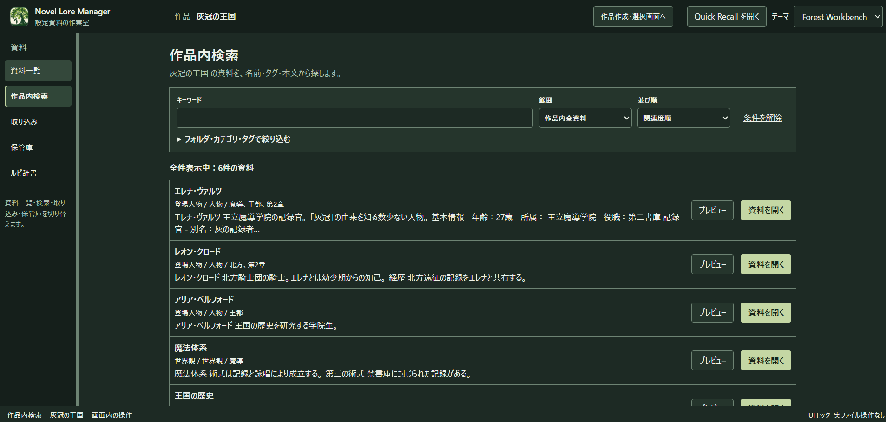

取り込み画面：
 - 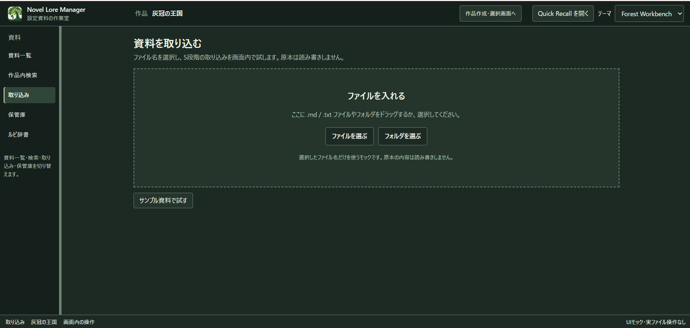
 - 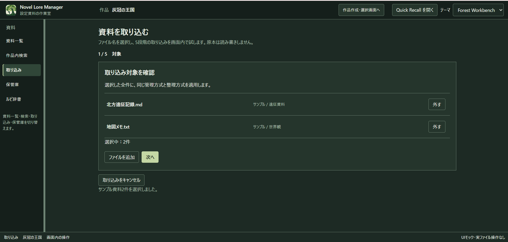
 - 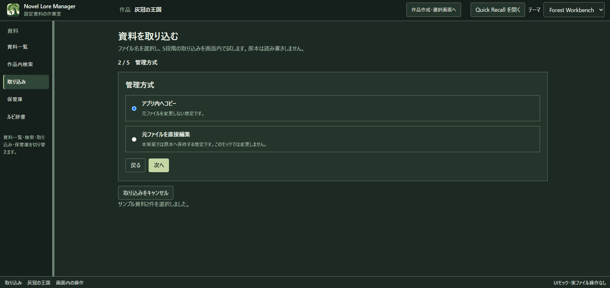
 - 
 - 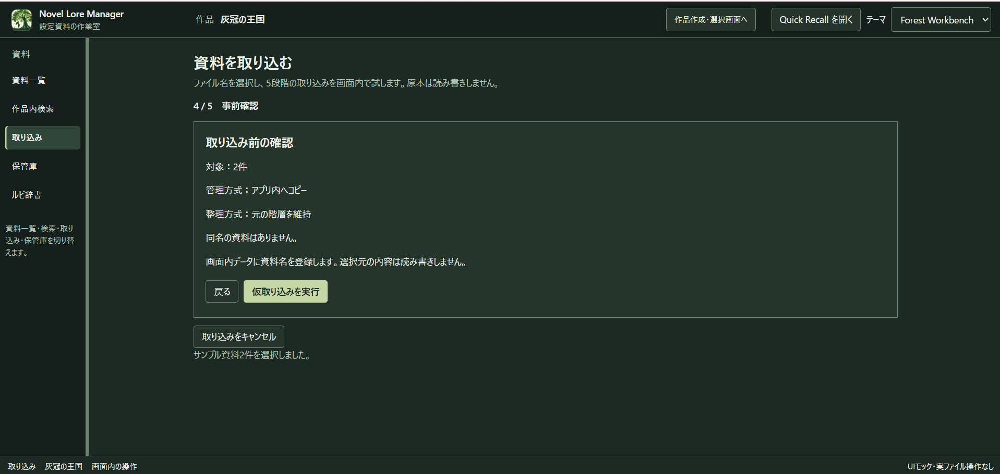
 - 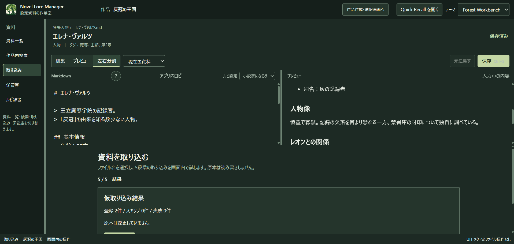
 - 

保管後画面：
 - 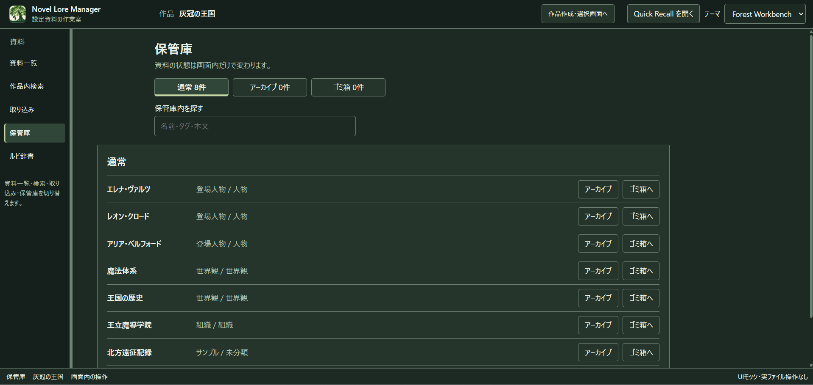 

ルビ辞書・一覧画面：

 - 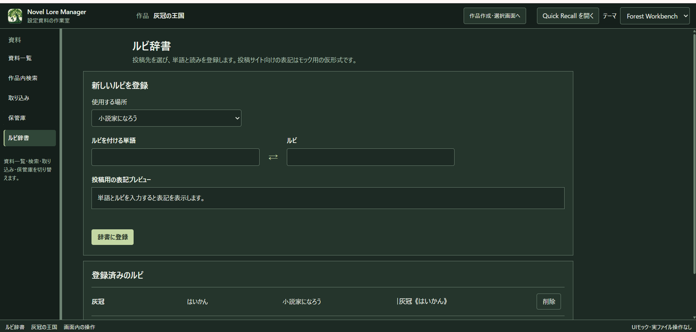

Quick Recall画面：
 - 
 - 
 - 
 - 
 - 

## 2. 実行境界とデータ

- 技術はHTML5、CSS3、Vanilla JavaScriptのES Modules。画面は同じDOMと操作コードを使い、テーマCSSを切り替える。
- 初期作品名は「灰冠の王国」。初期資料は人物3件、世界観2件、組織1件の計6件。各資料には `id`、表示名、フォルダ、主カテゴリ、タグ、別名、関連資料ID、概要、本文、保存済み本文、Undo履歴、状態、管理方式を持たせる。
- 資料本文・作品名・ルビ辞書・メモ・取り込み結果・保管庫状態はページ内メモリにある。再読み込みで初期化される。**テーマ選択だけ** `localStorage` の `nlm-theme` に保存され、同一オリジンの別窓にも `storage` イベントで反映される。
- 選択したファイルは名前と `webkitRelativePath` のみ参照し、内容を読み書きしない。保存、削除、復元、DIRECT管理方式はすべてUI上の模擬処理。
- `fetch`、XHR、WebSocket等の外部API呼び出しは現行の対象JSにない。プレビューはループバックアドレスへの静的配信を使う。Markdown内の `http(s)` リンクはクリックすると通常の外部ページへ遷移し得るが、資料をAPIに送る機能ではない。

## 3. 画面と遷移

| 画面・ビュー | 到達経路 | 主な次画面・操作 | 状態 |
|---|---|---|---|
| 起動画面 | 通常の `index.html` 起動時 | 「作品を選ぶ」→作品作成・選択画面 | 実装 | 
| 作品作成・選択（SCR-01） | 起動後、上部の戻るボタン | 既存作品→資料一覧、新規作品→最初の設定資料 | 模擬 | 
| 最初の設定資料（SCR-01/02） | 新規作品の表紙を開く | 資料作成→作品内検索 | 模擬 |
| 資料一覧・編集（SCR-02/03） | 作品選択、左レール、検索結果 | 資料切替、編集、関連資料、各専用ビュー | 実装・保存は模擬 |
| 作品内検索（SCR-04） | 左レール、`Ctrl+F` | プレビュー→資料を開く | 実装 |
| 取り込み（SCR-05） | 左レール、Quick Recall内 | 5段階ウィザード→結果→資料一覧 | 模擬 |
| Quick Recall（SCR-06） | 上部ボタン、`index.html?recall=1` | 検索、概要／詳細、編集、メモ、ルビ、取り込み、保管庫 | 実装・別窓同期は未実装 |
| 初回ガイド（SCR-07の一部） | 作品画面の「初めての使い方」 | 3操作の説明ダイアログ | 一部実装 |
| 保管庫（SCR-08） | 左レール、Quick Recall内 | 通常／アーカイブ／ゴミ箱、復元 | 模擬 |
| ルビ辞書 | 左レール、Quick Recall内 | 登録、一覧、削除、検索・表示 | 模擬 |

左レールの検索・取り込み・保管庫・ルビ辞書はワークスペース中央の専用ビューを切り替える。作品画面へ戻る際は未保存資料に対して保存・破棄・キャンセルを提示する。通常のレール切替ではこの確認を通さない。

## 4. 機能詳細

### 4.1 起動・作品

| ID | 現行動作 | 制約・状態 |
|---|---|---|
| F-01 | 起動時にアプリ名と木を表示し、ボタンで作品画面へ進む。ローカル端末の月で春／夏／秋／冬、時刻で朝／昼／夕／夜を決め、SVGとCSSの表現を変える | 外部時刻・天候APIは使わない。季節と時刻は起動時に一度判定 |
| F-02 | 最近開いた作品、すべての作品、本の表紙、作品作成フォームを表示する。作品名必須、ジャンルと表紙を選択する | 作品作成は表示名・ジャンル・表紙のメモリ内変更。既存資料配列を作品別に分離しない |
| F-03 | 新規作品の本を開くと最初の設定資料フォームへ進む。資料名の空欄・同名を検査し、カテゴリとMarkdown内容から資料を1件追加する | 追加後は検索画面に進む。新規資料に専用の作品IDや実ファイルはない。既存6件も共通配列に残る |
| F-04 | 「初めての使い方」で本を開く・資料選択・編集保存の3操作を案内する | 詳細チュートリアル、設定専用画面はない |

### 4.2 資料一覧・編集

| ID | 現行動作 | 制約・状態 |
|---|---|---|
| F-05 | フォルダとカテゴリの両方から通常状態の資料を選択する。フォルダは展開／折り畳み、カテゴリは選択時に配下を表示する | フォルダは登場人物／世界観／組織の固定領域。任意の階層管理・カテゴリ編集はない。地理カテゴリはあるが地理用フォルダ領域はない |
| F-06 | 資料IDを使ってタブを追加・選択・閉じる。関連資料ボタンと `[[資料名]]` リンクから同じ資料を開く | リンク解決は表示名の完全一致。名前変更や参照切れ対策はない |
| F-07 | 編集／プレビュー／左右分割を切り替える。分割時、右側に別の開いている資料を選べる。区切りはポインターと左右キーで幅調整可能 | 右側は参照表示で編集欄は左側の選択資料。パネルの自由配置はない |
| F-08 | テキストエリアの入力を資料の `content` に反映し、`saved` との差で「未保存」を表示する。保存ボタン／`Ctrl+S` は `saved` を更新する | ディスク保存・自動保存・保存失敗状態はない。ページ再読み込みで変更は消える |
| F-09 | 入力前の本文を資料ごとの履歴に最大100件積み、Undoボタン／編集欄での `Ctrl+Z` で1件戻す | Redoや永続履歴はない。ルビ候補挿入も履歴に加える |
| F-10 | 未保存タブの閉鎖時に保存して閉じる／破棄して閉じる／キャンセルを表示する。作品画面へ戻る時は未保存資料全件を確認する。ページ離脱時はブラウザの警告を要求する | ブラウザ警告の文言・表示はブラウザに依存。画面内のすべての遷移に同じ離脱確認があるわけではない |
| F-11 | Markdownガイドに入力例とプレビュー例を表示する | 記法は限定的。生HTMLはエスケープして文字として表示する |

Markdown表示対象は見出し1～6、引用、箇条書き、番号付きリスト、水平線、太字、斜体、インラインコード、`[[資料名]]`、`｜語《読み》`、HTTP(S)リンク。画像、任意HTML、完全なMarkdown仕様には対応しない。

### 4.3 検索・ルビ

| ID | 現行動作 | 制約・状態 |
|---|---|---|
| F-12 | 通常状態の資料を、タイトル・明示した別名・タグ・本文の部分一致で検索する。NFKC正規化と日本語ロケールの小文字化を適用する | 漢字の読み推定、形態素解析、一般的な表記ゆれ解決、作品横断検索はない |
| F-13 | 範囲を全資料／現在資料から選び、フォルダ・カテゴリ・タグで絞る。名前順、または初期配列順の「関連度順」を選ぶ | 関連度スコア計算はない。資料の状態が通常以外なら検索対象外 |
| F-14 | 件数、本文抜粋、単純一致の強調、結果プレビュー、資料を開く操作、0件表示、条件解除を提供する | ハイライトは簡易な文字位置処理。検索結果内の資料プレビューは現時点のメモリ本文を使う |
| F-15 | ルビ辞書に単語・読み・投稿先を登録、一覧・削除する。編集欄で登録語の直後に候補を表示し、Tabまたはクリックで挿入する。複数候補時はコンテキストメニューで選ぶ | 辞書はメモリのみ。投稿サイト別記法は表示例で、正確な変換規則・出力機能は未確定 |

### 4.4 取り込み

| ID | 段階 | 現行動作 |
|---|---|---|
| F-16 | 対象 | `.md`／`.txt` のファイルまたはフォルダ選択、ドラッグ投入、サンプル2件を受け付ける。拡張子で選別し、同じパスの重複を外す。名前と相対パスのみ使用 |
| F-17 | 管理方式 | 選択対象全件に「アプリ内へコピー」または「元ファイルを直接編集」の想定を指定 |
| F-18 | 整理方式 | 「元の階層を維持」または「カテゴリ別に整理」の想定を指定 |
| F-19 | 事前確認 | 対象件数・両方式・同名スキップ候補を表示。現行の同名判定は拡張子を除いたタイトルの一致 |
| F-20 | 結果 | 仮実行で資料名と固定のダミー本文を配列に追加し、登録／スキップ件数と失敗0件を表示。途中キャンセルと戻る操作を提供 |

実ファイルの内容、文字コード、改行、アクセス権を検査せず、コピー・DIRECT書き込み・実フォルダ作成を行わない。取り込み資料のフォルダ文字列は選択元の相対パスから作るが、固定の資料一覧ツリーには新規フォルダを動的に増やさない。サンプル2件は現在の初期6件と同名でないため、初期状態では2件とも登録される。

### 4.5 Quick Recall

| ID | 現行動作 | 制約・状態 |
|---|---|---|
| F-21 | 上部ボタンから `index.html?recall=1` を約420×560のブラウザ別窓で開く。ポップアップ不可なら同一ページの小窓を表示する | 常時最前面、OS全域ショートカット、ネイティブ最小化はない |
| F-22 | 通常資料をタイトル・別名・タグ・本文で絞り、概要、詳細Markdown、資料編集欄を切り替える | 別窓は独立して初期データを読み込むため、メイン画面と本文を同期しない。同一ページ小窓のみ同じメモリを参照する |
| F-23 | 簡易メモを入力して保存済み／未保存を表示する。閉じる際に未保存メモを確認する | メモはページ内メモリのみ。別窓との共有・永続化はない |
| F-24 | 概要／設定検索／簡易メモ／ルビ検索・表示／取り込み／保管庫をタブ状に切り替える。取り込みは共通ウィザード、保管庫は各資料の状態表示とアーカイブ／復元を使う | Quick Recall内の保管庫にはゴミ箱へ送る操作がない。未保存資料のアーカイブは保存を促す表示に留まる |
| F-25 | 閉じる・最小化相当のボタンで表示を終える | 両ボタンは同じ非表示処理。別窓で `window.close()` ができない場合は `index.html` へ移動する |

### 4.6 保管庫・テーマ

| ID | 現行動作 | 制約・状態 |
|---|---|---|
| F-26 | 保管庫に通常／アーカイブ／ゴミ箱を分け、名前・タグ・本文の検索と件数、空状態を表示する | 状態変更はメモリのみ。完全削除はない |
| F-27 | 通常資料をアーカイブまたはゴミ箱へ移す際に確認し、未保存なら保存／破棄／キャンセルを選ぶ。移動後は通常ツリーとタブから外し、保管庫から通常へ復元できる | 実ファイル削除・移動はない。復元時の同名・パス衝突検査はない |
| F-28 | 上部セレクタで3テーマを切り替え、選択をブラウザに保持する。3テーマは共通HTML・JS・資料データを使用する | 本文や資料の保存とは異なり、テーマ設定だけ永続化される |

## 5. エラー・空状態・アクセシビリティ

- 作品名・最初の資料名の空欄、資料名の重複、検索0件、保管庫0件、未対応拡張子、未保存離脱を画面上で扱う。取り込み失敗は結果欄で常に0件と表示するだけで、失敗経路はない。
- `label`、`role="status"`／`role="alert"`、`aria-expanded`、`aria-pressed`、スキップリンク、ダイアログ、幅調整用セパレータのキーボード操作を用意している。実際の読み上げ品質と全解像度の表示は本書で検証済みとは扱わない。
- `Ctrl+F` は通常画面で作品内検索へ、`Ctrl+S` は表示中の編集またはQuick Recallのメモ／資料保存へ割り当てる。OS全域のショートカットではない。

## 6. 要件との差・次段階の未決事項

| 領域 | 現行モックとの差・判断が必要な点 |
|---|---|
| 作品分離 | 新規作品作成は名前の切替で、資料は単一配列を共用する。作品ごとの独立管理と横断の境界は未実装 |
| 資料構造 | フォルダ・カテゴリは固定表示が中心。任意階層、カテゴリ編集、主カテゴリ変更、タグ編集は未実装 |
| 保存と原本 | ディスク保存、COPY／DIRECTの実処理、バックアップ、復旧、外部変更検知、競合処理は未実装 |
| 取り込み | 内容を読み込まないため、TXTの原文保持や文字コード・拡張子の扱いは検証できない。同名判定はタイトル単純一致 |
| Quick Recall | 別窓とメイン画面の同時編集・メモ共有は未実装。最前面やグローバルショートカットもブラウザでは保証できない |
| 検索・ルビ | 関連度順は配列順。表記ゆれ推定、ルビ読みによる資料検索、投稿サイト別の確定変換規則は未実装／未決 |
| 画面品質 | 実ブラウザでの1366×768／1440×900／1920×1080の操作・コントラスト・読み上げ検証は別途必要 |

この表は製品要求の削除や採用を決めるものではない。`requirements.md` 等で `OPEN`／`PROVISIONAL`／`FUTURE` とされる事項はそのまま維持する。

## 7. 確認方法と検証範囲

本書は上記ソースの静的読解に基づく。2026-11-11に `node mockups/novel-lore-manager/tests/smoke.mjs` を実行し、通過した。このテストは検索の基本条件、MarkdownのHTMLエスケープ、ルビ表示例、共通テーマ資産を検査する。ブラウザの全画面遷移、別窓挙動、実ファイル保護、各解像度の目視を自動的に保証するテストではない。

ローカル確認時は `mockups/novel-lore-manager` で `node preview.mjs` を実行し、`http://127.0.0.1:4173/` を開く。Quick Recallの現行単独画面は `index.html?recall=1`。`preview.mjs` が表示する `quick-recall.html` の案内は旧試作を指すため、現行機能のURLとして採用しない。

## 8. ver3.0修正指定との追加照合：未実装・未再現部分

`docs/UI・UX修正設計書ver3.0.md` の「修正して欲しいところ」を、現行の `js/enhancements.js`、`js/flows.js`、`css/ver3.css`、読み込み元の `index.html` と照合した。画像は `mockups_imagever2.0/スタート画面.png`、`作品作成画面.png`、`作品作成画面2.png` を参照した。設計書に記載された `作品作成画面1.png` という名前のファイルは見当たらず、`作品作成画面.png` を対応する1枚目として扱った。以下は**ソースと参照画像の差分**であり、画像だけに描かれた操作を承認済みの機能要件に変更するものではない。

### 8.1 スタート画面

ver3.0で明記された、起動画面のアイコン非表示、アプリ名の下の木、朝・昼・夕・夜の背景色、春の桜・夏の緑・秋の紅葉・冬の雪をかぶったクリスマスツリーは、`js/enhancements.js` と `css/ver3.css` に実装がある。木は外部画像の取得ではなくローカルSVG描画で、時刻・季節は起動時の端末日時で決まる。この範囲に、ソース上で確認できる**未実装項目はない**。参照画像にあるアプリアイコンは、ver3.0の「スタート画面でアイコンの表示は無し」という文章指定に従って起動画面には表示しない。`index.html` のファビコンと、起動後のワークスペース上部にあるアイコンは別の表示箇所である。

### 8.2 作品作成・選択画面

| 差分 | 現行モックの状態 | 判定・根拠 |
|---|---|---|
| 「最近開いた作品」の実履歴 | 現在選択中の `projectName` を常に1件表示する。開いた順序・日時・件数を記録せず、再読み込みで初期化する | **未実装**。`js/flows.js` の `renderProject()` は `recentBook` を1件生成するだけ。画像の「最近3件の記録」のような履歴表示は再現していない |
| 複数作品を本棚から選ぶ体験 | 初期状態は「灰冠の王国」1件。新規作成後も、現在の作品と初期作品の最大2冊を表示する。資料は作品別に分離されない | **一部実装**。表紙を押して画面移動できるが、画像のような複数の独立作品を保持・選択する動作はない。作品分離は第6節にも記載 |
| 参照画像のカード表現と情報 | `css/ver3.css` で本型の表紙、最近開いた作品の棚、既存作品と作成フォームの二分割を表示する。一方、表紙画像、更新日時、進行状態などを含むカードは生成しない | **デザイン未再現**。`renderProject()` が生成するメタ情報はジャンルと資料件数のみ。画像の細部は視覚参照であり、メタデータの正式仕様は未決 |
| 「すべての作品」の検索・並び替え | 作品一覧専用の検索欄、絞り込み、更新日順セレクタはない | **画像内の操作は未実装**。`js/flows.js` の検索は作品内の資料検索であり、作品一覧検索ではない。ver3.0本文は画像へのデザイン変更を求めており、これらの操作仕様までは明記していない |
| 参照画像にある作成・読み込み導線 | 現行画面では右側フォームで作品名・ジャンル・表紙を入力し、「本を作成」で現在作品名を切り替える。画像の「新しい作品を追加」タイルや「既存作品を読み込む」ボタンはない | **画像と導線が異なる**。既存の作成機能は残っている。作品ファイルの読み込み処理は未実装で、ver3.0の文章から追加機能として確定しない |
| 作品0件の空状態 | 初期作品が常に1件あり、作品を0件にする操作もない | **未実装**。`docs/screen-specifications.md` のSCR-01／ST-01で求める空状態を、この画面では試せない。画像2の空状態プレビューも表示しない |

ver3.0本文で指定された画面名「作品作成・選択画面」、既存の色を使うこと、および既存機能の維持は、現在の見出し・テーマ変数・作品フォームのコードに反映されている。上表の画像由来の要素を実装する場合は、作品の独立性、履歴・更新日時のデータ定義、作品読み込みの範囲を先に決める必要がある。ここでは未決事項の採用やソースコードの変更は行っていない。

### 8.3 検証上の限界

本節の判定はソース読解と参照画像の目視による。実ブラウザでの各テーマ・各解像度のスクリーンショット比較や操作確認は実施していないため、色・間隔・アニメーションの視覚的一致まで保証しない。この照合で外部API通信、実ファイルの読み書き、取り込み・削除は行っていない。

