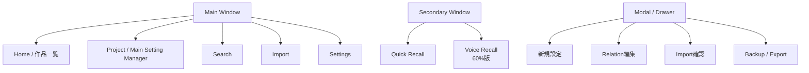
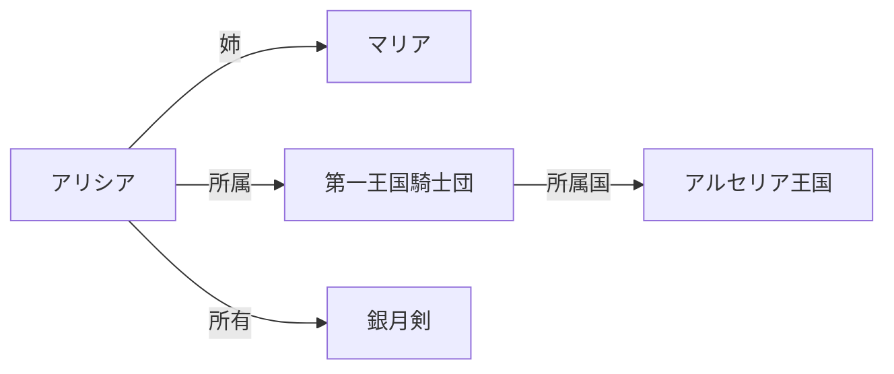
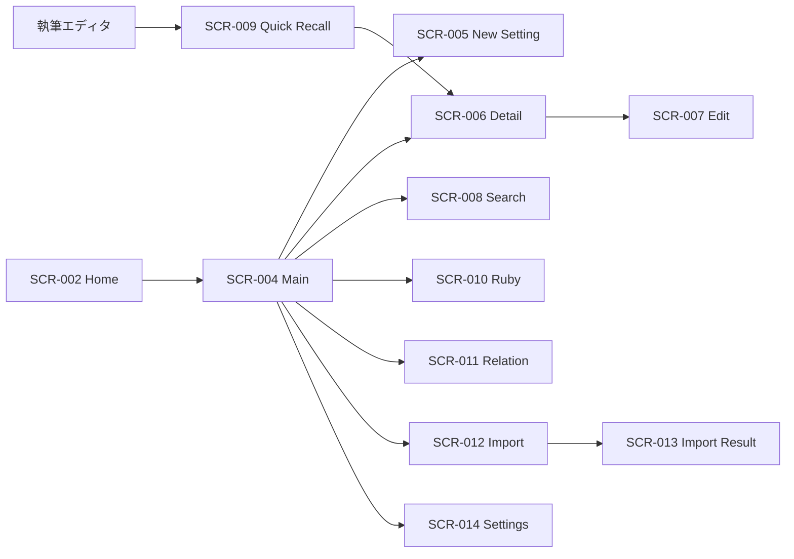
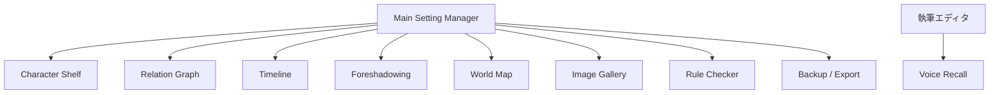

# Novel Lore Manager 画面構成図 v0.3

作成日：2026-09-24  
対象：Windows デスクトップアプリ  
基準資料：企画書 / 要求分析書 / 要件定義書 / 画面一覧 / 画面遷移図 / システム構成図

---

# 1. 目的

本資料は、Novel Lore Manager の各主要画面について、

- 画面内の領域
- 配置するUI要素
- 主な操作
- 画面間で共通化する領域
- MVP / 60%版 / 完成版の境界

を定義するための画面構成図である。

本アプリは「本文執筆」ではなく、**設定の保存・整理・検索・参照**を目的とする。

最重要UXは以下の順とする。

1. Quick Recall
2. Main Setting Manager
3. Search
4. Setting Detail
5. Home / Shelf

---

# 2. 全体UI構成



## 画面共通方針

- Main Window は基本1つ
- Quick Recall は独立した小型Window
- Voice Recallは60%版で独立Window
- 新規作成や設定編集の一部はModal / Drawer化を検討
- 画面数は論理的には多いが、物理Window数は増やしすぎない
- Standard ModeではAI機能を前面に出さない

---

# 3. SCR-002 Home / 作品一覧

## 3.1 目的

ユーザーが管理している作品を視覚的に選択する。

Mint Complete Shelf の「棚からコレクションを選ぶ」という体験を参考にするが、
レイアウトやグラフィックは独自設計とする。

## 3.2 構成図

```text
┌────────────────────────────────────────────────────────────┐
│ Header                                                     │
│ [Logo] Novel Lore Manager          [Search] [Settings]     │
├────────────────────────────────────────────────────────────┤
│                                                            │
│  My Worlds                                  [+ New Project] │
│                                                            │
│  ┌─────────────┐  ┌─────────────┐  ┌─────────────┐        │
│  │ Cover       │  │ Cover       │  │ Cover       │        │
│  │             │  │             │  │             │        │
│  │ 白銀の魔女  │  │ NanoBlade   │  │ Project C   │        │
│  │ Fantasy     │  │ VRMMO       │  │ SF          │        │
│  │ 142 Lore    │  │ 328 Lore    │  │ 89 Lore     │        │
│  │ Updated     │  │ Updated     │  │ Updated     │        │
│  └─────────────┘  └─────────────┘  └─────────────┘        │
│                                                            │
│  Recent Projects                                           │
│  ────────────────────────────────────────────────────────  │
│                                                            │
└────────────────────────────────────────────────────────────┘
```

## 3.3 表示項目

### Header
- Logo / App Name
- Global Search
- Settings
- 将来：Account

### Project Card
- Cover Image
- Title
- Genre
- 設定数
- Character数
- 最終更新
- Favorite

### Main Action
- New Project
- Project Open

---

# 4. SCR-004 Main Setting Manager

## 4.1 目的

設定管理の中心画面。

**Explorer / Setting Detail / Relation & Metadata の3Pane構成**を基本とする。

## 4.2 構成図

```text
┌──────────────────────────────────────────────────────────────────────────┐
│ Top Bar                                                                  │
│ [← Home] [Project: 白銀の魔女] [Search] [Import] [+ New] [Settings]     │
├───────────────┬───────────────────────────────────┬──────────────────────┤
│ LEFT PANE     │ CENTER PANE                       │ RIGHT PANE           │
│ Explorer      │ Setting Detail                    │ Relation / Metadata  │
│               │                                   │                      │
│ ▼ Characters  │ アリシア                          │ Relations            │
│   ├ Alicia    │ ────────────────────────────────  │ ・姉 → マリア        │
│   ├ Maria     │ [Image]                           │ ・所属 → 王国騎士団  │
│   └ Luna      │ Name : アリシア                  │                      │
│               │ Ruby : ありしあ                  │ Tags                 │
│ ▼ Countries   │ Age  : 19                        │ [Knight] [Ice]       │
│   └ Kingdom   │ Race : Human                     │                      │
│               │ Organization : 王国騎士団        │ Alias                │
│ ▼ Magic       │                                   │ ・姫騎士             │
│ ▼ Items       │ # 概要                            │                      │
│ ▼ Events      │ 王国騎士団所属...                │ Backlinks            │
│               │                                   │ ・Chapter 01         │
│               │ # 武器                            │ ・War Event           │
│               │ 銀月剣                            │                      │
│               │                                   │ Metadata             │
│               │                                   │ Updated: 12:30       │
├───────────────┴───────────────────────────────────┴──────────────────────┤
│ Status Bar: Saved / Standard Mode / File Watch Status                   │
└──────────────────────────────────────────────────────────────────────────┘
```

## 4.3 LEFT PANE：Explorer

### MVP
- Character
- Country
- Organization
- Location
- Item
- Other

### 将来
- Race
- Magic
- Skill
- Religion
- Creature
- Event
- Custom Category

### 操作
- Expand / Collapse
- Entity Select
- New Entity
- Context Menu
- Favorite表示

## 4.4 CENTER PANE：Setting Detail

### View Mode
- 設定閲覧
- Entity Type
- Image
- 基本項目
- Markdown本文
- 関連情報へのリンク

### Edit Mode
- Name
- Ruby
- Alias
- Description
- Notes
- Entity固有項目

### 状態表示
- Saving...
- Saved
- Save Error

## 4.5 RIGHT PANE：Relation / Metadata

### MVP
- Relation
- Alias
- Metadata

### 60%版
- Tag
- Backlink
- Favorite
- Recent Link

---

# 5. SCR-005 設定新規作成

```text
┌────────────────────────────────────────────┐
│ 新規設定作成                         [×]   │
├────────────────────────────────────────────┤
│ Entity Type                               │
│ [ Character ▼ ]                           │
│                                            │
│ Name *                                     │
│ [____________________________]             │
│                                            │
│ Ruby                                       │
│ [____________________________]             │
│                                            │
│ Alias                                      │
│ [____________________________] [+ Add]      │
│                                            │
│ Tags                                       │
│ [ Knight ] [ Kingdom ] [+ Add]             │
│                                            │
│ Description                                │
│ [                                      ]   │
│ [                                      ]   │
│                                            │
│               [Cancel] [Create]            │
└────────────────────────────────────────────┘
```

---

# 6. SCR-006 Setting Detail

```text
┌───────────────────────────────────────────────┐
│ アリシア             ☆ Favorite  [Edit] [...] │
├───────────────────────────────────────────────┤
│ [Character Image]                             │
│                                               │
│ Name          アリシア                        │
│ Ruby          ありしあ                        │
│ Alias         姫騎士                          │
│ Age           19                              │
│ Race          Human                           │
│ Organization  第一王国騎士団                  │
│ Weapon        銀月剣                          │
│                                               │
│ [概要] [関連] [メモ] [履歴 ※将来]            │
│ ────────────────────────────────────────────  │
│ 第一王国騎士団に所属する騎士。                │
│ ...                                           │
└───────────────────────────────────────────────┘
```

---

# 7. SCR-007 Setting Edit

```text
┌──────────────────────────────────────────────────────┐
│ アリシアを編集                  Saved ✓  12:30       │
├──────────────────────────────────────────────────────┤
│ Name      [ アリシア____________________________ ]   │
│ Ruby      [ ありしあ____________________________ ]   │
│ Alias     [ 姫騎士______________________________ ]   │
│                                                      │
│ Description                                          │
│ ┌──────────────────────────────────────────────────┐ │
│ │ Markdown / Rich Text Editor                      │ │
│ │                                                  │ │
│ └──────────────────────────────────────────────────┘ │
│                                                      │
│ Relation                       [+ Add Relation]       │
│ 姉 → マリア                                          │
│ 所属 → 第一王国騎士団                                │
│                                                      │
│ [Delete]                                  [Close]    │
└──────────────────────────────────────────────────────┘
```

- Auto Save
- `Saving... / Saved / Error`
- Pencil Soundは完成版

---

# 8. SCR-008 Full Text Search

```text
┌──────────────────────────────────────────────────────────────┐
│ Search                                                       │
├──────────────────────────────────────────────────────────────┤
│ [ 王国 騎士団___________________________________ ] [Search]  │
│                                                              │
│ Filters                                                      │
│ Entity: [All ▼]   Tag: [All ▼]   Favorite: [ ]              │
│                                                              │
├───────────────────────┬──────────────────────────────────────┤
│ Results (18)          │ Preview                              │
│                       │                                      │
│ ● アリシア            │ アリシア                             │
│   Character           │ 王国騎士団所属...                   │
│                       │                                      │
│ ● 第一王国騎士団      │ Related                             │
│   Organization        │ ・アリシア                           │
│                       │ ・王国                               │
│ ● 王国                │                                      │
│   Country             │ [Open Detail]                       │
└───────────────────────┴──────────────────────────────────────┘
```

### MVP Search
- Exact
- Partial
- Alias
- Ruby
- Full Text

### 80%版
- Semantic Search

---

# 9. SCR-009 Quick Recall

最重要画面。

```text
        Ctrl + Shift + Space

┌───────────────────────────────────────────┐
│ 🔎 [ アリシア 武器____________________ ] │
├───────────────────────────────────────────┤
│ アリシア                                  │
│ Character                                 │
│                                           │
│ 武器    銀月剣                            │
│ 属性    氷                                │
│                                           │
│ ↑↓ Select   Enter Detail   Esc Close      │
└───────────────────────────────────────────┘
```

UX要件：

- Always on Top
- Focus自動取得
- 500ms以内表示を目標
- Keyboard Only対応
- Main Windowを前面化しない
- 不要情報を表示しすぎない
- Standard ModeではLLMを使用しない

---

# 10. SCR-010 Ruby Dictionary

```text
┌──────────────────────────────────────────────────────┐
│ Ruby Dictionary                                      │
├──────────────────────────────────────────────────────┤
│ [ ラグナロク____________________________ ] [Search]  │
│                                                      │
│ 表記             Ruby            Entity Type         │
│ ───────────────────────────────────────────────────  │
│ 終焉魔導         ラグナロク      Magic               │
│ 月影王国         ルナリア        Country             │
│ 神聖天剣         セレスティア    Weapon              │
│                                                      │
│                                      [+ New Ruby]    │
└──────────────────────────────────────────────────────┘
```

---

# 11. SCR-011 Relation Manager

```text
┌───────────────────────────────────────────────┐
│ Relation追加                                  │
├───────────────────────────────────────────────┤
│ Source                                        │
│ [ アリシア ▼ ]                                │
│                                               │
│ Relation Type                                 │
│ [ 姉 ▼ ]                                      │
│                                               │
│ Target                                        │
│ [ マリア ▼ ]                                  │
│                                               │
│                  [Cancel] [Add Relation]      │
└───────────────────────────────────────────────┘
```

---

# 12. SCR-012 Import

```text
┌──────────────────────────────────────────────────────┐
│ Import                                               │
├──────────────────────────────────────────────────────┤
│ Import Source                                        │
│ (●) Folder   ( ) File                                │
│                                                      │
│ C:\Novel\Settings                         [Browse]    │
│                                                      │
│ Detected Files                                       │
│ ☑ alice.md                                           │
│ ☑ maria.md                                           │
│ ☑ kingdom.txt                                        │
│                                                      │
│ 3 supported files                                    │
│                                                      │
│                              [Cancel] [Next]          │
└──────────────────────────────────────────────────────┘
```

---

# 13. SCR-013 Import Confirmation

```text
┌──────────────────────────────────────────────────────┐
│ Import Result                                        │
├──────────────────────────────────────────────────────┤
│ ✓ Imported     12                                    │
│ ⚠ Review        3                                    │
│ ○ Skipped       2                                    │
│                                                      │
│ Review Required                                      │
│ magic_old.txt     Unknown TYPE                       │
│ person.txt        Missing NAME                       │
│                                                      │
│                [Back] [Import Valid Files]           │
└──────────────────────────────────────────────────────┘
```

---

# 14. SCR-014 Settings / Preferences

```text
┌──────────────────────────────────────────────────────┐
│ Settings                                             │
├──────────────┬───────────────────────────────────────┤
│ General      │ Theme        [Dark ▼]                │
│ Appearance   │ Font Size    [14 ]                   │
│ Shortcut     │                                       │
│ Editor       │ Quick Recall Shortcut                │
│ Import       │ [ Ctrl + Shift + Space ]             │
│ Privacy      │                                       │
│ AI ※将来     │ Auto Save    [ON]                    │
│              │                                       │
│              │ Standard Mode [ON]                   │
│              │ Local AI      [OFF] ※完成版          │
└──────────────┴───────────────────────────────────────┘
```

---

# 15. 60%版：Character Shelf

```text
┌──────────────────────────────────────────────────────────┐
│ Characters                     [Filter ▼] [Search]       │
├──────────────────────────────────────────────────────────┤
│ ┌─────────┐ ┌─────────┐ ┌─────────┐ ┌─────────┐        │
│ │ Image   │ │ Image   │ │ Image   │ │ Image   │        │
│ │ Alicia  │ │ Maria   │ │ Luna    │ │ Albert  │        │
│ │ Knight  │ │ Mage    │ │ Saint   │ │ King    │        │
│ └─────────┘ └─────────┘ └─────────┘ └─────────┘        │
└──────────────────────────────────────────────────────────┘
```

---

# 16. 60%版：World Relation Graph



---

# 17. 60%版：Timeline

```text
┌──────────────────────────────────────────────────────┐
│ Timeline                      [World] [Story]         │
├──────────────────────────────────────────────────────┤
│ 1000年  ● 王国建国                                  │
│          │                                           │
│ 1020年  ● 第一次魔法戦争                            │
│          │                                           │
│ 1050年  ● アリシア誕生                              │
│          │                                           │
│ 1070年  ● 騎士団入団                                │
└──────────────────────────────────────────────────────┘
```

---

# 18. 60%版：Foreshadowing Tracker

```text
┌────────────────────────────────────────────────────────────────┐
│ Foreshadowing Tracker                        [+ New]            │
├────────────────┬─────────────┬───────────────┬────────────────┤
│ Title          │ First       │ Payoff        │ Status         │
├────────────────┼─────────────┼───────────────┼────────────────┤
│ 黒い剣の噂     │ Chapter 3   │ Chapter 20    │ 提示済         │
│ 消えた王子     │ Chapter 5   │ 未定          │ 未回収         │
│ 東の塔         │ Chapter 10  │ Chapter 18    │ 回収済         │
└────────────────┴─────────────┴───────────────┴────────────────┘
```

---

# 19. 60%版：World Map

```text
┌──────────────────────────────────────────────────────────────┐
│ World Map                          [＋ Pin] [Filter]          │
├──────────────────────────────────────────────────────────────┤
│                                                              │
│                   [ Map Image ]                              │
│                                                              │
│       ● 王都                       ● 魔王城                  │
│                                                              │
│                  ● セレス村                                  │
│                                                              │
├──────────────────────────────────────────────────────────────┤
│ Selected: 王都 / Location Detail                            │
└──────────────────────────────────────────────────────────────┘
```

---

# 20. 60%版：Rule Contradiction Checker

```text
┌──────────────────────────────────────────────────────────────┐
│ Rule Check Results                                           │
├──────────────────────────────────────────────────────────────┤
│ ⚠ Alicia : Age mismatch                                     │
│   Birth Year      1020                                       │
│   Current Year    1040                                       │
│   Registered Age  18                                         │
│   Expected        20                                         │
│                                                              │
│   [Open Setting] [Intentional] [Ignore]                      │
└──────────────────────────────────────────────────────────────┘
```

---

# 21. 完成版：Local RAG

```text
┌──────────────────────────────────────────────────────────────┐
│ Ask Your Lore                              Local AI : ON      │
├──────────────────────────────────────────────────────────────┤
│ [ 帝国と魔族の戦争についてまとめて_____________________ ] │
│                                                    [Ask]     │
│                                                              │
│ Retrieved Sources                                            │
│ ・Empire.md                                                  │
│ ・DemonRace.md                                               │
│ ・WarHistory.md                                              │
│                                                              │
│ Answer                                                       │
│ ┌──────────────────────────────────────────────────────────┐ │
│ │ 登録済み設定によると……                                  │ │
│ └──────────────────────────────────────────────────────────┘ │
└──────────────────────────────────────────────────────────────┘
```

---

# 22. AI機能の画面上の扱い

Standard Modeを基本状態とする。

```text
Standard Mode : ON
Local AI      : OFF
```

Local AI利用時：

```text
Standard Mode : ON
Local AI      : ON
```

AI機能利用中であることを、

- アイコン
- ラベル
- 設定状態

で明示する。

投稿サイト上のAI利用区分は本アプリでは判定しない。

---

# 23. 共通コンポーネント候補

- `AppHeader`
- `ProjectCard`
- `ExplorerTree`
- `EntityCard`
- `SettingDetail`
- `RelationPanel`
- `SearchBox`
- `SearchResultItem`
- `TagChip`
- `StatusBadge`
- `SaveStatus`
- `QuickRecallWindow`
- `ConfirmDialog`
- `ImportResultList`
- `ImageCard`

---

# 24. レスポンシブ方針

PC専用。

対象候補：

- 1920×1080
- 2560×1440
- サブモニター
- Window縮小

スマートフォン用Responsive UIは作成しない。

---

# 25. パフォーマンスを考慮した画面設計

候補：

- Virtualized List
- Lazy Loading
- Pagination / Incremental Loading
- Search Debounce
- Image Lazy Load
- Graph表示Node制限

Quick Recallは最小限のComponentのみロードする。

---

# 26. MVP画面構成まとめ



---

# 27. 60%版までの画面構成



---

# 28. 設計上の重要事項

1. Quick Recallを最優先で設計する
2. Homeは見栄えより起動速度を優先
3. Mainは3Paneを基本とする
4. 設定詳細と編集は極力同じContext内で完結させる
5. Standard ModeではAI UIを隠す/弱く表示する
6. Local AI利用時だけAI状態を明示する
7. Import原本を破壊しない
8. Auto Save状態を必ず表示する
9. 高速表示のため大量一覧はVirtualizationを検討
10. 画面遷移を増やしすぎずDrawer / Modalを適切に使う

---

# 29. AI利用規約に対する画面方針

## 小説家になろう

2026年時点では作品創作におけるAI利用状況の設定が必須であり、
AI直接使用 / AI間接利用 / AI補助的利用 / AI不使用の区分が存在する。

本アプリでは区分を自動判定しない。

## カクヨム

2026年時点では生成AIの利用状況に応じ、
AI本文利用 / AI本文一部利用 / AI補助利用のタグ付けが推奨されている。

本アプリでは、

- Standard Mode
- Local AI Mode

を画面上で分離するが、投稿先の区分適合を保証しない。

---

# 30. ポートフォリオとしての画面設計評価ポイント

- なぜHomeよりQuick Recallを優先したか
- なぜMainを3Paneにしたか
- なぜAI機能を別画面に分離したか
- なぜSearchとRAGを分けたか
- なぜ別WindowでQuick Recallを実装するか
- なぜ大量リストにVirtualizationが必要か
- なぜGoogle LoginをMVP画面から外すか
- なぜPC専用UIとしたか

**ユーザー課題からUI構成を説明できること**を重視する。

---

# 31. 次工程

1. ワイヤーフレーム
2. デザインシステム
3. コンポーネント一覧
4. システム構成図との対応整理
5. データフロー図
6. 基本設計書
7. ER図
8. 機能設計書


---

# 32. 最新整合性メモ（2026-09-24）

## 32.1 Desktop Framework

既存のシステム構成図では `Electron + React` が描かれている一方、要件定義書 v1.0 では **Tauri 2 を第一候補**としている。

画面構成そのものはFramework非依存とし、基本設計前の技術検証で以下を比較して正式決定する。

- 第一候補：Tauri 2 + React + TypeScript
- 代替候補：Electron + React + TypeScript

Quick Recallに必要な機能は、少なくとも次のとおり。

- Global Shortcut
- Separate Window
- Always on Top
- Focus Control
- Keyboard Navigation

## 32.2 Google Account

ユーザー要望にはGoogleアカウント認証があるが、要件定義書ではLocal-Firstを優先し、MVPでは不要としている。

したがって画面構成は次のように扱う。

- MVP：Account画面を表示しない
- Cloud Sync / Multi-PC / Subscriptionを採用した場合：SCR-031 Accountを追加

Google Passwordを本アプリ側で取得・保存する画面は設けない。

## 32.3 AI機能の境界

本ツールの主要画面はStandard Modeで生成AIなしに成立させる。

Local AI / RAGを追加する場合も、主用途は**既存設定の検索・参照・要約**とし、以下は対象外とする。

- 小説本文生成
- 台詞生成
- 新キャラクター生成
- 新魔法生成
- 新規プロット生成

AI利用状態はUI上で明示し、投稿サイト上の利用区分を本アプリが自動判定しない。

---

# 33. 参照情報（確認日：2026-09-24）

- 小説家になろう「AI利用状況に関して」  
  https://syosetu.com/site/ai/

- カクヨム「カクヨムの小説投稿ガイドラインを一部変更しました」  
  https://kakuyomu.jp/info/entry/gen_ai_guideline

- Tauri 2 Global Shortcut  
  https://v2.tauri.app/plugin/global-shortcut/

※ 投稿サイトのAI利用ルールおよび技術仕様は変更される可能性があるため、実装着手時・公開時に再確認する。
