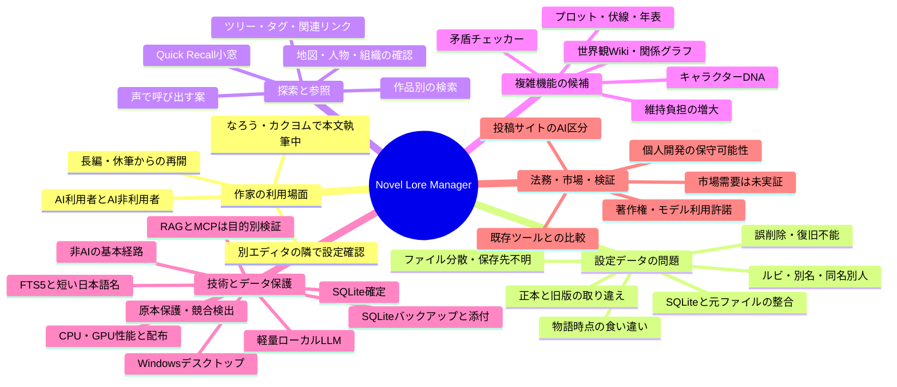

# Novel Lore Manager 要求分析書 ver3.0

| 文書属性 | 内容 |
|---|---|
| 文書種別 | 要求分析書（Requirements Analysis） |
| 作成・改訂日 | 2026-11-17（日本時間） |
| 改訂元 | `要求分析書ver2.0.md`（2026-11-17）／原型 `要求分析書ver1.0.md` |
| 文書状態 | **レビュー案／未承認**。本実装の着手・機能採用・法令適合・公開を承認する文書ではない |
| 製品 | Novel Lore Manager（旧構想名：LoreWeaver〈仮〉） |
| 対象 | Windows向け小説**設定資料**管理・検索・参照・編集デスクトップアプリ |
| 開発 | 個人開発／GitHubでソース管理／Windows／Codex CLI利用 |
| データベース | **SQLite確定（本改訂で再指定）**。保存方式・物理スキーマ・検索索引等の詳細は未決 |
| 情報源 | 現行`docs/`文書、モックアップ資料、Scenario A調査7件、2026年までの企画PDF6件、ver2.0、今回のユーザー指定、投稿サイト・SQLiteの公式資料 |

> **本改訂の決定点**：データベースは**SQLiteを確定採用**する。ver2.0で指定されたPostgreSQLは撤回された過去の変更要求として履歴に残す。DB製品の選定は未決ではないが、正本方式・SQLiteスキーマ・全文検索・バックアップ・外部ファイルとの整合性は引き続き要設計・要検証。要件定義書（`docs/requirements.md`）など既存資料は本書の作成だけでは自動更新しない。

---

## 1. 文書の目的・位置づけ・分析方法

### 1.1 目的

小説執筆者が設定を**どの場面で参照・修正したいか**を起点に、①課題、②要求、③競合による代替、④実現機能の候補、⑤非機能・データ保護、⑥実測による採用判断を対応づける。「機能が多いから価値がある」「AIが使えるから優位」と結論づけない。

### 1.2 文書間の関係

`研究・企画（仮説/証拠） → 本要求分析書（要求/未決定） → requirements.md（承認済み要件） → data-management-design.md / user-flows.md / screen-specifications.md（設計） → モックアップ / 本実装（検証）`

### 1.3 表記と判定

| 状態 | 定義 |
|---|---|
| **明示指定** | 今回のユーザー入力で明示された開発方針。実現性や従来資料との整合性まで確定した意味ではない |
| **既存合意** | 以前のdocsに記載された承認済み方針。新指定と衝突した場合は変更管理へ |
| **研究支持** | Scenario Aで基盤/保全上の合理性が示された候補。市場需要の実証ではない |
| **条件付き/検証候補** | 使い勝手、需要、実装負担、法務等の確認が必要 |
| **保留** | 定義不足または権利/技術/根拠の確認不足 |
| **モック** | 架空データとブラウザUIでの疑似操作。実OS制御・DB・ファイル処理ではない |

根拠の強さは「公式仕様／作者本人の個別記述／開発者自己観察／技術的推論／未確認」に分ける。要件の優先順位と、証拠の確かさは別軸で記録する。

## 2. 製品の概要と境界

### 2.1 解く仕事

小説家になろう・カクヨム等で**別のエディタや投稿画面を使って本文を書いている作者**が、執筆を中断する負担を抑えつつ、人物・国・地理・魔法・歴史・出来事・アイテム・伏線などの**自分で決めた設定の所在、内容、採用版、関係**を確認できるようにする。

### 2.2 何を作らないか

- 本文執筆エディタを製品の中心にしない。プレビュー・編集の対象は**設定資料**であり、投稿用本文生成や代筆を要求しない。
- スマートフォン版は対象外。作者が普段どの端末で執筆するかという市場分析とは区別する。
- クラウド同期・共同編集・投稿サイトへの自動投稿・外部Web大量取得は初期の確定対象にしない。
- **軽量ローカルLLMを利用する方針**は今回のユーザー指定として保持する。一方、RAG・MCP・音声・グラフ等の採用範囲およびLLMの具体的モデル・用途・提供時期は評価が必要。これらが現在のモックアップで動いている、または既存代替より有益であるとは扱わない。

### 2.3 プロダクト価値の仮説

**「設定を探す → 正しい作品・人物・版を見分ける → 根拠を読む → 必要なら更新 → 執筆に戻る」一連の作業にかかる総負担を、既存運用より小さくできるか。** 研究上は検証価値があるが、現時点では製品・価格・市場優位は未実証（Scenario A総合判定：CONDITIONAL）。

## 3. 調査対象と情報の信頼性

- **Scenario A（2026-10-25）**：初期台帳F-001〜F-021の21/21件評価、証拠A-E001〜034、主張A-C001〜040。A-AUD001〜005、A-SK001〜011、リスクA-R001〜010を保持。全構想の網羅性と独立実査は未確認。
- **企画・旧要件PDF6件**：旧名LoreWeaver、本文執筆・Git履歴によるAI証明・Tauri/Electron・PostgreSQL/MongoDB等の案を含む**過去の構想・二次的論評**。過去案は新しい正式仕様ではない。
- **docs/4件**：製品要件、データ管理・ユーザーフロー・画面仕様の設計基準。FR、SCR、UF、DM-Qの既存IDを保存。
- **UI資料・コード**：3テーマとHTML/CSS/JSのモックアップ実装を示す。ただしブラウザ実測による機能・性能・セキュリティの保証ではない。別系統のJS/CSSが存在するため共有状態の統合状況は未検証。
- **追加指定（ver3.0）**：**SQLite確定**、軽量ローカルLLMの利用方針、Windows、Codex、下位PC対応、音声で素早く呼び出したい、AI処理を可能な限り補助・参照用途に限定したい等。これらは要求の入力であり、全機能の技術的成立や投稿規約適合を実証したものではない。
- **変更履歴の区別**：ver2.0のPostgreSQL指定は、今回のSQLite確定指定により現行要求ではなくなった。Scenario AのSQLite採用調査は参考になるが、同調査で想定した詳細仕様が一括承認されたわけではない。

## 4. 開発背景と作家・編集者が直面する問題

作家が長編を連載しているとき、例えば「第2章でエレナがどの組織に所属していたか」「旧姓でメモした人物は誰か」「王国暦412年の事件の前後関係は何か」を確認する必要がある。複数のメモ・ファイルを開き直すことは集中を阻害し得る。**これは想定タスクであり、対象作家全体での発生頻度は未測定**。

編集者の観点では、設定の曖昧さそのものより、**引用元・採用状態・物語内の時点が分からない**状態が確認負担になる可能性がある。ただし編集者への一次インタビューは行われていない。反証として、Obsidian・VS Code・秀丸等の通常検索やファイル整理だけで十分な作家も存在し得る。

### 4.1 課題分析表（要望の必須追加項目）

「深刻度」は現時点の暫定分析で、発生頻度の市場統計ではない。**高**はデータ消失・誤版などの重大性、**要測定**は便益・発生頻度が未確認の意味。

| 課題ID | 利用状況／困りごと | 原因の仮説・背景 | 作家・編集者への影響 | 既存代替／反証 | 根拠水準 | 重要度 | 対応要求候補 | 追加検証 |
|---|---|---|---|---|---|---|---|---|
| P-01 | メモや資料が散在、保存先不明 | 保存先・命名・分類規則が統一されない | 執筆を止め、資料を探し直す | 作品フォルダ＋VS Code/Obsidian検索 | 個別記述・自己観察 | 要測定 | UR-01,02 | 過去1か月の探索失敗と操作記録 |
| P-02 | 旧姓・ルビ・偽名・異表記で見つからない | 原表記と別名・読みの管理不足 | 別人誤同定・検索漏れ | 別名リスト＋通常検索 | 技術上の検証課題 | 要測定 | UR-03 | 1〜2字、全半角、同名別人の正解集合 |
| P-03 | 採用版と旧版を取り違える | 更新時刻と作品上の正本を混同 | 設定矛盾を本文へ持ち込む | 版名規則＋履歴 | 自己観察・推論 | **高** | UR-04,10 | 正本誤選択率、外部更新競合 |
| P-04 | 誤削除・編集失敗・故障で消失 | 履歴と全体バックアップの混同 | 復元不能・長期作品の喪失 | 既存バックアップ | 技術・保全上の根拠 | **高** | UR-05 | 障害注入・別環境への復元試験 |
| P-05 | 執筆画面から設定参照に切替が必要 | 画面を行き来して検索 | 書いている流れが途切れる | 2画面・検索ウィンドウ | 製品仮説 | 要測定 | UR-06 | Quick Recallと既存手段の比較 |
| P-06 | 休筆後に前回の作業が分からない | 未完了項目・最終変更・採用版が分離 | 再開準備に時間がかかる | 既存の再開メモ | 自己観察・仮説 | 要測定 | UR-07 | 休止期間を挟む利用観察 |
| P-07 | 世界観・国・組織・人物間の関係を追えない | 関連情報が文章に分散 | 手作業で資料を照合 | Wikiリンク・表・グラフ | 機能仮説 | 要測定 | UR-08 | リンク一覧とグラフを比較 |
| P-08 | 第n話時点での設定が分からない | 設定の更新日時と物語時点が異なる | 意図的な伏線と矛盾を混同 | 人物×話数の表 | 外部の個別手法・推論 | 要測定 | UR-09 | 回想/分岐/嘘を含むケース |
| P-09 | PC外で取ったメモを移し忘れる | Windows専用、スマホとの転送負担 | 設定が最新にならない | 手動移入・同期フォルダ | 利用場面の推論 | 要測定 | UR-11 | 移入まで含めた総負担 |
| P-10 | AI利用の申告を誤認する | 「ローカル」「AIモード」を投稿区分と誤解 | 公募・出版・信用上のリスク | 各サイト公式規約の手動確認 | 公式規約＋分析 | **高** | UR-12 | 実利用工程に基づく判断UIテスト |
| P-11 | 大量の機能入力が創作負担になる | Wiki/地図/グラフ/DNA等の重複維持 | 整理が目的化し執筆時間が減る | メモ＋通常検索のみ | 反証レビュー | 要測定 | UR-13 | 継続利用と登録維持時間 |
| P-12 | ローカルLLMが遅い/動作しない | RAM/VRAM/CPU/文脈長の制限 | 待機、バッテリー/熱、操作遅延 | 非AI検索 | 技術的懸念、未測定 | 要測定 | UR-14 | 複数PC/量子化/CPU・GPUの実測 |
| P-13 | 音声検索で固有名詞を誤る | ルビ・造語・同音異義語 | 誤人物を開く・周囲への音声漏れ | キーボード検索 | 需要・技術未確認 | 要測定 | UR-15 | オフライン性・認識誤り・同意 |
| P-14 | 未公開作品の外部流出 | 画像URL・WebView・MCP・ログ等 | 作品公開前の損害 | 通信遮断・安全表示 | OWASP等の技術上の想定 | **高** | UR-16 | 通信監査・XSS・権限の試験 |
| P-15 | 個人開発で更新・保守が追いつかない | 全21機能＋DB＋LLM＋配布 | バグ修復や継続公開が困難 | 機能を絞る | 反証・工数未測定 | **高** | UR-17 | 作業量と更新/障害対応の計測 |

### 4.2 問題の因果関係（簡易）

- **分散 → 探索 → 誤版**：フォルダ集約だけでは「どれを採用するか」を決められない。
- **複雑化 → 関連情報の維持負担**：視覚化の追加は閲覧を助ける可能性がある一方、登録の二重化を生む可能性がある。
- **AI追加 → 利用区分・出典・権利・性能の検証負担**：LLMを搭載するだけで正確な情報検索・規約適合・プライバシーが保証されるわけではない。

## 5. 課題・背景のマインドマップ（要望の必須追加項目）

以下は**調査で把握した論点を可視化した分析図**であり、一般作家の課題割合・因果の実証を意味しない。Mermaid対応のMarkdownビューアで表示できる。

**読み方**：左側の「困りごと」から必要な要求を特定し、右側の「技術・候補」で解決できるか、最後に利用者の実操作で確認する。技術から先に機能を決めない。

## 6. ステークホルダーと対象ユーザー

| 層 | 利用シナリオ | 主要求・不明点 |
|---|---|---|
| AIを使用しない作者 | 投稿画面で本文を書きつつ、資料やルビを検索 | **AIなしで**登録・検索・編集・復旧を行う。創作工程全体のAI不使用の判断はアプリでは保証しない |
| AIで設定案を作る作者 | 生成した案と作者が採用した案を分ける | 出所・採用状態・版・編集履歴を区別。AI生成設定の扱いと本文利用の有無を混同しない |
| AIで本文を執筆する作者 | 外部ツールで本文作成し、当アプリで設定確認 | 設定の参照は対象。ただし本人の投稿区分を本アプリの利用モードから判定しない |
| 長編・連載作者 | 複数話・人物・国・年表の参照 | 時点・別名・正本・再開。需要割合は未確認 |
| 編集者（将来） | 設定の根拠や人物の整合を確認 | 参照・共有の要求は仮説。直接取材なし |
| 個人開発者 | GitHub/Codexで開発・保守 | 品質、実装範囲、検証可能性、ライセンス、可搬性 |

市場の端末比率は**調査対象の属性**であり、製品対象をPCに固定したことと矛盾しない。Windows利用者比率、AI別需要、支払意思は未知。

## 7. 現状業務（As-Is）と目標利用体験（To-Be）

### 7.1 As-Is（想定。現地観察ではない）

1. 投稿サイトまたは既存エディタで本文を執筆。
2. 「王国暦の事件」「キャラの旧姓」を確認したくなる。
3. メモ帳、ノート、ファイルを開き直して検索。
4. 複数候補のうち正しい作品・版・人物を自力で選択。
5. 元の執筆画面へ戻る。

### 7.2 To-Be（達成したい結果）

1. 作品単位で資料を管理し、別の作品を意図せず混ぜない。
2. キーワード・別名・読みから**実際に採用した設定へ**到達する。
3. 根拠・版・更新状態を確認し、必要なら安全に編集・復元できる。
4. Quick Recall等の小窓で短時間の参照を試せる。
5. AIの有無にかかわらず基本的な資料管理を完遂し、投稿規約の判断は作者が行う。

### 7.3 測定すべき業務指標

タスク成功率、正しい資料・正本への到達時間、誤版選択数、検索語の修正回数、アプリ切替回数、登録・修正・保守時間、復元成功率、再開所要時間。**目標値の絶対数値はベースライン測定後に確定する**。

## 8. ユーザー要求一覧（要求IDと追跡先）

IDはver2.0から継続した分析ID。既存`FR-*`とは別番号であり、採用済みの機能要件を意味しない。

| 要求ID | ユーザーが達成したいこと | 対応課題 | 既存の関連ID／候補 | 状態 |
|---|---|---|---|---|
| UR-01 | 作品ごとに設定と関連メモを分離したい | P-01 | F-002, FR-001/002 | 既存合意の目標 |
| UR-02 | ファイルの階層とカテゴリを直感的にたどりたい | P-01 | F-001/002 | 既存合意の目標 |
| UR-03 | 登場人物の別名・ルビ・固有名詞を探したい | P-02 | F-003/006 | 条件付き |
| UR-04 | 採用済み設定と旧版を識別したい | P-03 | F-018, RA-01/02 | 保全要件、方式未決 |
| UR-05 | 誤操作・障害後も資料を復元したい | P-04 | F-019, RA-03 | 保全要件 |
| UR-06 | 執筆用アプリの隣で設定を参照したい | P-05 | Quick Recall, FR-401〜407 | 既存目標、便益要検証 |
| UR-07 | 休筆後に途中状態を思い出したい | P-06 | F-020, RA-08 | 仮説 |
| UR-08 | 人物・国・組織・世界観の関連を確認したい | P-07 | F-005/007/008 | 条件付き |
| UR-09 | 話数・時点で設定の違いを確認したい | P-08 | F-021 | 条件付き |
| UR-10 | 設定を安全に編集し、元のファイルを勝手に壊されたくない | P-03/04 | F-001/004/018, FR-101〜108 | 保全要件 |
| UR-11 | PC以外で作成した既存テキストも移せるようにしたい | P-09 | F-001 | 条件付き。同期ではなく取込 |
| UR-12 | どのAI処理が動いたか分かり、投稿規約の判断を誤解しない | P-10 | F-017, A-R005 | 重要、区分自動判定禁止 |
| UR-13 | 必要な機能だけで設定管理を続けたい | P-11 | A-SK005 | 要検証 |
| UR-14 | 軽いPCでも基本操作が使え、LLM可否を事前に確認できる | P-12 | F-016/017 | 新規明示指定、性能未検証 |
| UR-15 | 手が離せないとき音声で検索したい | P-13 | F-014 | **需要・技術保留** |
| UR-16 | 未公開作品が意図せず通信・ログ等で流出しない | P-14 | A-R003 | 安全要件 |
| UR-17 | 個人開発で更新・修復可能な規模にしたい | P-15 | A-R007/010 | 開発制約 |

## 9. 機能候補と業務・機能要求の分析

### 9.1 基本経路（採用を検討する順序案）

1. **作品単位の管理**：`project_id`による隔離、作品名、フォルダツリー、カテゴリ、タグ（F-002）。
2. **設定文書の取り込みと編集**：既存`.md/.txt`読取、原文保持、プレビュー、手動保存、COPY/DIRECTの違い（F-001/004）。
3. **非AI検索**：現在作品優先、通常文字検索、別名、カテゴリ、根拠プレビュー、0件状態（F-003/006）。
4. **版・保存・復旧**：採用版、旧版、変更履歴、外部編集競合、ゴミ箱/アーカイブ/バックアップ（F-018/019）。
5. **Quick Recall**：別ウィンドウ相当の素早い参照。OSの前面固定、グローバルショートカットは本実装の別要件。

### 9.2 全21機能の研究分類を維持

| Scenario A区分 | 該当ID | ver3.0での取り扱い |
|---|---|---|
| 研究支持5 | F-001 / F-003 / F-004 / F-017 / F-019 | 基本経路/保全として検討。差別化は未実証 |
| 条件付き7 | F-002 / F-005 / F-006 / F-010 / F-018 / F-020 / F-021 | モデル・入力負担・利用者価値を検証 |
| 需要未確認3 | F-008 / F-009 / F-012 | 世界観グラフ、キャラクターDNA、伏線は中核化しない |
| 既存代替で十分の可能性2 | F-007 / F-011 | 世界観Wiki、プロットボードは既存ノート等と比較 |
| 見送り候補1 | F-014 | 音声検索は意向を尊重しつつ別PoCで検証 |
| 技術・法務保留3 | F-013 / F-015 / F-016 | 矛盾チェッカー、RAG、LLMの精度・性能・権利確認が必要。**F-016は今回のユーザー指定でローカルLLM利用方針あり**。研究分類と製品方針を混同しない |

### 9.3 固有機能の要求定義で決めること

| 機能 | 意味・最小入力 | 成否判定 | 保留事項 |
|---|---|---|---|
| 世界観Wiki | 文書IDによる相互リンク、関連資料一覧 | リンク切れ検出、元資料へ戻れる | 既存ツールとの差・入力負担 |
| 世界観グラフDB | 人物/国/組織/時点のノードと意味づけした関係 | 関係に根拠文書・時点がある | 関係型定義・必要性。**別のグラフDB採用は前提にしない** |
| キャラクターDNA | 名称のみで定義不十分 | 評価不能 | 属性・変化・心理推定のどれかを確定 |
| 世界地図 | 作者の画像を表示し、設定資料と結ぶ候補 | 該当箇所を指せるか | 地図**制作**は別要求。画像権利・形式 |
| プロットボード | 章/出来事の概要・並びの表示候補 | 既存表より管理しやすいか | 本文執筆と境界、重複入力 |
| 伏線トラッカー | 提示/回収/意図的未回収の記録候補 | 誤警告なく確認できるか | 入力負担と管理方法 |
| 矛盾チェッカー | 根拠のある**矛盾候補**を表示 | 誤検知/見逃しと根拠を測定 | 作者の意図的矛盾、正解定義 |
| ローカルRAG | 設定資料を検索し根拠文書を提示・必要なら回答 | 通常検索とのRecall@k/MRR、根拠一致等 | 採用判断・モデル・分割/版・権利 |
| 音声検索 | ユーザー起動中の認識、検索結果を表示 | 固有名詞の認識率、操作完了率 | 常時待受・音声保存・低性能PC |

## 10. データ管理・正本・SQLite確定

### 10.1 データベース選定：SQLite確定（ver3.0の変更点）

- **現行の確定指定はSQLite**。以前のScenario Aとver1.0でもSQLiteが選定されていた。ver2.0では一度PostgreSQLへの変更要求を受けたが、**今回のユーザー指示によりその変更要求を撤回し、SQLiteを正式な開発方針とする**。
- 本書で確定するのは**DB製品の種類**。正本がSQLite内の管理コピーか外部`.md/.txt`か、ファイル添付の扱い、スキーマ、ジャーナルモード、検索実装、暗号化、DB配置場所は未確定。
- `requirements.md`、`data-management-design.md`、技術選定記録、検索・バックアップ・テスト計画にあるDB記述は、既存の承認事項を確認した上でSQLiteに統一する。**本書の作成により他ファイルを変更したことにはしない**。
- Windows向けローカル単独アプリを前提とし、**一般利用者にPostgreSQLサーバーやDockerの導入を求めない**。SQLiteは組み込みDBであり、アプリからローカルDBファイルを安全に管理する構成を検討する。

### 10.2 正本・原本・外部編集との整合（DB選定とは独立）

1. **正本方式を選択**：A案「SQLite内の管理コピーが正本／元ファイルは読み取り・再取込元」と、B案「外部`.md/.txt`が正本／SQLiteは派生情報・索引」を比較する。**COPY/DIRECTというUIの選択肢だけで正本を決めない**。
2. `project_id`、`document_id`、`revision_id`、`adoption_status`を区別し、**更新日時が新しいだけで採用済み設定を決めない**。
3. 原本の文字コード、改行、ルビ、添付、リンクを保持し、再取込・再出力後の一致と差分を検証する。
4. 外部アプリで元ファイルが変更された場合、観測ハッシュ・版と現行内容を比較する。衝突時は作者の確認なしに上書き・消失させない。
5. 削除・ゴミ箱・アーカイブ・履歴復元・完全消去・全体バックアップは別の操作・保護範囲として設計する。

### 10.3 SQLiteで重点的に検証する技術要件

| 項目 | SQLiteで検討・検証すること | 現状 |
|---|---|---|
| DBファイル | Windowsのユーザーデータ領域、パス/権限、アプリ更新とアンインストール時の保持、複数作品の格納方式 | 配置・方式未決 |
| 同時アクセス | Quick Recallとメイン画面の**同一データへのアクセス**、トランザクション、タイムアウト、競合と書込ロック、異常終了時の挙動 | 実機未測定 |
| 整合性 | 外部キーの有効化・制約、安定ID、版・関係の参照整合、スキーマ移行とロールバック | 物理スキーマ未決 |
| ジャーナル | ロールバックジャーナルとWALを比較。WALを使う場合は関連ファイル・チェックポイント・バックアップ時の整合に注意 | WALは未採用 |
| 通常検索 | キーワード・タグ・カテゴリ・作品境界・別名・ルビの検索に適切なテーブル/索引を定義 | 検索精度未測定 |
| 日本語全文検索 | **FTS5の`unicode61`、`trigram`、別名辞書、`LIKE`等を実データで比較**。`trigram`のFTS全文クエリでは3文字未満に制約があり、1〜2文字の名前は別経路を設計する | FTS5採否未決 |
| 原本保護 | DBコミットと外部ファイル書き込みは同一トランザクションではない。外部編集、途中失敗、再取込を復旧可能にする | 正本方式未決 |
| バックアップ | SQLiteの**Online Backup API**や`VACUUM INTO`等のDBスナップショットと、添付・履歴・出力を含む復元単位を分けて設計する | 実復元未試験 |
| セキュリティ | SQLパラメータ化、未信頼ファイルからの取込、DBファイル・バックアップの権限、本文ログへの混入、ローカルLLMへの参照許可 | 脅威分析・試験待ち |
| 配布 | SQLite接続ライブラリの同梱・ライセンス・更新、Windowsの対象OS/CPU、DB移行、旧版へのロールバック | 配布方式未決 |

SQLiteの公式仕様：
- FTS5：https://www.sqlite.org/fts5.html
- Online Backup API：https://www.sqlite.org/backup.html
- Atomic Commit：https://www.sqlite.org/atomiccommit.html
- Write-Ahead Logging：https://www.sqlite.org/wal.html
- Foreign Keys：https://www.sqlite.org/foreignkeys.html

**これらは選択・検証可能なSQLite機能であり、本アプリへの実装完了や安全性を保証するものではない。** 特に、DBのバックアップが成功しても、外部添付や元ファイルを一括復元できるとは限らない。

### 10.4 必要な論理情報（候補であり物理スキーマではない）

- 作品：`project_id`、作品名、説明、作成・更新日時。
- 資料：`document_id`、所属`project_id`、種類、親フォルダ、タグ、本文、関連情報、元パス、文字コード・改行。
- 採用状態と履歴：`revision_id`、採用/草案/棄却等の状態、変更元、改訂理由、観測ハッシュ。
- 検索と関係：別名、読み・ルビ、表記ゆれ、関連文書ID、物語内の有効時点、人物・場所・組織との関係。
- 保護と復旧：ゴミ箱・アーカイブ状態、復元対象、添付メタデータ、バックアップのmanifest・整合情報。

世界観グラフを実装する場合でも、関係情報をSQLiteのテーブルで扱うことは可能であり、**専用グラフDB製品の追加採用は前提としない**。関係型・時点・入力負担・検索の改善効果を検証する。

### 10.5 SQLite確定による要求・リスクの更新

| 既存の要求・リスク | SQLite確定後の扱い |
|---|---|
| RA-01 / D-02 正本選定 | **未解決のまま**。SQLiteの採用だけではDB内管理コピーか外部正本か決まらない |
| RA-02 / A-R001 外部更新競合 | **未解決のまま**。外部ファイルとの上書き・二重正本を防ぐ |
| RA-03 / A-R002 全体バックアップ | **未解決のまま**。DB＋外部添付＋履歴を別環境で復元する |
| RA-04 / A-R008 日本語検索 | SQLite FTS5等を検証候補へ戻す。1〜2文字、同名・別名・ルビの正解集合を使う |
| A-R003 / A-R009 未公開作品・削除残存 | SQLite DBとバックアップ/索引/ログへの残存、外部送信経路を監査する |
| 旧D-01 PostgreSQL選定衝突 | **今回の変更で解消**。現行DB製品はSQLite。ただし関連設計書の記述更新は未実施 |

### 10.6 先に行う検証（案）

権利処理済みの架空のMarkdown資料を用いて、(a)通常保存と異常終了、(b)外部アプリとの競合、(c)Quick Recallからの同時参照/編集、(d)別名と短い日本語名の検索、(e)DB・添付一式の復元を実施する。**SQLite単体のテストと完成製品の保全試験は別々に合格判定する**。

## 11. 非機能要求・性能・動作環境

### 11.1 開発機

Windows / x64、Core i7-13650HX、RAM 16 GB、NVIDIA RTX 3050 Laptop GPU 6 GB、Intel UHD Graphics。**これは開発機の申告スペックであり製品の最低要件ではない。**

### 11.2 AI機能あり・なしの動作環境を分ける

| 区分 | 必要な定義 | 現段階の判定 |
|---|---|---|
| **基本機能（非AI）** | 作品管理、検索、編集、保存、Quick Recall、復元が使えるCPU/RAM/OS/保存容量 | 実測前。低性能PCを含め測定 |
| **AI機能あり・最低環境** | 選定モデル・量子化・文脈長・同時処理・推論バックエンド・応答基準を満たすPC | **未確定。低スペックでも動作の実測が必要** |
| **AI機能あり・推奨環境** | 同条件で作業継続に十分な速度とメモリ余裕を確認したPC | **未確定** |

ユーザー指定は「AI機能ありのモードのみ、ローカルLLMが動かないPCは非対応」であり、**AIなしの基本機能まで非対応にしない**。CPUのみでの推論を許すか、最低GPU/VRAMを課すかは機能検証で決める。モデルの必要量をVRAMだけで固定せず、モデル重量・KVキャッシュ・実行時メモリ・共有RAM・バックエンドで評価する。

**製品配布時に掲示する最低・推奨環境の欄（未測定のため数値は未確定）**：

| 記載項目 | 非AI基本機能：最低 | AI機能：最低 | AI機能：推奨 |
|---|---|---|---|
| Windowsの対応バージョン/CPU命令 | 実機検証後 | 実機検証後 | 実機検証後 |
| CPU・物理RAM | 実機検証後 | モデル選定後の実測 | モデル選定後の実測 |
| GPU・VRAM（CPU推論可否を含む） | 原則専用GPU不要の設計候補／要検証 | 実測後 | 実測後 |
| 保存容量（SQLite DB・モデル含む） | 実測後 | モデル容量・資料量次第 | 実測後 |
| 体感応答の合格条件 | 検証設計時に設定 | LLM応答/検索の計測後 | LLM応答/検索の計測後 |

**最低環境が空欄のまま公開するのではなく、モデルと対象OSを決めた段階で測定値を埋める。** 開発機のGPUが6GBであることは下位PCへの動作保証ではない。

### 11.3 計測と性能要求

- 起動、作品を開く、非AI検索、保存、Quick Recall表示のp50/p95、ピークRAM、ディスク使用量。
- LLMは初回応答、後続応答、トークン生成速度、長い資料での遅延、キャンセル、モデル破損/未導入時の振る舞い。
- 低/中/大の資料数・総文字数のテストセットを固定し、Windows版、CPU/GPU/ドライバとモデルハッシュを記録。
- **現在は最低RAM/VRAM・処理秒数を保証する数値を掲載しない。** 採用モデル候補と複数機の実測後に確定する。

## 12. ローカルLLM・RAG・MCPの役割と安全境界

### 12.1 初学者向けの整理

- **ローカルLLM**：作者のPCで動く言語モデル。**考えたり文章を返したりする処理**に使えるが、設定の正しさを自動保証しない。
- **検索（非AI）**：登録された原文や別名を探し、根拠を表示する。AIモデル不要。
- **RAG**：先に関連資料を検索し、それを根拠としてLLMに示す構成。**RAGはAI利用の免除制度ではない**。回答に出典・版・該当行・検索日時等を対応づける必要がある。
- **MCP**：アプリとモデル/ツールの間で機能やデータへのアクセスをやり取りするためのプロトコル。**RAGの実装に必須ではない**。ツールを呼ぶ際の権限設計が必要。

### 12.2 提供する処理の境界（候補）

| 処理 | AI | 望ましい出力 | 留保 |
|---|---|---|---|
| 作品フォルダ・文字列検索 | 不要 | 資料名・該当位置・採用状態 | 非AI経路は維持 |
| ルビ辞書・別名検索 | 不要 | 該当人物候補と原文 | 誤同定検証 |
| 関連資料のルール型リンク | 不要 | 手動の根拠リンク | 入力維持負担 |
| RAGによる設定の質問応答 | 使用 | **根拠資料を示す回答/該当なし** | 正本誤選択/ハルシネーションを実測 |
| 矛盾候補の指摘 | 条件付き | 根拠付きの**候補**、作者が採否判断 | 意図的矛盾の誤判定 |
| 設定案・プロット案の創作 | 使用 | **現行の主要対象外** | AI補助区分や創作工程への影響が複雑 |
| AIによる本文生成・改稿の自動保存 | 使用 | **対象外** | 代筆・規約誤認のリスク |

### 12.3 ローカル推論の技術候補

**軽量ローカルLLMを使用すること自体は今回の開発方針**。`llama.cpp`はCPU/CUDA等のバックエンドと量子化を備える実装候補（公式：https://github.com/ggml-org/llama.cpp）。モデル名・量子化・日本語性能・利用許諾・バージョン・取得先は**未選定**。開発機の6GB VRAMでの動作、さらに低いPCでの適切な推論速度は未実測。モデル配布権とランタイムのOSSライセンスは別に確認する。

**段階的な候補**：まずSQLiteの設定資料検索と根拠表示を非AIで実装し、次に選定した軽量LLMで根拠付き回答のPoCを行う。RAGは必要性・誤回答・根拠確認時間を比較して設計し、MCPは外部ツールとの連携要件が具体化してから判断する。**この順番は作業計画案であり、全機能の採用済み仕様ではない**。

### 12.4 非AIモードの制約

モデル未導入でも主要機能が動き、意図しない埋込生成・モデル読込・外部送信を行わない。**「このアプリで非AIモードを使った」ことと「その作品の創作工程でAI不使用」は別**。

## 13. 投稿サイト規約・著作権・秘密情報

### 13.1 2026-11-17に一次情報を再確認した結果（ver3.0でも再照合）

| サイト | 確認できた公式情報 | 開発上の結論 |
|---|---|---|
| 小説家になろう | **AI直接使用／AI間接利用／AI補助的利用／AI不使用**の4区分。作品投稿時の設定が必須。補助的利用は、本文執筆そのものにAIが関与しない例など。 | アプリのAI使用/不使用の切替だけで投稿区分は決定できない。生成した設定やプロットを作者が創作にどう利用したかまで考慮が必要 |
| カクヨム | **AI本文利用／AI本文一部利用／AI補助利用**の3種類のタグを、実態に応じて推奨。2026-05-27公式変更告知。日常ツールの検索等の補助機能には除外例がある。 | すべての検索/AI処理を一律で「AI補助利用」に分類しない。一般投稿とコンテスト条件は別 |
| アルファポリス | Scenario Aで公式原文未取得。今回もAI関連原文の確証を追加していない | **未確認**。ルビ・投稿条件・AI申告に関する断定を避ける |

**公式参照（確認日2026-11-17）**

- 小説家になろう「AI利用状況に関して」：https://syosetu.com/site/ai/
- カクヨム「小説投稿ガイドライン」：https://kakuyomu.jp/legal/guideline
- カクヨム「小説投稿ガイドラインを一部変更しました」（2026-05-27）：https://kakuyomu.jp/info/entry/gen_ai_guideline
- 公募、出版社、出版申請等は個別の最新要項を再確認する。

### 13.2 ユーザーの「AI補助利用に該当しない範囲」希望の扱い

**保証できない要求として記録**する。例えば「すでに作者が書いた資料の単純検索」はLLM不要だが、アプリでRAG質問応答をした場合、そもそも投稿サイトの区分はサイトごと・用途ごとに異なる。**LLMがローカルで動くからAI不使用**、**本文を生成しないから必ずAI補助にも当たらない**、とは断言しない。作者の創作工程での利用実態に合わせた判断を支援する説明に留める。

### 13.3 著作権・特許・OSS

第三者の設定資料、地図、画像、作品本文、モデル重み、フォント、UI素材を無断同梱・再配布しない。オープンソースのライブラリとLLMモデルの使用・再配布条件を別に記録。既存製品の特定画面をそのまま複製しない。著作権・特許の個別適法性は法的助言ではなく別途専門確認が必要。

### 13.4 セキュリティ要件

未信頼Markdownのraw HTML、外部URL画像、危険なリンク、ログ出力、任意パスへのアクセス、MCPツールへの権限委譲、外向き通信、モデル取得、SQLite DB・検索索引・外部添付・バックアップを脅威分析する。利用者に「データは一切外部に出ない」と**実通信監査なしで断言しない**。AIが外部ツールを呼ぶ場合は最小権限と明示承認、操作監査を検討する。

## 14. ルビ・固有名詞・日本語検索

ユーザー提示の表記例（**入力例**でありサイトの全構文仕様の確認済み一覧ではない）：

- なろう：`|転生《てんせい》`
- カクヨム：`炎《フレイム》`
- アルファポリス：`|水《ウォーター》`

検索では「表示上の原文」「読み」「別名」「原稿での記法」「検索用に正規化した語」を別に保持する。作品固有の漢字・ルビ、異体字、同姓同名を**同一人物だと自動断定しない**。サイト別の記法全体、ルビの開始記号、エスケープ、変換・往復出力を実際の公式記法およびテストデータで確認する。外部サイトへの自動投稿機能は対象外。

## 15. UI/UX・画面・モックアップの位置づけ

### 15.1 現行のデザイン比較

`Forest Workbench`（暗い森の書斎）、`Storybook Atelier`（古書/紙）、`Quiet Lore Studio`（明るい静かな作業空間）。**同じ情報・操作・DOMの意味構造**で見た目だけを比較する。旧Complete Shelf案は既定デザインではなく、今回は3案を比較してから採否を決める。

### 15.2 画面とフロー

既存の`SCR-01〜08`、`UF-01〜08`を原則参照。作品選択、ワークスペース、設定資料編集/プレビュー、検索、取込、Quick Recall、保管（アーカイブ/ゴミ箱）、設定。Quick Recallは隣のモニターや小型ウィンドウで参照する用途を検討。視認性、キーボードフォーカス、未保存の確認、長い日本語名に対するレイアウトを検証。

### 15.3 モックアップと製品の差

| 観点 | ブラウザモックアップ | 本番Windowsアプリで必要な検証 |
|---|---|---|
| 設定の保存 | メモリ内のモックデータ | **SQLite**・外部ファイルの正本/競合/障害復旧 |
| 作品内検索 | JSによる限定的検索 | 大量データ/日本語検索/作品境界の検証 |
| Quick Recall | `window.open`等の小窓相当 | OSの最前面/複数モニター/ホットキー/同期 |
| 音声検索 | 未実装 | 認識エンジン、許可、誤認識、オフライン性 |
| AI/RAG/MCP | 未実装 | 根拠一致、最小権限、ライセンス、ローカル性 |
| テーマ | 3テーマCSS | 本実装へ採用テーマ・設計トークンを移植 |

### 15.4 制作ツール

現状は**Windows版Codex CLI＋`frontend-design`＋`UI UX Pro Max`**でHTML/CSS/Vanilla JSを制作済み。Google StitchとPencil.devは利用候補であり必須にしない。現在の実装に別系統のJS/CSSと共通状態の確認事項があるため、モックの存在を受け入れテスト合格とは扱わない。今後本実装でReact/Tauri等を利用する場合、モックコードの直接流用ではなく、共通UI設計・コンポーネント・操作要件を採用する。

## 16. 技術構成とGitHub/Codex運用

| 分野 | 明示された条件／現状 | 変更管理・検証ポイント |
|---|---|---|
| OS | Windowsデスクトップ | Windowsバージョンと配布方法は未決 |
| 開発・支援 | VS Code/PowerShell、Codex CLI、GitHub | 指示・コードレビュー・テスト結果をコミットごとに記録 |
| UI | モックはHTML/CSS/Vanilla JS。React等は本実装の検討候補 | モックの状態と本実装の型・コンポーネント・アクセス性を再設計 |
| デスクトップ容器 | Tauri 2 / Electron等の既存提案 | **未確定**。軽さ/インストール/OS APIを実測比較 |
| DB | **SQLite確定（今回の明示指定）** | 組み込みDBの保存先、スキーマ、ロック、FTS5、日本語検索、添付を含む復元を設計・実測 |
| AI | **軽量ローカルLLMを使用する方針** | 具体的なモデル・用途・実行器・配布許諾・CPU/GPU最低条件はPoCで決め、非AI経路を分離 |
| RAG | 候補（初心者） | まず通常検索と根拠表示、必要性比較を先行 |
| MCP | 候補（初心者） | 単体RAGに必須ではない。外部ツール連携の目的・権限を定義してから採否判断 |
| Docker | 必要な場合に使用 | 開発用の補助・統合試験用に限って検討。**SQLiteの通常利用やWindowsアプリの実行にDockerを必須としない** |

### 16.1 Gitブランチと成果物の分離

モックアップ専用ブランチに、`design/`と`css/js/html`を保持。mainへは**承認した要求・設計資料・必要なSkillルール**を選別してPull Requestで取り込む。試作データ、重複する試行コード、未検証の見た目を本番コードとして無条件でマージしない。`AGENTS.md`とSkillのスコープ/ライセンスは別途確認する。

## 17. 検証計画・測定指標・判断基準

### 17.1 ユーザータスク（既存ツール対照）

| テストID | タスク | 計測するもの | 比較先 |
|---|---|---|---|
| T-01 | 別名で人物を検索して採用設定を開く | 正解率・到達秒数・誤版率 | Obsidian/VS Code等 |
| T-02 | 旧版と正本を区別 | 誤選択・理由説明 | 正本命名+履歴 |
| T-03 | 10分の中断後/長期休止後の作業再開 | 再開までの作業時間 | 再開メモ |
| T-04 | 別作品の同名人物を検索 | 誤混入率 | フォルダ別検索 |
| T-05 | 取り込み時に原文を保持 | 文字コード/改行/ルビの往復一致 | 元ファイルとdiff |
| T-06 | 外部から同時変更を加える | 上書き防止・競合認識 | 操作記録 |
| T-07 | 保存障害後に一式を復元 | 復元成功、データ整合 | バックアップ復元 |
| T-08 | 執筆とQuick Recallを行き来 | 切替数・到達秒数・主観負担 | 通常ウィンドウ・2画面 |
| T-09 | 3テーマの同一タスク | 可読性・誤操作・操作時間 | Forest/Storybook/Quiet |
| T-10 | 通常検索とRAGを比較 | Recall@k/MRR、根拠一致、応答時間 | 非AI検索 |
| T-11 | AI機能を切った状態で利用 | ローカル検索・保存・通信の有無 | ネット遮断試験 |
| T-12 | 低性能PCでLLM | 初回応答、p95、RAM/VRAM、完遂 | 開発PCと下位PC |

### 17.1.1 SQLite確定に伴う追加データ保全テスト（実施案）

| ID | 検証場面 | 確認内容 |
|---|---|---|
| DB-T01 | SQLite初回起動・DB移行・旧版からの更新 | 初期化/移行結果、失敗時の復旧、既存データ保持 |
| DB-T02 | メインとQuick Recallによる同時参照/書込 | ロック競合・未保存警告・一貫した版・再試行動作 |
| DB-T03 | 1〜2文字の人名・別名・ルビ・同名別人の検索 | FTS5の短字制約に対応した代替経路と作品隔離 |
| DB-T04 | 外部`.md/.txt`を別アプリで同時編集 | 無断上書き禁止、競合コピー・作者確認 |
| DB-T05 | 保存中の強制終了・容量不足・異常終了 | DBと元ファイルの整合、原本保護、復旧可能性 |
| DB-T06 | DB/添付/履歴/索引のバックアップと別PCでの復元 | manifest・参照先・検索索引の再構築、全資料が使えること |

設計段階で数値を捏造せず、事前にサンプル資料、正解集合、試行順、合格ラインを定める。利用者テストが未実施の間は「使いやすいと実証した」と書かない。

### 17.2 セキュリティ・法務・品質ゲート

- A-R001（正本/競合）、A-R002（復旧）、A-R003（流出）に相当する重大リスクは**公開前に障害・復元・通信試験を行う**。
- AI誤回答、投稿区分誤認、モデル配布権、未確認のサイト規約を解決扱いにしない。
- モックの`smoke.mjs`等が合格しても本番のデータ保全や画面品質の実測と区別する。
- GitHubのCIで単体/統合/セキュリティ関連チェックを走らせる方針は候補。実装状況と証拠を都度追記。

## 18. 要求の優先順位、未決事項、変更管理

### 18.1 重要度と採用判断

| 区分 | 例 | 判断 |
|---|---|---|
| **P0：設計先行** | 正本・外部競合、SQLiteファイル/スキーマ/ロック、バックアップ、未公開作品保護 | 実装前に方式と試験条件を定める |
| **P1：基本体験** | 作品管理、md/txt、非AI検索、別名、Quick Recall、資料CRUD | 実用性を検証。Quick Recallの優位は未実証 |
| **P2：条件付き拡張** | ルビ、地図表示、時点、再開、Wiki、伏線/ボード | 利用者価値・入力負担で採否を決める |
| **P3：技術/需要検証** | 軽量ローカルLLM（利用方針あり）、RAG、MCP、音声、DNA、グラフ、矛盾 | **LLMの導入方針と、モデル・用途・初期リリース採否を分ける**。その他は実証後判断 |

**注意**：上記のP0〜P3は**本書が提案する検討順序**。Scenario Aの「研究支持」と同じではない。**SQLiteはDB製品として確定**、軽量ローカルLLMは**利用方針を受領済み**だが、モデル・機能の提供時期・最低スペックは実測前に決めない。

### 18.2 意思決定台帳

| 決定ID | 未決事項・衝突 | 次に必要な判断/証拠 |
|---|---|---|
| D-01 | **SQLite確定（解決済みの製品選定）** | ver2.0のPostgreSQL要求を撤回した履歴を残す。`requirements.md`等の関連資料への反映は**未実施** |
| D-02 | DBコピー正本 vs 外部md/txt正本 | 事故/外部編集/再取込/エクスポートの試験 |
| D-03 | COPY/DIRECT併存の整合・保存仕様 | 同時編集・競合コピー・原本非破壊の動作 |
| D-04 | 最低/推奨PCスペックとLLMモデル | モデル/量子化・CPU/GPU/長文/複数機の実測。AIなしの最低環境とAIありの最低/推奨環境を分けて公開 |
| D-05 | AIの最小機能をどこまでに限定するか | なろう/カクヨムの用途別区分、作者の確認負担、ログ |
| D-06 | 音声検索の優先度 | 利用頻度・オフライン認識・固有名詞・マイク同意 |
| D-07 | 世界観グラフ/DNA/地図/矛盾/伏線の定義 | 具体タスク、入力形式、正解、既存代替と維持負担 |
| D-08 | Windows UI実装技術と配布形態 | Tauri/Electron、OS機能、インストール/更新計測 |
| D-09 | 作品資料の外部通信・モデル取得規則 | ネットワーク監査・権利・承認画面 |
| D-10 | 現行21機能台帳と全過去構想の対応 | `novel-lore-manager_function.md`と開発者による完全性照合 |
| D-11 | SQLiteファイル配置・ライブラリ同梱・ロック/移行・配布 | Windowsユーザーデータ配置、DB初期化、WAL含むバックアップ、更新/復旧/アンインストール時の保持を検証。**サーバーとDockerを通常利用者に要求しない** |
| D-12 | 既存UIモックの採用部分 | 3テーマの実作業比較、JS/CSS統合検査、UI承認 |

### 18.3 要求トレーサビリティの記録様式

| 項目 | 記録例 |
|---|---|
| 課題ID | P-02 |
| ユーザー要求ID | UR-03 |
| 研究機能ID | F-003 / F-006 |
| 既存要件ID | `FR-301〜305`（最終対応は要確認） |
| 設計画面/フロー | `SCR-*` / `UF-*`（詳細を照合） |
| 出典 | Scenario A A-E026 等、ユーザー入力、設計書 |
| 判定 | 条件付き |
| 受け入れ方法 | T-01、T-04 |
| 決定者/決定日 | 未決 |

## 付録A. リスク一覧と保持すべき留保

| ID | Scenario Aの未解決リスク（要約） |
|---|---|
| A-R001 | 正本・外部編集競合による誤上書き・消失（CRITICAL） |
| A-R002 | 不整合バックアップ・復元不能（CRITICAL） |
| A-R003 | Markdown/画像/ログ/連携による未公開作品流出（CRITICAL） |
| A-R004 | RAG/LLMの誤回答、旧版参照（HIGH） |
| A-R005 | 投稿サイトのAI区分を誤認（HIGH） |
| A-R006 | OSS/モデル/第三者コンテンツの権利違反（HIGH） |
| A-R007 | 全機能の保守・入力負担の増大（HIGH） |
| A-R008 | 同名・別名・ルビ・時点の誤同定（HIGH） |
| A-R009 | 削除後に履歴・索引・バックアップ等へ情報残存（MEDIUM） |
| A-R010 | 配布・更新・モデル取得の改ざん/復旧失敗（HIGH） |

A-AUD001〜005とA-SK001〜011は未解決のまま`research/A/outputs/`に残す。根拠を新たに取得しない限り解決扱いにしない。

## 付録B. 資料の採用ルールと参照一覧

### B-1. 現行構成の一次資料（リポジトリ内）

- `docs/requirements.md`：現在の要件定義。**本書で自動更新しない**。
- `docs/data-management-design.md`：保存/直接編集/未決事項（DM-Q01〜08等）。
- `docs/user-flows.md`：UF系列の利用手順。
- `docs/screen-specifications.md`：SCR系列の画面仕様。
- `novel-lore-manager_function.md`：広い機能構想。全候補と研究初期台帳の同一性は未確認。
- `mockups/novel-lore-manager/design/`：共通UX/ワイヤー/3テーマ/比較/調査ログ。
- `mockups/novel-lore-manager/`：実際のブラウザモック。動作完成を保証しない。

### B-2. 研究資料（確認日2026-10-25）

- `research/A/outputs/input-audit.md`：初期21件の入力監査。
- `research/A/outputs/source-research.md`：34証拠・40主張の一次情報台帳。
- `research/A/outputs/feature-evaluation.md`：21機能の分類・技術検証。
- `research/A/outputs/legal-security.md`：AI投稿規約とリスク。
- `research/A/outputs/evidence-audit.md`：監査と不足。
- `research/A/outputs/skeptic-review.md`：11の反証。
- `research/A/outputs/scenario-a-report.md`：CONDITIONALの統合報告。

### B-3. 歴史的資料（新しい方針の根拠とは分ける）

- `小説執筆支援デスクトップアプリ企画書.pdf`
- `2026年におけるAI利用・非利用小説執筆者の課題と背景...pdf`
- `小説執筆における情報整理・メモ支援...pdf`
- `小説執筆支援デスクトップアプリ「LoreWeaver（仮）」要件定義書.pdf`
- `小説執筆支援デスクトップアプリ「LoreWeaver（仮）」要件定義書_分析・評価レポート.pdf`
- `小説執筆支援デスクトップアプリの機能要件.pdf`

上記には、本文執筆、Git履歴でAI不使用を証明する案、PostgreSQL/MongoDB、Tauri/Electron、クラウド同期などの**以前の候補**が混在する。現行の設定資料管理という製品境界と整合するかを判定してから転記する。**Git履歴だけで人間執筆やAI不使用を証明するとは扱わない。**

### B-4. 今回確認した公式外部資料（2026-11-17）

1. 小説家になろう： https://syosetu.com/site/ai/
2. カクヨム投稿ガイドライン： https://kakuyomu.jp/legal/guideline
3. カクヨム2026-05-27告知： https://kakuyomu.jp/info/entry/gen_ai_guideline
4. llama.cpp： https://github.com/ggml-org/llama.cpp
5. SQLite公式：https://www.sqlite.org/docs.html
6. SQLite FTS5：https://www.sqlite.org/fts5.html
7. SQLite Online Backup API：https://www.sqlite.org/backup.html

> 注意：一般投稿のルールと各コンテスト・出版契約条件は別。文書作成時の確認を超えて、将来の規約改訂がないことを保証しない。

## 付録C. 改訂履歴（ver1.0 → ver2.0 → ver3.0）

### C-1. ver2.0以前の変更履歴（当時の記録）

1. 「課題分析表」を15課題に拡張（作家/編集者視点、既存代替、根拠水準、追加検証を明記）。
2. マインドマップ（Mermaid）を追加。
3. AI利用者/非利用者、PC限定、別モニターとQuick Recall、音声の要求を明文化。
4. **PostgreSQLへの変更指定と旧SQLite資料との衝突**を明示。Dockerを任意の開発支援候補として整理。
5. 開発機（16GB/RTX3050 6GB）と、製品の最低/推奨スペックを分離し、下位PCでのAI推論検証を追加。
6. AI検索・RAG・MCPを初心者向けに分離し、AIを利用しない基本経路を維持。
7. なろう/カクヨム公式AIルールを2026-11-17に再確認し、「AI補助にも当たらない」という一律保証を避ける。
8. 全21機能のScenario A分類、10リスク、監査上の限界を維持。
9. 旧LoreWeaver PDFの本文執筆/AI証明/技術案を歴史的候補として区分。
10. 現行の3テーマモックアップと本番Windows実装の差・検証条件を追加。

### C-2. ver2.0 → ver3.0（2026-11-17）の変更

1. **DB選定をSQLite確定に更新**。ver2.0のPostgreSQL変更要求は撤回された履歴とし、現行の必須条件から除外。
2. 第10章をSQLiteの正本・外部ファイル競合・ロック・FTS5・WAL検討・Backup API・復元試験へ全面改訂。PostgreSQLサービスの起動/配布を通常利用要件から除外。
3. 15項目の課題分析表（P-01〜15）とユーザー要求UR-01〜17、Scenario AのF-001〜21、A-R001〜10を維持。根拠のない需要・性能保証を追加しない。
4. マインドマップのDBノードをSQLiteに変更。短字検索、原本とDBの整合、復旧を追加し、Mermaidの字下げを整備。
5. 技術構成、モックと本番の比較表、P0優先項目、意思決定台帳（D-01/D-11）、公式資料をSQLite向けに更新。
6. DB-T01〜06を追加し、SQLiteの整合・外部編集・日本語検索・バックアップの試験を具体化。
7. 軽量ローカルLLMは**利用方針**として保持するが、モデル・許諾・性能・提供時期・RAG/MCP採否は別途検証。非AIの基本経路を維持。
8. なろう・カクヨムの公式AI利用方針を再確認し、AIモード名やローカル実行による投稿区分の自動保証を行わない。

### C-3. 変更管理上の注意

今回のSQLite確定は**要求分析書に反映済み**。リポジトリ内の`requirements.md`、`data-management-design.md`、画面・本実装・テストへ反映したことを意味しない。差分を承認した上で関連文書を更新し、古いPostgreSQL前提を探して整理する。

---

**最終注記**：本版は要求分析のドラフトであり、製品の公開可否、個別法律相談、投稿作品のAI利用区分の自動判定、具体的な最低スペックの保証を行うものではない。**DB製品はSQLite確定**、その他の設計・リスク・MVP範囲は別途確定する。設計書への変更反映は、開発者が差分を承認した後に実施する。
