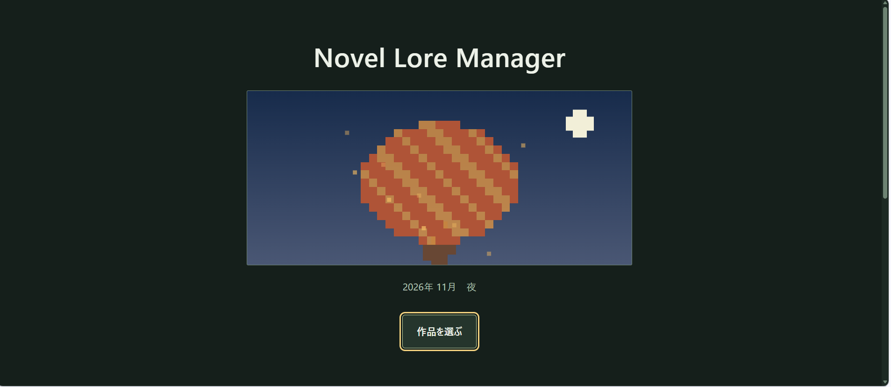
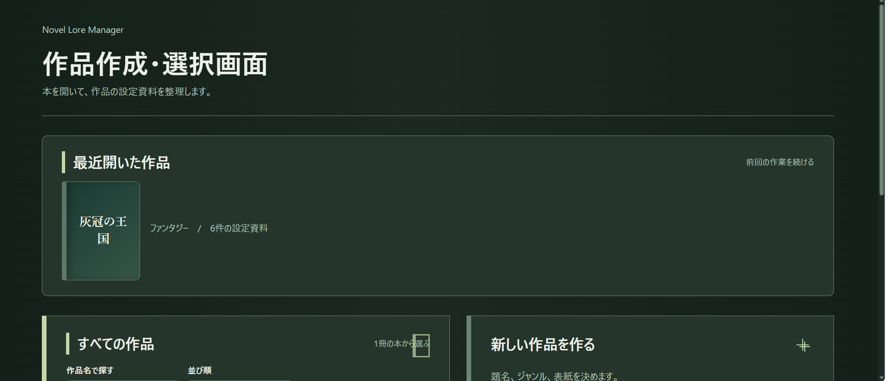
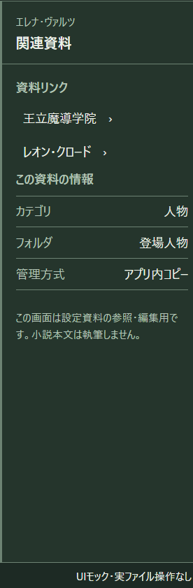
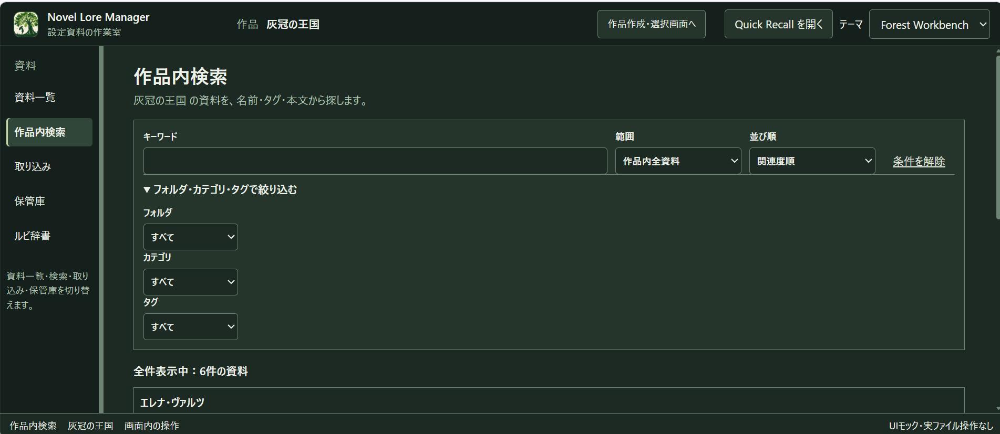
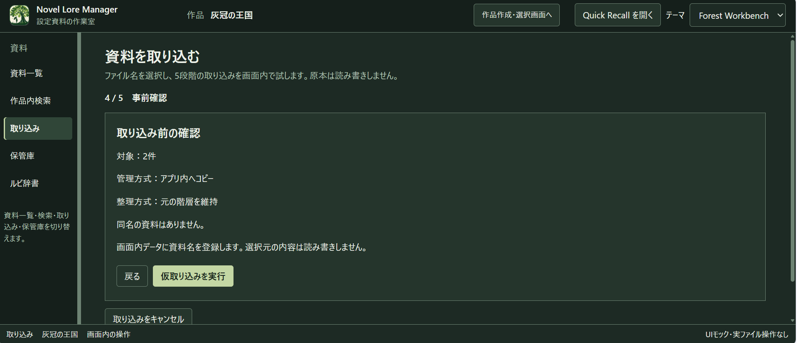
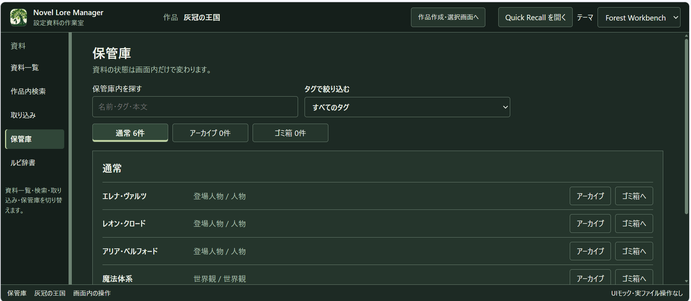
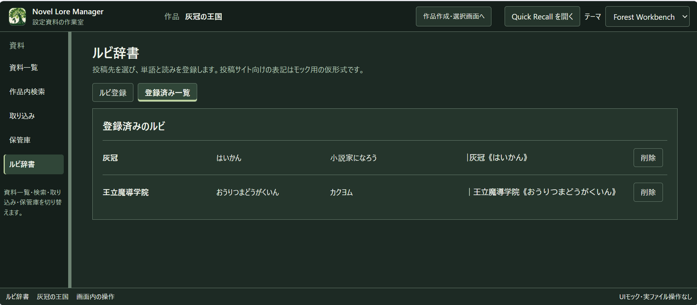

# Novel Lore Manager 操作モック

Windows向け設定資料管理アプリのブラウザ試作です。本文執筆エディタではありません。[`index.html`](index.html) と共通JavaScript、共通CSSを3テーマで使い、テーマ別CSSで見た目を切り替えます。テーマによる機能分岐はありません。

ver2.0 では起動の季節の木、表紙付き作品作成、最初の設定資料、Markdownガイド、ルビ辞書、入力時のルビ候補、ドラッグできる区切り、Quick Recall内の取り込み・保管庫を追加しました。変更と検証状況は `design/ver2-review.md` に記録しています。投稿サイト別のルビ表記は仮の表示例です。

## 起動

Node.jsでローカルHTTPサーバーを起動します。追加パッケージは不要です。

```powershell
cd mockups/novel-lore-manager
node preview.mjs
```

`http://127.0.0.1:4173/` を開きます。Quick Recall単独表示は `http://127.0.0.1:4173/index.html?recall=1` です。停止はターミナルで `Ctrl+C`。ES Modulesのため `file://` では開かないでください。

## 実装済みのモック操作

- スタートから作品選択、作品作成、最初の設定資料の作成、ワークスペースへ進めます。作品名の空欄・重複を検査し、最近開いた3作品、全作品検索・並び替えを表示します。既存の架空資料を固定フォルダ、カテゴリ、タブから開き、右側に別資料を参照表示できます。同じ資料IDを参照し、別コピーを生成しません。
- Markdownの編集・プレビュー・分割、限定的な見出し・引用・リスト・資料リンク表示。プレビューはHTMLエスケープ後に限定した構文だけを生成し、入力された生HTMLを実行しません。
- `Ctrl+S` と保存ボタンでメモリ上の内容を保存済みにし、未保存表示と離脱確認を更新します。`Ctrl+Z` / Undoボタンは現在資料の編集履歴を戻します。テキストエリア内でもモックの履歴を使用します。
- 作品内または現在資料の検索、フォルダ・カテゴリ・タグ絞り込み、名前順・仮の関連度順、結果抜粋、結果プレビュー、単純一致の強調、0件状態。
- 5段階の取り込みウィザードで `.md` / `.txt` のファイル・フォルダ選択、ドラッグ投入、サンプル2件を受け付けます。コピー／直接編集の想定と元階層／カテゴリ別配置を選択し、事前確認、キャンセル、結果を表示します。実行時は資料名と固定ダミー本文を画面内データへ追加し、同名候補をスキップします。
- Quick Recallの別ウィンドウ起動、検索、概要、詳細、資料編集の仮操作、簡易メモ、閉じる・最小化相当。ポップアップが阻止された場合は承認済みHTML内の小窓シミュレーションへ切り替えます。
- ルビ辞書への単語・読み・投稿先の登録、一覧、検索、削除と、編集欄での候補挿入を模擬します。アーカイブ、ゴミ箱、復元を別の論理状態として扱い、移動前と未保存時に確認します。上部セレクタから3テーマを切り替えます。

## 制限と未実装

- 資料の保存、取り込み、削除、復元はページ内メモリの操作です。ユーザーファイル、元の取り込み対象、DBへはアクセスしません。再読み込みで資料状態は初期化されます。テーマだけブラウザの `localStorage` に保存します。
- 取り込みのファイル・フォルダ選択と、`.md` / `.txt` の拡張子・同一パスの重複判定は画面内で動きます。本文の読み取り、実際のコピー・直接編集、文字コード・権限確認、原文保持、実フォルダ作成は未実装です。取り込み実行後は結果画面を保持します。
- 検索は既知の資料本文・タイトル・タグ・明示した別名に対する部分一致とNFKC正規化だけです。漢字の読み・ルビ・一般的な表記ゆれの推定、形態素解析、作品横断検索はありません。関連度順はモックデータの順序です。
- プレビューはMarkdownの全構文に対応しません。入力した生HTMLは文字として表示されます。画像、任意HTML、スクリプトは表示・実行しません。
- Quick Recallの別ウィンドウとメイン画面で、資料本文・メモの編集状態は同期しません。ポップアップの最前面固定、OS全域のショートカット、ネイティブの最小化はブラウザから保証できません。`quick-recall.html` と `scripts/` / `styles/` は以前の独立試作であり、この共通UIの操作・受け入れテストには使用しません。
- 作品作成と作品ごとの資料・タブ・選択状態の退避はメモリ内の仮操作です。再読み込み後の永続化、別作品への資料移動・コピー、任意階層・カテゴリ・タグの編集、標準／ユーザー定義テンプレート、パネル自由配置、外部変更の検知、保存失敗の再試行は未実装です。作品をまたぐ編集・取り込み・保管庫操作の通し検証も未了です。

## 現段階の機能一覧と画面・ソース

この一覧は[機能設計書（モックアップ版）](../../docs/機能設計書.md)（記述時点：2026-11-15）を基に、現行ファイルの存在と主なコード経路をローカルで照合したものです。**実装**はブラウザ内に操作経路があること、**模擬**は結果がページ内データに限られることを示します。製品仕様の承認や実ブラウザでの動作保証を意味しません。画面の入口は共通の[`index.html`](index.html)で、画像は各状態の参考表示です。

| 画面・要件 | 現在できること | 現在ないこと・検証待ち | 主なソースと画面 |
|---|---|---|---|
| スタート／作品選択・作成（SCR-01、FR-001～003、501） | 起動時の木、最近開いた3作品、全作品の検索・並び替え、作品名・ジャンル・仮表紙での新規作成、空欄・重複検査、最初の資料作成を**実装・模擬**。3操作の初回ガイドは**一部実装**。 | 全作品0件の初期空状態、再起動後の保持、別作品への資料移動・コピーは**未実装**。作品をまたぐ状態の通し操作は**未検証**。 | [画面入口](index.html) · [画面遷移](js/flows.js) · [起動演出](js/enhancements.js) · [作品選択画像](../../mockups_imagever2.0/作品作成・選択画面上画面.png) · [初回ガイド画像](../../mockups_imagever2.0/作品作成・選択画面操作説明画面.png) |
| 資料一覧・編集（SCR-02/03、FR-004～011、201～205） | 固定フォルダ・カテゴリ、複数タブ、右側の別資料参照、ポインター／左右キーによる区切り調整、最初の資料作成、限定Markdownの編集・プレビュー・分割、`Ctrl+S`、最大100件のUndo、未保存時のタブ閉鎖・作品へ戻る確認を**実装・模擬**。 | 任意階層、カテゴリ・タグの編集、標準／独自テンプレート、自由配置と配置保持、実保存、Redo、保存履歴・障害復旧は**未実装**。同名判定方式と自動保存は**未確定**。 | [画面入口](index.html) · [編集と保存](js/theme-manager.js) · [資料作成と遷移](js/flows.js) · [Markdown表示](js/markdown.js) · [区切りとガイド](js/enhancements.js) · [資料作成画像](../../mockups_imagever2.0/資料作成画面・関連資料画面.png) · [Markdownガイド画像](../../mockups_imagever2.0/資料一覧画面編集記号説明画面.png) |
| 作品内検索（SCR-04、FR-301～308） | 資料名・明示的な別名・タグ・本文の部分一致、NFKC正規化、作品全体／現在資料、フォルダ・カテゴリ・タグ絞り込み、件数・抜粋・プレビュー・簡易強調・0件表示を**実装**。 | 漢字の読み推定、一般的な表記ゆれ、作品横断検索、実スコアによる関連度順、検索失敗状態、リンク改名追従は**未実装／未確定**。 | [画面入口](index.html) · [検索画面](js/flows.js) · [検索処理](js/search.js) · [絞り込みを閉じた画像](../../mockups_imagever2.0/作品内検索画面フォルダカテゴリ絞り込み非表示.png) · [絞り込みを開いた画像](../../mockups_imagever2.0/作品内検索画面フォルダカテゴリ絞り込み表示.png) |
| 取り込み（SCR-05、FR-101～110） | ファイル・フォルダ選択、ドラッグ投入、サンプル2件、拡張子・同一パス判定、対象→管理方式→整理方式→確認→結果の5段階を**実装・模擬**。 | 本文読取、原文保持、実コピー／直接編集、TXT変換、エクスポート、自動同期、失敗からの復帰は**未実装**。管理方式の適用単位と「更新」の意味は**未確定**。 | [画面入口](index.html) · [取り込み画面](js/flows.js) · [共通ウィザード](js/import-wizard.js) · [開始画面画像](../../mockups_imagever2.0/資料取り込み画面.png) · [確認画像](../../mockups_imagever2.0/資料取り込み画面4・5.png) · [結果画像](../../mockups_imagever2.0/資料取り込み画面5・5.png) |
| ルビ辞書 | 単語・読み・投稿先の登録、一覧・検索・削除、編集欄での候補挿入を**模擬**。 | 投稿先別の正式な記法変換・出力と、辞書の永続化は**未実装／未確定**。 | [画面入口](index.html) · [ルビ画面](js/flows.js) · [辞書データと表示例](js/ruby.js) · [候補挿入](js/enhancements.js) · [登録画像](../../mockups_imagever2.0/ルビ辞書登録画面上画面.png) · [一覧画像](../../mockups_imagever2.0/ルビ辞書一覧画面.png) |
| 保管庫（SCR-08、FR-206/207） | 通常・アーカイブ・ゴミ箱の状態、件数、検索、登録済みタグ絞り込み、移動前確認、復元を**模擬**。 | 完全削除、実ファイル移動、復元時の名前・パス衝突、通常ツリーでの削除済み資料表示は**未実装／未確定**。 | [画面入口](index.html) · [保管庫と状態遷移](js/flows.js) · [保管庫画像](../../mockups_imagever2.0/保管庫画面.png) |
| Quick Recall（SCR-06、FR-401～407） | 約420×560の別窓またはページ内小窓で、検索、概要・詳細・編集、簡易メモ、ルビ、共通取り込み、保管庫を**模擬**。 | メイン窓との本文・メモ同期、競合解決、メモ永続化、OS全域ショートカット、常時最前面、ネイティブ最小化、メイン終了後の常駐は**未実装／未確定**。閉じると最小化は現在ほぼ同じ非表示処理。 | [単独画面入口](index.html?recall=1) · [基本操作](js/theme-manager.js) · [追加の小窓機能](js/enhancements.js) · [検索・編集画像](<../../mockups_imagever2.0/Quick Recall画面資料検索・一覧・編集画面.png>) · [メモ画像](<../../mockups_imagever2.0/Quick Recall画面簡易メモ画面.png>) |
| テーマ・設定（SCR-07の一部） | Forest Workbench／Storybook Atelier／Quiet Lore Studioを共通DOM・データ・操作で切替え、テーマ選択だけを`localStorage`に保持。 | 設定画面全体、手動バックアップ・出力、Windows向け配布機能は**未実装**。3テーマ×3画面サイズと拡大表示の実ブラウザ確認は**未検証**。 | [画面入口](index.html) · [テーマ切替](js/theme-manager.js) · [Forest](css/themes/forest-workbench.css) · [Storybook](css/themes/storybook-atelier.css) · [Quiet](css/themes/quiet-lore-studio.css) |

### 画面画像の表示

画像はリポジトリ内の`mockups_imagever2.0/`にある状態記録です。作品作成の別案である[上画面見本](../../mockups_imagever2.0/作品作成画面上画面見本.png)・[下画面見本](../../mockups_imagever2.0/作品作成画面下画面見本.png)は**変更希望の参考画像**であり、現在の実装画面として扱いません。

**スタート・作品選択**





**資料作成・検索**





**取り込み・保管庫・ルビ辞書**







**Quick Recall**


### 共通資産と実装範囲

- [共通画面](index.html)、[基礎CSS](css/base.css)、[配置CSS](css/layout.css)、[部品CSS](css/components.css)、[フローCSS](css/flows.css)、[改訂CSS](css/revisions.css)、[現行追加CSS](css/ver3.css)を使用します。テーマ固有CSSは上表の3ファイルです。
- [ローカル配信](preview.mjs)は`127.0.0.1:4173`の静的プレビュー用、[簡易テスト](tests/smoke.mjs)は検索、MarkdownのHTMLエスケープ、ルビ例、テーマ資産などの確認用です。外部APIへの接続はこのモックの機能に含みません。
- 旧[`quick-recall.html`](quick-recall.html)、`scripts/`、`styles/`は独立試作で、現行[`index.html`](index.html)の実装判定には含めません。
- 製品化前に決める主な事項は、資料IDと参照方式、同名判定、COPY／DIRECTの適用範囲、TXTの実形式、外部資料の更新、Quick Recallの同期・競合、検索の読み・表記ゆれ、バックアップとWindows実装基盤です。AI機能、自然言語検索、自動同期は現行モックの対象外です。

## チェック結果（2026-11-03）

| 項目 | 結果 |
|---|---|
| `node --check js/theme-manager.js` / `js/flows.js` / `js/search.js` / `js/markdown.js` | 通過 |
| `node tests/smoke.mjs` | 検索0件・別名・現在資料・カテゴリ・ゴミ箱除外、Markdownエスケープ、3テーマ共通のHTML/JS参照を確認 |
| ローカルHTTP配信 `/` / `/js/flows.js` | HTTP 200 |
| 3テーマの機能・DOM・データ | 共通のHTML・JSを参照し、テーマCSSのみ切替。コード構造を確認 |
| 保存／未保存、検索0件、取り込みキャンセル、削除／復元、同資料の別ビュー | コード経路を確認。実ブラウザ操作は未検証 |
| キーボードフォーカス | 共通CSSの `:focus-visible` とテキストエリアの輪郭を確認。実描画は未検証 |
| 1366×768 / 1440×900 / 1920×1080 での全テーマ操作 | 未検証。ブラウザ操作ホストが利用できず、EdgeのUI操作も許可されなかった |
| UI UX Pro Max の `search.py` 領域検索 | 未実行。`python` と `py` が環境にないため起動できない。結果を捏造せず `design/ux-research-log.md` に経緯を記録 |

同一シナリオの手動確認: 3テーマそれぞれで作品を開く → エレナを編集 → 未保存表示 → プレビューでHTMLが文字表示されることを確認 → `Ctrl+Z` → `Ctrl+S` → 検索0件と結果プレビュー → 取り込みをキャンセル → 架空の取り込み → 資料をゴミ箱へ移動して復元 → Quick Recallの検索とメモ、の順に操作してください。
